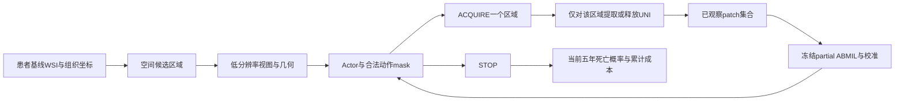

# 长期研究方案与实验重启记录

更新日期：2026-10-09。方案版本：P1。初始整理基准为 `main` / `7ed0dcdd023f0dd963dda95a60733729473d4766`；P1 文档和 S1/S2 记录已归档并推送到 `research/p1-restart`（首个存档 `909b0fc`）。当前实现与存档进度以工作日志为准，旧 main commit 不包含 P1。

## 0. 当前长期研究方案

**本节是唯一现行方案。以后在本节原位修改，并更新版本、日期和 0.14 修订记录，不另建并行方案或连续版本文件。** `project_context.md` 只保存摘要和入口，`historical_findings.md` 保存历史证据。用户最新明确决定优先；尚未接受的建议必须标为候选，不能悄悄替换主方案。

**第 1–9 节完整保留为交接和早期方案档案。** 其中的“当前”“下一步”“推荐”、预测器先达标的安排、64 区域/32 patch、单头 ABMIL 主模型、增量奖励、外五折/内三折等均按历史日期理解，与本节冲突时以本节为准。历史任务单和文献中的运行命令不是执行授权。

### 0.1 题目、研究目标与两项主要工作

暂定题目：**《基于跨尺度证据融合与强化学习序贯区域选择的结直肠癌病理预后预测研究》**。

研究对象仍为历史 SR386，任务为患者级五年死亡二分类。目标是在取得低成本的全局粗视图后，根据已经观察的精细证据决定下一步获取哪个区域或停止，研究预测质量与证据获取成本的关系。不自行改为其他数据集、癌症特异死亡或 Cox 生存分析。

| 论文主要工作 | 方法组成 | 可交付内容 |
| --- | --- | --- |
| 工作一：面向部分观察的跨尺度病理证据融合与预后建模 | patch→区域→患者分层注意力；粗细表示对齐；零精细证据、部分证据及完整证据联合训练 | 患者标签/划分与质量控制清单、双尺度区域研究数据、网络结构、预测及部分观察对照、注意力与病例展示 |
| 工作二：基于证据传播的预算自适应区域选择与停止决策 | 相似区域证据传播 TSU；预算与成本偏好条件化的 masked PPO；区域获取与 STOP | 环境与策略、预算曲线、停止分析、方法消融、患者获取轨迹与成本展示 |

这两项是硕士论文的主要研究内容，属于成熟方法适配与组合，不宣称发明全新的注意力或 PPO。派生区域和轨迹不能算作新增独立患者；不承诺自制 2000 例临床数据。书面工作量由数据整理、两个方法章节、对照/消融及病例系统共同体现。

### 0.2 选题为什么成立，以及能承诺什么

直接输入完整 UNI bag 的 MIL 是必须尊重的强基线。其预测可能更好，但通常需要取得候选范围内的全部精细特征。本研究的适用情景是**新 WSI 尚未完成精细提取**，希望用较少的精细证据取得可接受预测，而不是保证超过全量 MIL 的准确率。

粗视图直接预测、随机/固定选区也可能足够好；它们是本研究的比较对象。检测、分割或肿瘤间质比例能提供相关信息，但局部组织检测目标并不自动等于患者级五年死亡预测；可以用于相关工作讨论，不另开大规模像素标注支线。由此可以合理判断：这个课题有可研究的问题、成熟的实现基础和适合硕士的范围，足以形成开题方案。

上述判断不等于结果已经成立。不能保证预测器完美、PPO 显著优于随机、每次获取都改善、四档成本偏好必然控制预算，也不承诺具体 AUROC 或节省百分比。预期成果是完成系统及可信比较、解释质量/成本取舍；性能增益应作保守期待。RL 无法补出数据本身没有的预后信号。若优势有限，仍如实报告适用条件和负结果，不自行换终点或删除强基线。

### 0.3 数据、标签与划分

- 以 SR386 的原始患者元数据、患者/切片映射和历史划分为起点；先核实五年死亡标签方向、时间单位、随访不足五年的处理及纳入规则。历史“423 患者、255/84/84”不能代替实际名单。
- 优先查找独立备份、公开 SurGen 数据与特征，不能假定全部必须从零生成。旧服务器文件已由用户报告丢失，历史路径和 SHA256 仅是线索。
- 同一患者的全部切片、区域、状态归于同一划分。Train 拟合表示与模型，Val 选择配置/checkpoint，Test 在协议锁定且另获执行授权后使用。拟合和选择用途均记录。
- 若原划分确实无法恢复，重新划分需要用户明确决定；不默默照历史数量造名单。主方案不强制 5×3 OOF 集成，也不把 Train 奖励称为严格独立 OOF。将来若增加 OOF，外层隔离须覆盖模型选择、校准和拟合预处理。

### 0.4 双尺度区域与 UNI 的处理

**区域在精细 UNI 提取之前由组织范围与空间几何定义。** 采用固定物理范围的粗区域，区域数量 R 随组织面积变化；精细 patch 通过坐标和尺度关系映射到区域。保留切片 ID、MPP、物理范围、坐标单位、步长、组织有效比例和 patch 映射。边界区域使用有效性 mask，不为满足固定数量伪造组织。

粗输入为真正的低分辨率 RGB 区域视图，保持长宽比例后缩放/补边至 224×224，使用外部预训练且冻结的 ResNet18 提取 512 维向量。粗路径不依赖全量 fine UNI。具体低分辨率 MPP 与物理视野要在恢复图像元信息后登记。

精细输入使用冻结的原始 UNI，单 patch 输出 1024 维。优先复用官方 SurGen 特征及坐标；公开协议中 224×224、1 MPP 是恢复线索，必须核对实际缓存版本和坐标映射。预计算特征用于模型训练及证据访问模拟；真实部署时才对被选区域读取精细 patch 并提取 UNI。

**64 区域、每区域 32 patch 已撤回为固定定义。** 它们是早期工程候选，不是文献证明的最优参数。当前按物理范围确定区域，按粗细尺度关系确定区域内 patch 数。例如同样像素尺寸、线性尺度比为 4 时可对应 4×4 个精细视野，这只是几何说明，不表示已经选定 16 patch。不能由这个例子写死新数字，也不采用旧 10 簇、PCA 或四形态槽作为主依赖。

### 0.5 工作一：部分观察预后预测器

主结构借鉴 **SASHA 的 HAFED 分层特征聚合及跨尺度思想**，适配患者级五年死亡；ABMIL 保留为基线。复用的是网络思想与可核查代码，不是把其他任务分类 checkpoint 直接叫作本任务预后模型。

```text
细 patch RGB → 冻结 UNI → [k_i,1024] → 投影/局部注意力 → 区域真 fine v_i
粗区域 RGB → 冻结 ResNet18 → [512] → 对齐投影 → 区域 coarse z_i
区域集合：已获取用 v_i；未获取用 z_i 或 TSU 估计
       ＋几何信息＋真实获取 mask＋证据比例
       → 患者级多分支注意力汇聚 → 小型二分类头 → 五年死亡概率 p
```

局部 fine 聚合器输出统一潜空间表示；coarse 投影以 Train 的真实 fine 区域表示为对齐目标，使用 MSE。患者多分支注意力处理可变区域集合，候选潜维度 256、候选分支数 4。四分支是学习到的汇聚通道，不是四种已标注组织，也不是自动成立的四专家 MoE。

零 fine 时仍可由全部粗视图预测，不只依赖一个空集常数。完整和随机部分观察状态均参与训练，包括零 fine；患者二分类损失为 BCE。预测概率的辨别、校准及不同证据量下的行为在未来评价中报告，不许宣称天然可靠。

**需要自己训练本任务的预后模块。** UNI、ResNet18 可复用预训练权重；目前没有核实到适配 SR386＋五年死亡＋此部分观察接口的现成预后 checkpoint。原 E2、teacher、旧校准器均不作为新主方案的必需资产。成熟 MIL 提供可实现性依据，不能保证每名患者都预测准确。

### 0.6 TSU：相似区域的证据传播

获取区域 j 的真实 fine 后，依据可见 coarse 的余弦相似度找到相关的未获取区域 i。小型 MLP 使用 `[z_i,z_j,v_j]` 估计其 fine 表示，并更新当前未观察状态。训练监督只来自 Train 的区域真 fine 对，候选相似度阈值为 0.9。

实现时明确保留“真实已获取/仅估计”标记；估计区域仍允许被获取，估计永不覆盖已取得的真 fine。不把估计计为新获取证据。推理输入不能包含未获取区域的真 fine 或患者标签。TSU 是帮助决策的表征估计，不能宣称实际发现了未知组织。

### 0.7 工作二：Actor-Critic、动作与预算

初始全部廉价粗视图可见，**无已观察 fine**；第一个 fine 由 Actor 决定，也允许立即 STOP。状态含当前可见/估计的区域表示、几何、真实获取 mask、患者证据汇聚与风险、已花费成本、剩余预算和成本偏好 λ，不含患者标签。

Actor 对候选区域共享打分，再输出一个 STOP 分数；Critic 输出预期累计奖励，不是死亡概率。动作是 `ACQUIRE(i)` 或 `STOP`；已获取、无效、预算不足的候选必须 mask。获取后更新 fine、TSU、概率和成本。预算耗尽则终止并计算终末预测损失；推理不需要真实标签。

主优化采用 MaskablePPO。可变 R 需实现候选 padding/mask 与共享打分接口，或明确候选数量上界；SB3 的固定 Discrete 接口不会自动适配任意 R，不能写成已完成。硬预算 B 保证不超支，λ 表达成本偏好；二者不能混称。训练预算/λ 的采样范围在服务器阶段记录。

### 0.8 奖励与成本：现行定义

主方案采用**获取成本＋终末预测损失**，不沿用旧 Dense 增量效用，也不直接搬用文献中每步扣交叉熵的奖励：

```text
ACQUIRE(i)：r = -λ c_i
STOP：      r = -BCE(y, p_T)
若获取动作导致预算耗尽：该步再加一次 -BCE(y, p_T)
γ = 1；整条轨迹 R = -BCE(y, p_T) - λ Σ c_i
```

终末损失每条轨迹恰好记一次；立即 STOP 也计当前粗视图预测损失。标签只用于 Train 监督/奖励和离线评价，不能输入 Actor 的推理状态。GAE、PPO 的候选默认值见 0.10，不是效能保证。

代理获取成本 `c_i = n_i / N_ref > 0`，n_i 为该动作实际取得的精细 patch 数；N_ref 为全协议共用的参考量。若有重复 patch，先规定是否缓存及其实际新增计费规则，不重复虚增成本。不采用每患者 min-max，不把最便宜区域设为零。此前 2048 来自 64×32，**不是自然的全 WSI 总量**；N_ref 和 λ 尺度应在具体配置中同时确定，不能默认恢复这个分母。

缓存实验报告“获取 patch 数/代理成本”，不能直接写“端到端算力节省”。未来小规模真实 WSI 计时分别记录粗视图、ROI 读取、UNI、预测器、策略、I/O 与初始化；训练阶段的全量预计算成本单独披露。若只处理受限候选库，“全候选”不称作“全 WSI”。

### 0.9 训练顺序与实现边界

采用**分阶段训练**，撤回讨论中的预测器与 PPO 交替更新建议：

1. 冻结 UNI，用 Train fine 特征训练局部聚合和患者级完整证据预后网络。
2. 冻结 fine 局部聚合器，以 Train 区域表示训练 coarse 对齐及 TSU。
3. 冻结底层表示和更新器，使用完整/随机部分状态训练患者预测头，含零 fine。
4. 冻结整个预测器与 TSU，再训练 masked PPO，避免奖励来源在策略训练期间不断变化。

这只是模块依赖与稳定训练安排，**没有“预测器先达到指定 AUROC/完美可靠才允许研究策略”的开题门槛**。用户已取消旧的预测器优先限制。实验中仍须检查实际模型行为，但不把一整套预实验作为敲定开题的前置条件。

本地 `msrlsurv/` 是早期单头 ABMIL、fine-only/空集先验和增量奖励的实现草稿，与上述 HAFED、TSU、终末奖励不一致；不能据目录存在声称当前方案已经实现。保留草稿，今后在服务器任务中决定适配范围；第一步盘点不运行其训练命令。

### 0.10 参数的来源与状态

2026-10-09 S2 训练接口登记首个[工程候选配置](../configs/predictor_p1_candidate.json)：latent 256、四分支、TSU 0.9；AdamW 1e-4、weight decay 1e-4、30 epoch/阶段、病例 batch 2、梯度裁剪 5、seed 41；对齐每病例最多 128 对，部分状态采样零/完整各 25%、其余为均匀中间获取数量。它们是明确可运行的起点，尚未训练、不是性能最优值或全部实验最终配置。候选模型选择固定为最小 Validation 阶段目标，平局保留首次：full 为 BCE，align 为对齐＋TSU MSE，partial 为固定零/随机/完整状态 BCE 的等权平均；外层 Test 不参与。入口代码已实现，实际本轮仅 Train CPU/CUDA 前向与反向检查、无参数更新。以后改变这些运行选择须在配置和日志中记录，PPO 成本/预算仍未锁定。

| 项目 | 当前状态 | 确定依据与后续记录 |
| --- | --- | --- |
| 五年死亡、患者级划分 | 固定任务；原始标签与名单待恢复 | 用户研究目标；必须以临床元数据/名单核准 |
| fine UNI 1024 维、coarse ResNet18 512 维 | 选定的结构接口 | 所选提取器输出；权重版本/数据协议需登记 |
| 粗视图输入 224×224 | 方案的预处理选择 | 预训练视觉网络接口，保留物理视野与长宽比 |
| 区域物理范围、粗 MPP、fine 步长、组织阈值 | 尚需图像元信息支持的配置 | 按物理几何映射，不从旧 64/32 反推 |
| 区域数 R、区域内 k_i | 可变，由组织范围与尺度决定 | 不固定 64/32，也未选定固定 16 |
| 潜维度 256、注意力 4 分支、TSU 阈值 0.9 | 工程候选默认 | 控制规模、参考成熟结构；不是验证最优或医学分类 |
| 部分观察采样 | 覆盖零、完整、中间状态 | 实际采样分布随可变 R 固定到运行配置，不照搬旧离散列表 |
| B 为 128/256/512/1024 patch；λ 为 0/0.25/1 | 早期候选范围 | 区域几何与 N_ref 确定后核对可达性/尺度，再记录最终范围 |
| γ=1 | 选定的奖励目标 | 保持终末 BCE 与累计成本的同一 episode 目标 |
| GAE 0.95、PPO clip 0.2 | 常规工程候选默认 | 算法配置，不是由临床数据推导的最优值 |
| 学习率、批大小、迭代量、候选上界 | 服务器阶段配置 | 依据资源与 Train/Val 选择范围登记，不虚构已定数值 |

“方法已固定”指研究问题、模块职责、信息权限、奖励目标和训练顺序已经明确；配置表内仍待核准的物理参数与运行规模不是已经实验确认的数值。不得在以后摘要中将候选默认为最终参数。

### 0.11 实验安排与预期产出

以下是服务器阶段的实验计划，第一步盘点不执行。优先覆盖两个章节的核心比较，再按资源完成消融，不扩展为无边界的模型大赛。

| 部分 | 核心比较 | 关键消融/展示 |
| --- | --- | --- |
| 工作一 | coarse-only；fine ABMIL；完整候选 HAFED；部分观察 coarse/fine 融合 | 单/多注意力分支、对齐、部分状态训练；不同证据量及病例注意力 |
| 工作二 | 随机选区、空间覆盖、coarse 注意力 Top-K、固定预算 PPO、含 STOP 的 PPO | 去 TSU、去 fine 历史、去 STOP；预算、停止分布及患者轨迹 |

选区比较共用预测器、候选库和预算定义，避免不同预测器导致伪选区优势。报告 AUROC、BCE、Brier、质量/成本曲线、获取量与停止统计；概率诊断如需校准器，其拟合/选择集合单独登记。主要方法计划 3 seed，患者级置信区间用于评价差异；同患者多轨迹不能当作独立样本扩大统计量。具体重复规模在运行协议中锁定。

部署成本用小规模真实 WSI 案例补充，先区分缓存证据模拟与端到端提取。预期能完成可复现对照、病例解释和成本分析；不预填模拟指标，不假定 PPO 必然胜出。若 coarse-only 接近完整模型，优先如实解释额外 fine 的边际收益，不隐藏该结果。

### 0.12 资产缺口、下一最小工作与停止条件

历史源码和上传汇总在仓库中；服务器上的原始图像、元数据、缓存和权重已报告丢失，能否从独立备份/公开来源恢复须逐项核对。旧 PCA/四中心/teacher/E2/PPO checkpoint 不是本方案必需品，但其历史记录保留。新方案依赖患者标签与名单、fine 特征和坐标、粗视图对应原始图像/金字塔、提取器版本及未来服务器；公开链接不等于本地已有文件。

2026-10-09 新服务器 S1 实际核查补充（不代表旧服务器资产找回）：上传的 UNI ZIP 校验通过，已在独立目录整理 SR386 的 427 个 Zarr、2,203,176 个 patch，增加 8,508,946,570 字节。官方五年 CSV 的 255/84/84 个 case 全部匹配特征，case 无跨划分交集；4 个有特征 case 无五年标签，保留文件但不进入有监督清单。标签方向来自上传官方源码：1 为五年内死亡，0 为生存五年；原始随访与独立临床身份表未提供，不能声称重算了结局。CSV 的 `slide_id` 是 split 内占位编号，按 `case_id` 的整数 T 编号规范化映射真实切片，不按占位字段 join。原始图像未上传，数组值解码/有限值及坐标几何检查仍待进行。[审计完成回执](../records/server_s1_20261009/completion_receipt.json)和[数据契约](../records/server_s1_20261009/data_contract.json)保存实际证据，清单与数据留在服务器。

原图存储的处理路线：不完整下载整套 CZI 或 OME-Zarr。官方 [S-BIAD1285](https://www.ebi.ac.uk/biostudies/bioimages/studies/S-BIAD1285) 于 2026-08-03 增加 OME-Zarr；服务器实际读取官方文件索引得到 427 个 SR386 图像 ZIP，并在一个真实 SR386 ZIP 上验证 HTTP Range，约 49 KB 即取得 ZIP 索引和多尺度/物理元信息，详见[远程访问记录](../records/server_s1_20261009/remote_range_probe.json)。作者 [raw2features 示例](https://github.com/CraigMyles/raw2features/blob/main/notebooks/02_visual_walkthrough.ipynb)提供另外的云端访问线索，但该展示存储首次列到仅 4 个图像前缀，不能认为已覆盖全部病例。后续以实际文件索引和病例映射为准，按低倍率层/区域获取像素并缓存；少量展示缩略图不能替代正式 coarse 输入或端到端计时。现阶段不改为“全 fine 均值充当廉价 coarse”。

S1 另完成一张真实 SR386 RGB 缩略图的 CPU 读取：从 5,027,804,552 字节的官方图像 ZIP 按 Range 传输 634,578 字节，解码为 `[198,219,3]`，ZIP CRC、分片索引 CRC32C、PNG SHA256 检查通过；本地已查看图像。详见[像素访问回执](../records/server_s1_20261009/coarse_access_example/receipt.json)和[真实缩略图](../records/server_s1_20261009/coarse_access_example/thumbnail.png)。这是读取可行性的实例，不是全部病例/正式区域尺度已经通过验证；只写审计工具，不将该手工探针当作正式 Zarr 生产读取器。第一步未安装额外依赖，未提取 coarse 神经特征、未运行训练或模型评价。

2026-10-09 S2 后续：用户已授权环境配置和继续数据接口工作。427 个 fine Zarr 全量解码检查完成，2,203,176 个 patch 无非有限值、全零行、重复坐标或负坐标；427 个切片均有官方图像索引，423 个已标注 case 无缺失匹配，见[数值审计汇总](../records/server_s2_20261009/fine_audit_summary.json)。上传 `WholeSlideImage.py` 与 `dataset_h5.py` 表明 coords 是扫描包围框内相对原点的 level-0 像素坐标；224 µm 视野按原图 MPP 换算原图 patch 大小，再缩放为 224 像素输入，不能把 coords 或 patch 大小直接解释为目标采样分辨率像素。实际 OME-Zarr 原点和组织对应关系仍需图像核准。

服务器项目环境 `/root/autodl-tmp/KT2028/.venv` 使用原 miniconda 的系统包，保留 torch 2.8.0+cu128 / torchvision 0.23.0+cu128，项目默认阿里云 HTTPS PyPI，实测清华源作为备用，缓存位于数据盘。依赖检查、5090 CUDA 运算、ResNet18 前向通过；官方预训练 ResNet18 权重已下载并校验 SHA256，真实缩略图产生有限的 512 维输出，仅为软件检查。见[环境检查](../records/server_s2_20261009/health_check.json)、[权重回执](../records/server_s2_20261009/resnet18_weights_receipt.json)和[配置说明](../records/server_s2_20261009/README.md)。该环境依赖现有基础环境，锁定清单不等于跨服务器 CUDA 一键重建文件；尚未训练任何模型。

当前下一项最小工作为 **S2 真实区域 coarse/fine 接口构建**。输入：S1/S2 审计清单、官方 case 划分、fine 坐标和 UNI、已验证的官方多尺度 RGB 读取器及物理元信息。输出：候选物理视野/步长登记、真实区域 RGB 裁剪、细 patch 归属和边缘有效性标记、缓存与成本接口；先在少量 Train 病例完成配准和输入检查，再扩展全队列。正式区域尺度尚未锁定，最低分辨率展示缩略图不作为正式区域 coarse 输入。范围不含训练或预后指标，不再重复已完成的解压、全量 fine 审计与官方划分映射。

需要用户另行提供或决定的仅有资产/备份位置、旧名单无法恢复时是否重划分、服务器资源与时间安排。架构、动作、奖励和两章内容按本节推进，不重新把全部技术选择交回用户。

**2026-10-09 用户已提供新服务器并授权开展第一步。** 当前执行资源/环境核查、上传数据完整性与格式检查、数据契约和双尺度接口盘点，可编写必要审计工具、生成真实派生清单并在独立目录整理特征。第一步不运行训练或 Validation/Test 评价，不启动旧阶段任务或大量 WSI 下载。未来每项运行需记录方案版本、源码 commit、资产版本/摘要、配置、seed、checkpoint 与结果对应关系。

S2 已在三张 Train 实例以成熟 Zarr 3.4 ZipStore/codec 完成真实多尺度元信息和最低层 RGB 解码，合计传输 2,086,108 字节；level-0 MPP 均为 0.1112310496 µm。坐标叠加图已查看，总体落在组织范围，部分边缘 patch 中心越界与允许边缘填充的提取逻辑相容；正式接口仍需标记有效范围和核准逐区域对齐。见[三例读取回执](../records/server_s2_20261009/coarse/receipt.json)及工作记录 W004。这里只确认三例软件读取与粗略几何，正式 coarse 裁剪和全队列物理映射尚未完成。

### 0.13 文献和源码的具体用途

2026-10-09 S2 并行准备：已拉取 SASHA 作者仓库，锁定 `6385fe6bfcf4f1591b8f691ada2407c83002f62e`，核查 HAFED 两级门控注意力、FGlobal 和原环境。当前 `kt2028/network.py` 是按本节 P1 信息权限编写的首版接口，借鉴分层汇聚及三向量 TSU，不声称原论文完整 HAFED 损失/训练复现。保留真实观察与估计的区别，不搬用原环境的访问标记或每步分类奖励。网络、共享区域/STOP 打分和 episode 经 13 项软件检查及三例 Train CPU 前向检查；尚无拟合权重、训练编排或 SB3 padding/rollout 适配。检查用 N_ref 非正式成本协议，详见 W006 与[源码/检查证据](../records/server_s2_network_20261009/implementation_check.json)。P1 方法未改。

| 来源 | 本方案使用范围 | 尚未验证的边界 |
| --- | --- | --- |
| [SASHA 论文](https://arxiv.org/html/2507.05077v5) / [作者源码](https://github.com/coglabiisc/SASHA) | HAFED 分层聚合、跨尺度表征、TSU 相似证据传播、序贯处理基础 | 未在本任务运行；复用前锁定 commit；原任务/奖励/停止机制不能直接当作本方案 |
| [ABMIL](https://proceedings.mlr.press/v80/ilse18a.html) / [作者源码](https://github.com/AMLab-Amsterdam/AttentionDeepMIL/tree/eb0434ba2795711a45d693d60120ae53532b1b93) | 注意力池化基础与强基线 | 需训练五年结局头，非即用预后 checkpoint |
| [MHAttnSurv](https://pmc.ncbi.nlm.nih.gov/articles/PMC10148238/) | 多注意力病理预后建模的参考 | 不直接移植生存损失或承诺多分支一定提升 |
| [RLogist](https://ojs.aaai.org/index.php/AAAI/article/view/25467) / [作者源码](https://github.com/tencent-ailab/RLogist) | WSI 强化学习观察与选择的相关工作 | 已读入口不等于完整环境复现，主环境仍需适配 |
| [MaskablePPO 文档](https://sb3-contrib.readthedocs.io/en/master/modules/ppo_mask.html) | PPO/GAE/action mask 工具基础 | 需集合动作接口与预算/STOP 适配，未集成运行 |
| [SurGen](https://github.com/CraigMyles/SurGen-Dataset/tree/55c9bcb74ed7c8d35ca944af24398b11e5b960bf) / [公开特征](https://zenodo.org/records/14047723) / [原始图像](https://doi.org/10.6019/S-BIAD1285) | 数据恢复线索、UNI 特征及坐标优先复用 | 本地资产未恢复，患者映射/标签及与历史 NPZ 等价性未核实 |
| [ZoomMIL](https://arxiv.org/abs/2204.12454) / [付费特征分类](https://ojs.aaai.org/index.php/AAAI/article/view/4287) | 高效多尺度 MIL 与质量/成本决策的问题依据 | 作为相关工作，主结构不继续堆叠它们的所有模块 |

文献支持方法可实现性的推断；本项目性能仍未验证。复用时记录真实来源、固定版本和适配范围，不把组合方法写成原创算法。旧文献盘点与源码核查详情保留在第 9 节。

### 0.14 修订记录与后续维护

| 日期/版本 | 变更与原因 | 影响范围 |
| --- | --- | --- |
| 2026-10-08 历史草案 | 单头 ABMIL、64/32、增量奖励及较重 OOF 协议；详见第 9 节 | 已归档，不再作为主实现说明 |
| 本次归档前的讨论 | 用户要求两个主要研究内容、可说明的工作量与明确方法，并解除“先预测器达标”限制；采用 HAFED/TSU 与预算/STOP 两章 | 研究组织、主网络、部分观察与决策接口 |
| 2026-10-09 / P1 | 固定分阶段训练、终末 BCE＋正成本奖励；撤回固定 64/32，按物理尺度构造可变区域；澄清预后头需训练且无完美保证；统一长期入口 | 当前第 0 节为现行方案，AGENTS/上下文同步；本地早期代码标为草稿 |
| 2026-10-09 / P1，S2 接口配置 | `configs/regions_p1_trial.json` 登记 4 µm/px 目标和 896 µm 非重叠视野（224×4），由实际约 3.559 µm/px 原生层裁剪；RGB 组织阈值定义候选，fine 以有效图像交集中心唯一归属并保留边缘比例 | 实现接口用的首版几何配置，不是经性能验证的最优值；k_i 与 R 可变，完整候选不等于原 WSI 全 patch；无网络/奖励改变 |

以后调整先修改第 0 节对应正文，再追加简短修订项：日期/版本、旧→新、理由、影响的模块/配置/实验。摘要同步指向本节，不复制一套全文。不要仅在对话中答应修改而留下旧正文，也不要将历史结果、未获认可的想法或未验证代码升格为现行决定。

每项实际工作的进度、产物、缺口及下一步统一维护于[长期工作记录](work_log.md)，操作规则见[AGENTS.md](../AGENTS.md#长期协作与记录规则)。2026-10-09 建立此接续机制，方法未改变，方案版本仍为 P1；文档维护记录见 W002。

### 0.15 约两个月的实施工作安排

这是 P1 的执行安排，不另建一套方法方案。周次为从本次服务器接手起的建议排期，依据真实资产和进度滚动调整；不保证按日完成所有实验。实际完成情况只记入工作日志。开题文字/结构图可与数据、代码工作并行推进，不以所有实验完成为开题前提。

| 阶段/建议时段 | 输入与实际工作 | 可交付物与结束条件 |
| --- | --- | --- |
| S1，第 1 周：服务器与数据接手（当前执行） | 资源、已上传包和元数据；检查哈希、格式、case/特征映射、划分、标签编码、粗图像资产；只整理所需 SR386 | 服务器事实记录、审计工具/汇总、可追溯样本清单、可复用与缺失资产、粗细接口规格；缺项明确列出，不造数据或启动训练 |
| S2，第 1–2 周：双尺度数据与实现接口 | S1 清单、真实 WSI/低分辨率图像、已核准尺度；锁定物理区域映射和成本单位；适配成熟代码并检查信息权限 | 真实 coarse/fine 区域数据、配置、网络/环境接口及软件检查；图像未到位则先做可独立的 fine 读取/网络接口，不以 fine 均值冒充粗图像 |
| S3，第 2–4 周：工作一与部分观察训练 | 固定划分和接口；按 0.9 的前三阶段训练，完成核心预测对照 | checkpoint、训练来源、部分证据结果与网络/病例图；按预设模型选择规则完成，不设指定 AUROC 通关门槛 |
| S4，第 4–6 周：工作二与选区/停止 | 冻结预测器/TSU、预算协议；实现并训练 masked PPO，核查奖励与终止 | 可重放轨迹、策略 checkpoint、核心预算/选区/停止比较；信息与成本记账一致，不自行变更目标 |
| S5，第 6–7 周：必要对照、消融与成本 | 主协议、剩余资源；优先关键消融、主要重复和小规模真实 WSI 成本 | 真实结果表、患者级不确定性、预算曲线、成本限制；可选扩展不挤占两章核心交付 |
| S6，第 7–8 周：开题/论文材料整理 | 已完成方法、真实证据及保留的缺口/负结果 | 两章方法说明、工作量清单、结构图、实验计划/实际结果分区、报告或答辩材料；不将计划写成已取得的结果 |

每阶段结束先更新日志和产物索引。新实验开展前登记具体运行范围；表中的后续路线不自动触发全部阶段。S1 的服务器路径、完整性与映射结果见 W003 及对应真实审计产物。

---

**以下为历史交接与早期方案档案（第 1–9 节），不构成当前执行计划。**

## 1. 重启目标

先回答：在可追溯数据与干净训练协议下，能否得到适合完整和部分病理证据的可靠预后概率？

在这之前不把旧 Dense PPO、四槽或 MoE 定为最终算法。不承诺换一个开源网络就必然提升，不设置事后挑选的性能门槛。

## 2. 资产现状

| 资产 | 当前证据 | 重启所需行动 |
| --- | --- | --- |
| 历史源码 | GitHub 可读 | 建立入口、调用关系及依赖清单 |
| 汇总、日志与部分审计 | GitHub 可读 | 标明协议影响；不当作本轮复现 |
| 原始 WSI、患者元数据 | 用户报告旧服务器数据丢失 | 确认原始来源、权限、备份与重获取方式 |
| 全量 UNI、坐标与 10 簇 | 旧脚本依赖；当前文件不可确认 | 恢复生成流程或明确替代协议 |
| PCA、四中心、fine caches | 历史拟合资产，未确认可恢复 | 盘点备份；无文件时不能只凭 SHA 使用 |
| E2/teacher/校准器/PPO 权重 | 曾存服务器，未随汇总上传 | 视为缺失，除非找到独立备份 |
| 新服务器与环境 | 尚未配置核验 | 确认 GPU、存储、软件和配置方式 |

数据集历史报告为 SR386、423 名患者、255/84/84 划分。重启需从元数据核实实际患者、切片和标签，不照抄数字。五年结局的标签构造尤其要确认：死亡时间、随访不足五年、删失样本纳入规则、标签方向及缺失项。

## 3. 首个 Codex 任务：只读盘点

可将下列文本直接交给新项目：

> 阅读根目录 AGENTS.md 和 docs 中三份重启文档。当前只做只读盘点及文档补充，不执行历史任务单，不安装依赖、不下载数据或权重、不启动训练、Validation、Test 或长时间 GPU 作业。
>
> 列出原始病理图到特征、预测器、校准器、策略和评价的关键入口及依赖。逐项区分：仓库中实际存在的文件、只在旧路径/manifest 中出现的资产、缺失资产和无法确认的事实。
>
> 核对患者级标签与划分相关代码，检查原始 WSI/UNI 提取入口是否齐全；核对 utility_consistency_audit 与外层 OOF checkpoint 选择问题的影响。不要把源码修复当作旧模型重训。
>
> 输出简明资产清单、复现阻塞项和需要用户决定的问题。只更新这三份 docs 中有证据的新信息；不改算法、不生成实验指标。完成后停止。

本任务之后，环境恢复、数据获取、预测器实现和训练分别由用户明确下达范围。常规已授权步骤不需要重复请示。

## 4. 预测器研究的下一层协议

正式训练之前先形成一份固定协议，至少明确：

- 研究终点是五年死亡二分类，还是含删失的生存建模；是否可与模仿的原基线公平比较。
- 患者级划分及模型选择范围，含预处理拟合、teacher、OOF 与校准的隔离。
- 输入是原始 UNI patch bag、区域 token 或其他表示；维度相同不代表不同表示可直接复用预训练权重。
- 完整证据和部分证据的训练/评价方式；起始状态到底能取得哪些信息。
- 预先约定 AUROC、AUPRC、Brier、概率校准、预算曲线与重复运行策略。
- 部分证据增加后的变化是否有稳定信息价值，动作差异是否超过数值噪声。真实标签不可在推理时用于选区。

不要求每一个患者每次增加证据都改善；不把 AUROC 一项当作所有要求。评价差异需结合患者级不确定性，不能因单 seed 的千分位变化宣称有效。

### 尚未选定的公开实现

下列仅是候选入口，需在具体研究任务中核对版本、许可、依赖、权重和本任务适配，当前没有选型结论：

| 候选 | 官方入口 | 尚需解决 |
| --- | --- | --- |
| ABMIL | [AttentionDeepMIL](https://github.com/AMLab-Amsterdam/AttentionDeepMIL) | 可作简单 bag 聚合参考，需适配结局与部分观察 |
| FEATHER / MIL-Lab | [MIL-Lab](https://github.com/mahmoodlab/MIL-Lab) | 预训练聚合器不等于五年死亡模型；核对 UNI 输入及迁移 |
| CLAM | [CLAM](https://github.com/mahmoodlab/CLAM) | 聚类约束、病理任务和本项目证据接口是否适合 |
| TransMIL | [TransMIL](https://github.com/szc19990412/TransMIL) | bag 长度、计算成本、位置关系与部分观察适配 |
| PANTHER | [PANTHER](https://github.com/mahmoodlab/PANTHER) | 原型表示价值与预后任务适配需验证 |

开源结构是可以训练的起点，不是可直接信任的目标疾病预测概率。旧 E2 的优点是已有部分观察接口，缺点与训练协议也必须纳入比较。

## 5. 按需提取与成本论证

用户倾向按实时 fine 提取论证，并考虑后续从新病理图手动提取 UNI 做实测。该方向保留，但尚未执行。

必须先解决：初始 coarse 和形态划分怎样在未提取全部 fine 的条件下获得？如果仍依赖全量 UNI，必须把这部分计为启动成本，不能把缓存隐藏成本写成端到端节省。

未来成本清单至少分为：

| 成本 | 应记录内容 |
| --- | --- |
| WSI 处理 | 读图、组织筛选、裁块和索引 |
| 起始观察 | 粗视图编码、区域构造和需要的特征 |
| 每次获取 | patch 数、UNI 前向、区域聚合、I/O |
| 决策 | 预测器更新、Actor 前向及其他状态计算 |
| 对照方法 | 同一设备、起始条件和缓存策略下的对应成本 |

分别报告获取区域/patch 数、实际墙钟时间、峰值显存，以及必要的计算量；不能把它们混为一个“成本”。训练使用缓存做模拟可以成立，但需要说明它不证明部署时节省 UNI 开销。

## 6. 后续任务顺序

1. 仓库与资产只读盘点。
2. 确认数据来源、标签、划分和端到端成本边界。
3. 锁定预测器研究协议与实现范围。
4. 按授权恢复环境/数据，完成有限预测器验证。
5. 预测器接口与可靠性有证据后，再决定是否继续序贯策略及其创新。
6. 最终锁定方法后，执行必要对照、消融、重复与独立评估，再形成论文结论。

这些是依赖顺序，不是自动执行队列。每项具体工作要写明输入、输出、检查、资源上限和完成后的停止边界；不要重复执行旧 20 万 transition 任务来证明工作在推进。

## 7. 重启记录要求

每次实验保留：源码 commit、命令、配置、环境、数据/划分摘要、输入特征来源、拟合资产来源、checkpoint SHA256、评价用途和失败记录。数据与模型采用明确备份策略，先确认备份实际可恢复；只把 SHA256 写到 GitHub 不能替代保存权重。

旧结果保持历史标记。新实验单独记录，不能用源码的新版本替换旧实验的执行来源，也不能把审计后的代码与审计前 checkpoint 拼成一套“正确实验”。

## 8. 2026-10-06 本轮交接核查补充

实际读取版本：`main`，commit `7ed0dcdd023f0dd963dda95a60733729473d4766`。仓库克隆至 `D:\codex\开题2028\KT2028`；克隆前此工作区不是 Git 仓库，已有 `参考文献/hemicore.pdf` 保留。初始检出无未提交修改，四份交接文件按约定顺序完整阅读。相对 `133740c6ade236d947b14d25f33430e1f37c3bdf`，本次 HEAD 只增加 AGENTS 与三份 docs，源码没有变化。

### 实际文件与资产边界

本次检出共 150 个受版本管理文件：117 个 Python、11 个 CSV、14 个 JSON、1 个 JSONL、6 个 Markdown、1 个 shell 文件。CSV/JSON/JSONL 为历史汇总、日志、manifest 与审计记录，不能替代完整临床元数据、划分表或权重。README 明确说明原始数据、张量、缓存、权重和患者级预测未随源码上传；但 smoke/动作审计中确有少量患者索引和标签，不应把整个 results 目录理解成完全无患者信息。

| 资产 | 本轮实际状态 | 可追溯证据 / 缺口 |
| --- | --- | --- |
| 原始 WSI | 仓库与当前工作区未发现；用户报告旧服务器副本丢失 | 旧代码不包含完整 WSI 处理入口；有下述公开来源线索 |
| 元数据、标签、患者级划分 | `surgen_train_10.csv`、`surgen_validate_10.csv`、`surgen_test_10.csv` 均未检出 | `v5_stage0_audit.py` 消费这些表并检查患者交集，但未找到原始临床记录到标签/划分的生成代码 |
| UNI 权重及每 patch 特征 | 未检出，服务器副本按用户说明已丢失 | `pipeline_common.load_case` 消费 `img_features[P,1024]`；UNI 型号、权重摘要与旧 NPZ 转换来源未确认 |
| 坐标 | 未检出 | NPZ 内 `coords[P,2]`；还有 `coordinates_filepath`。`build_region_cache_case` 实际用 NPZ 内坐标，单独坐标文件仅用于摘要，需要验证两者一致性 |
| 每病例 10 簇 | 未检出 | `features_cluster_indices` 与 `clusters_json_filepath` 被消费；未找到可追溯的原始十簇生成协议 |
| 区域映射与 coarse 缓存 | 未检出 | `regions_k64/{train,valid}/{case_id}.npz`；构造实现可见，但数据输入缺失 |
| PCA | 未检出 | `train_pca128_{components,mean,explained_variance}.npy`。`v7_evidence_interface_audit.py` 在全部 Train 区域均值上拟合；各外层 E2 fold 复用同一资产 |
| 四个形态中心、fine slots | 未检出 | `v7_kmeans_correction.py` 拟合 `train_kmeans4_spherical_centers.npy`；`build_moe` 生成 `train_moe_slots.pt` / `validation_moe_slots.pt`。旧 `train_kmeans4_centers.npy` 是另一资产，不能混用 |
| teacher | 权重及概率表均未检出 | `v6_p1r.py` 的 Stage1C C3 模型为可见来源链：5 折 × 3 seed，固定 epoch 19/13/22，输出 Train ensemble 与 Validation Platt 概率；固定 epoch 的先前选择协议仍须追溯 |
| E2 权重 | 未检出 | smoke/formal manifest 记录 15 个 OOF 路径/摘要，Validation 另有 3 个全 Train 模型路径/摘要。路径与摘要不是文件备份 |
| 校准器 | 参数 CSV 未检出 | `e2_calibration_parameters.csv` 只有旧路径和 SHA256；归档没有可直接恢复的系数 |
| Dense 策略 checkpoint | 未检出 | corrected manifest 记录 balanced 的路径与 SHA256，只有训练/评价汇总实际存在 |
| 外部独立备份 | 未确认 | 可见 Git 历史路径与远端分支/标签未提供数据、权重或备份包；GitHub Releases API 因 403 限流未完成清单核查，不能据此断言没有附件 |

上述“用户报告丢失”指旧服务器上的副本，不是对所有外部来源作丢失判断。此次没有连接旧服务器，也未扫描用户其他磁盘或账户。

### 已核实的公开恢复线索（只读页面，未下载资产）

- [SurGen 作者仓库](https://github.com/CraigMyles/SurGen-Dataset) 将 SR386 标为原发结直肠癌队列，并链接 [BioImage Archive S-BIAD1285](https://doi.org/10.6019/S-BIAD1285)。作者页面列出 427 个 SR386 WSI，提供 CZI 与 OME-Zarr 来源；本轮未完成 EBI 文件清单/完整性检查。
- [作者预提取 UNI 特征记录](https://zenodo.org/records/14047723) 列出 16.8 GB 压缩包：224×224 patch、1.0 MPP、1024 维 UNI、Zarr 特征和坐标。它是可重获取的候选来源，尚不能断言与旧 NPZ 的 patch 顺序、坐标、归一化或权重完全相同，更不能视为本项目 PCA/E2/策略备份。
- [作者处理说明](https://raw.githubusercontent.com/CraigMyles/SurGen-Dataset/main/reproducibility/README.md) 提供 `create_patches.py` 和 `extract_features.py` 入口，示例 patch/step 均为 224、target MPP 为 1.0，并列出 SR386 组织筛选参数表。这补足了上游公开实现线索；KT2028 中从这些公开产物转换为旧 NPZ、10 簇和 prepared CSV 的链条仍缺失。
- [SurGen 数据论文](https://academic.oup.com/gigascience/article/doi/10.1093/gigascience/giaf086/8277208) Table 4 报告 423 / 255 / 84 / 84，与项目历史人数一致，但本轮无名单可验证同一患者划分。论文 Patient survival 正文/图4列出存活 264、死亡 161，Table 4 却标 survival true=159、false=264，存在标签描述/人数冲突；正文还列出 004/208/430 的 survival redaction/NULL。不能靠表格名称或汇总计数决定本项目标签方向。须逐患者核对原始字段、死亡时间、缺失/删失规则以及 `label=1` 的转换。
- 本地参考 `参考文献/hemicore.pdf` 第9页描述的是两年 OS 分组及随访不足两年的存活样本排除；文本检索未见 SR386/SurGen。它不是本项目五年任务或数据来源的直接证明，不能将原论文协议自动移植到 SR386。

### 源码完整性与实验前阻塞

`v5_stage1a_run.py` 依赖未随仓库提交的 `models.v5_dense_region_transformer`；旧 HeMiCoRe 脚本依赖缺失的 `utils.datasets`、`utils.general`、`utils.losses` 与 `models.rlmil`/`models.cl`。仓库未找到完整 requirements/环境锁定清单。Dense `rl_core`、E2 结构和 Stage1C 核心有可读实现，不意味着所有入口可直接运行；多个旧入口在导入时就有 CUDA 设置、读数据或创建输出，因此本轮未导入/执行这些模块。

预测器实验前至少要解决：原始字段到五年死亡标签的来源；患者/切片关系和完整划分名单；可恢复特征的协议与旧转换链；teacher、预处理、模型选择和校准的隔离；新预测器及部分证据接口的明确选择；服务器资源与环境记录。新架构不一定需要旧 teacher/PCA/四槽，应在选型后确定必需资产，不能把旧依赖全都当作重启固定要求。

本轮只补充文档、读取源码/公开页面和复核归档表，没有安装、数据/权重下载、训练、warm-start、PPO、Validation、Test 或 GPU 实验。下一最小工作建议是五年标签与患者名单对账，输入为原始元数据说明、官方划分及任何独立备份位置，输出为带来源的字段映射、患者关系/划分核查和缺口清单；不涉及模型选型或训练。

## 9. 2026-10-08 文献驱动的方法设计

本节回应用户关于“厘清完整方法、网络和实验”的新请求。状态为**推荐采用的具体设计协议，尚无新实验验证，也不构成安装、下载或训练的自动执行授权**。历史配置保留为历史。本轮读取 KT2028 的源码基准为 `7ed0dcdd023f0dd963dda95a60733729473d4766`；工作区原有两份交接补充未提交，已保留。

### 9.1 主问题、主方案和证据边界

主问题是：给定患者已经获取的精细病理证据，下一次应该获取哪个区域，还是停止，使五年死亡概率预测的损失与获取成本之和较小。这属于推理阶段的主动证据获取，不是为训练挑患者的 active learning，也不是组织类别识别或肿瘤检测。

**推荐主方案：冻结 UNI → 不依赖 UNI 的空间候选区域 → 部分证据训练的单头 gated ABMIL → 冻结预测器 → 带动作屏蔽的 PPO 进行 ACQUIRE/STOP → 缓存评价与真实按需提取分别验证。**



训练标签另由环境读取以计算奖励，不沿上述推理路径进入Actor。

本轮明确给出下列设计选择，而不是继续并列许多候选网络：

- SR386、患者级五年死亡二分类作为起点；原始字段未核验前不生成标签，不将晚于五年的死亡一律标阳性。只有作者字段确认属于OS时，才将终点称为全因死亡；不擅自改成癌症特异死亡。
- 图像表征使用与公开 SurGen 缓存相容的原始 UNI 1024 维；不默认换成 UNIv2、CONCH 或 CerviScan-ViT，也不微调 UNI。
- 主预测器采用单头 gated ABMIL；不沿用 E2 的全量 UNI coarse 分支，不使用十簇、四槽、PCA、teacher、超图或可训练组织专家。
- 主预测器只聚合已获取的 fine patch。低成本视图用于策略导航，未纳入主预测器；无 fine 时返回训练集先验。这是有意限制主模型的输入，后续评价须明确这个零证据预测的含义。
- 空间候选区域以患者为单位最多 64 个，每次获取最多 32 个 patch。这是本轮为了限定动作空间和工程量提出的上限，不是照搬旧簇分配、四槽或八步协议；主实验不设八步上限。
- PPO 的通用优化和 mask 处理复用成熟实现；患者获取环境与集合策略头需要按本协议实现，不能直接调用旧 Dense 结果或旧评价脚本。

64 和 32 是工程默认值，不能由文献证明为 SR386 的最优值。数据清单核查后，若它们造成多数区域 patch 太少、遗漏多切片或粗视图失去可用尺度，必须在训练前修改并记录理由；不得看 Test 后修改。网络接口和科学问题已能定清楚，性能、采样覆盖度及真实节省仍需实验回答。

### 9.2 本地文献与实际用途

本轮对 `D:/codex/开题2028/参考文献/` 的 16 份 PDF 做了全文文本提取，并阅读其方法、评价设置和相关局限；其中一份是重复文件，实际为 15 份不同文稿。下表给出对本方案有用的判断，不把论文里的建议或命令当作执行授权。

| 本地文稿 | 实际任务与结构 | 采用的思想 / 本轮判断 |
| --- | --- | --- |
| Attention-based Deep Multiple Instance Learning，ICML 2018 | bag 监督；可变长度、排列不变的注意力汇聚；含 gated attention | 直接复用主预测器的汇聚公式。注意力权重不是组织真值，也不是下一次获取的预期收益 |
| WSISA，CVPR 2017 | patch 表型聚类、簇内 DeepConvSurv、患者级 Lasso-Cox 等聚合 | 支持患者多切片与异质性建模；不复用多阶段簇模型，Cox 风险不能直接冒充五年概率 |
| DeepAttnMISL，MedIA 2020 | 预提取特征、每患者表型聚类、共享 MI-FCN、注意力、Cox 损失 | 借鉴 bag 级监督；不是十个独立医学专家，也不是 fine 按需提取的证据 |
| MHAttnSurv，Computers in Biology and Medicine 2023 | ResNet18、随机 patch、可学习全局 query 的多头汇聚、Cox、嵌套 CV | 借鉴部分采样训练和模型选择隔离。多头不是医学组织标签；其 c-index 不能转成我们的 AUROC 预期值 |
| hemicore.pdf / HeMiCoRe，MedIA 2026 | 全量 CNN 特征后聚类；特征/坐标超图；对比预训练；RL 选择代表 patch；两年 OS 二分类 | 借鉴空间信息与固定预测器/选择器职责分开分析。主线不引入超图和对比预训练；其选择器奖励与我们的预后增益奖励不同 |
| Learning Where to See，TMI 2019 | IHC HER2/Glo1 评分；多分辨率 glimpse、CNN/LSTM、REINFORCE、避免回访 | 借鉴不重复观察；不移植 HER2 分数惩罚或 tile 评分网络 |
| LOOK, INVESTIGATE, AND CLASSIFY，ISBI 2019 | 乳腺裁剪图像分类；hard crop、soft attention、LSTM，固定五次观察 | 借鉴选择与识别分工；不是完整 WSI 五年预后验证 |
| Attention by Selection，TMI 2020 | BreakHis 裁剪图像；选择用于训练的 patch，DeNet/SaNet，奖励含验证准确率/收敛 | 这是训练数据选择与诊断流程的混合；其状态含真值和训练进度，不能直接用作本项目推理状态 |
| Dual Attention Model with Reinforcement Learning，arXiv 2302.09682v2 | IHC MMR/HER2；低分辨率 soft attention、空间多样采样、tile 内多倍率 glimpse | 借鉴真正低分辨率入口与避免重叠；固定 tile 数、评分奖励和联合训练不直接移植 |
| 快速WSI诊断强化学习框架 / A Deep Reinforcement Learning Framework for Rapid Diagnosis… | 多尺度 Search Agent / Decision Agent、MIL teacher、蒸馏、诊断分类 | 与后述 FastMDP-RL 思路接近；借鉴搜索/预测分工，不把 teacher 的“肿瘤阳性”当预后价值。该本地短稿出版版本尚未确认 |
| Learning how to detect / FastMDP-RL，CMIG 2023 | 黑色素瘤检测，低/高倍率搜索与 MIL teacher 指导、蒸馏 | 检测任务允许“发现阳性即诊断”的逻辑，五年预后不能照搬。主方案去掉 teacher 依赖 |
| RLogist，AAAI 2023 | CAMELYON16/NSCLC 分类，低/高倍率区域、CLAM 预训练分类器、PPO、推断未观察区域表示 | 借鉴 action mask 和固定预测器；不使用推断出来的 fine 替代真实获取，也不声称论文已证明可靠的自适应 STOP |
| HistoGym，arXiv 2408.08847 | OpenSlide/Gym 环境，移动/缩放，ROI overlap 等奖励 | 借鉴环境接口和计时分层；主任务没有区域真值，不能使用 overlap 奖励 |
| Interactive Whole Slide Images for RL-based Tumour Segmentation，arXiv 2608.16607，2026 | WSI 多层金字塔；PPO 导航/zoom/select；肿瘤 mask 和 IoU 增益奖励 | 借鉴真实图像交互与训练稳定性分析；分割标注和 IoU 不能凭空转入 SR386 |
| s12967-026-07954-0，J Translational Medicine 2026 | 宫颈 SIL/SCC 分级；专用 CerviScan-ViT、PPO、CLAM-SB；先提取 patch 特征 | 借鉴基础特征与策略职责分离；不是预后证据，专业域预训练与全量特征成本不能省略 |
| 文件名 Patch-GCN.pdf | 实际为 DeepAttnMISL 的重复 PDF | 两者完整 SHA256 都是 `c05145c3051cad996acd6844fb2f378e2b42c6d9455b63d744029c16fe933fe7`。没有重命名或覆盖。真正 Patch-GCN 已另从官方页面核实 |

网络补充检索使用原论文、会议页面和作者源码：真正的 [Patch-GCN](https://arxiv.org/abs/2107.13048) 把空间 patch 作为图节点，适合研究拓扑，但局部加入节点会影响其他节点表示；不作为本轮增量预测主架构。[Classification with Costly Features](https://ojs.aaai.org/index.php/AAAI/article/view/4287) 和 [Active Feature Acquisition](https://proceedings.mlr.press/v139/li21p.html) 更直接支持“获取/停止＋预测损失＋成本”的问题定义；不在小样本 SR386 上额外训练高维生成模型。

[FEATHER / Do Multiple Instance Learning Models Transfer?](https://proceedings.mlr.press/v267/shao25a.html) 提供预训练的 slide 聚合器与 [MIL-Lab](https://github.com/mahmoodlab/MIL-Lab)，不是另一个 patch UNI。它值得作为之后的单独迁移比较，但分类预训练结果不能证明部分证据五年预后概率可靠。本轮主架构先使用从本任务训练的 gated ABMIL，不自动下载 FEATHER 权重。

### 9.3 数据契约：先确定我们预测的究竟是什么

每位患者的记录至少包括 `patient_id`、所有 `slide_id`、取材时间/样本类型、结局字段来源、随访时间和单位、死亡状态、预定义 split，以及 WSI/特征资产索引。患者而非切片、区域或状态是独立统计单位。同一患者所有基线切片进入同一 bag；后续复发、治疗后或其他时间点切片不能自动加入基线预测。

优先核对作者已提供的五年结局定义。若需要由时间和状态重建，正例应为从约定起点至五年内的全因死亡；阴性须已知存活到五年，死亡晚于五年也为五年阴性；五年前删失、时间起点不明、单位不明或字段矛盾者不能直接赋阴性。365.25 天/年、五年边界是否含等号等规则在字段核查后写入唯一转换规范。若只有死亡状态而没有可靠五年字段/时间，五年标签恢复仍然阻塞；不擅自换成“随访结束时死亡”或 Cox。

上述重建规则暂按OS说明；是否全因、起点是否诊断/手术以及五年边界最终须服从核实后的原任务定义。可核实且在预测时已知的年龄、性别、分期等临床字段，可作为单独的临床logistic基线；缺失就报告，不能补造，也不自动加入主策略输入。

历史 423/255/84/84 是人数线索，不能代替患者名单。优先恢复并验证原作者或旧项目患者级 Train/Validation/Test 名单；缺失时重新划分需要用户决定，并记录将失去与历史固定划分的直接可比性。外层 Train 内采用患者级分层五折；不能用 CSV 行号取模。已被历史工作反复查看的 Validation 继续是开发集，不能称为全新独立测试。Test 的名单和使用历史也要核查，若历史上已用于开发，应披露，不能通过本轮“锁定”重获独立性。

公开 SurGen 处理说明给出 [224×224、步长224、target MPP 1.0 和 UNI 的来源链](https://raw.githubusercontent.com/CraigMyles/SurGen-Dataset/55c9bcb74ed7c8d35ca944af24398b11e5b960bf/reproducibility/README.md)。恢复的 Zarr/坐标先做患者/切片映射、维度、顺序、重复坐标、MPP、patch 尺寸与特征版本核查；不声称与旧 NPZ 等价。若复用公开特征，不额外做原流程未做的 stain normalization；在线提取必须匹配公开协议。预训练 UNI 的数据来源及与本队列可能重合的限制也记录，未知不能写成已排除。

### 9.4 候选区域和观察权限

1. 使用组织 mask 和空间坐标，先于 fine UNI 提取构造区域。多切片患者按各切片可用 patch 数分配总计 `R≤64` 个区域，每个非空基线切片至少一个；在切片内递归切分坐标最长轴，按中位数划分，不跨切片。无法满足上限的患者先标记核查，不静默丢切片。
2. 坐标重复先报错/对账；分割 tie 用稳定坐标和原 patch ID 决定。区域依切片 ID 和空间位置稳定排序。每个有效 patch 恰属一个区域。区域由空间定义，不能赋予“肿瘤/间质”名称。
3. 每个区域预先锁定最多 32 个 patch 的**坐标**：以离坐标质心最近者开始，重复选取到已选集合最远的坐标；距离 tie 用稳定 patch ID。若不足32则全部使用。此步骤不读 UNI，不用患者结局。
4. 这构成每患者最多2048 patch 的候选库。ACQUIRE 一次只释放该区域预定 patch 的 UNI 向量；不跨区域补样，不允许第二次购买同一区域。坐标、候选 patch 数和合法动作可在初始时可见；未购买 fine 在策略和预测器接口中均不可见。
5. 策略的 cheap 视觉特征来自区域包围框的真正低分辨率 RGB：优先读约8 MPP或更粗的可用图像层，保持长宽比缩放/白底填充至224×224，经冻结 ImageNet ResNet18得到512维。记录实际读图层、物理范围和缩放；它不由全量 UNI 平均产生。缩略图采样不需要肿瘤标注。CZI 支持由 SurGen 作者读图链核查，不能假定 OpenSlide 可直接读取 CZI。
6. 只有公开 fine 缓存和坐标时，可完成预测器阶段及空间采样研究；不能凭空生成 low-res 特征并声称完成本协议主策略。以纯几何状态研究策略属于另一个明确标记的消融，需要后续单独授权；缺少 WSI/低分辨率资产不阻塞已能开展的预测器核查。

初始 `S=∅`、没有 fine，所有合法候选区域 cheap 信息可见，STOP 可用。首个 fine 由策略选择。没有“默认预先看一个最重要区域”。低分辨率内容虽已被策略看到，但本轮主预测器未利用它；零 fine 时的概率只能解释为先验预测。

### 9.5 预测器结构：partial gated ABMIL

| 层 / 变量 | 形状或操作 | 明确职责 |
| --- | --- | --- |
| 输入 `x_j` | 已获取 patch 的1024维 UNI；多切片拼为患者 bag | 未获取 patch 不进入 forward |
| 逐 patch 投影 | `Linear(1024,256) → ReLU → Dropout(0.25)` | 每 patch 独立编码；不截取 UNI 前256维 |
| gated attention | `tanh(Vh_j) ⊙ sigmoid(Uh_j)`；V/U各`256→128`，w为`128→1` | 一个学习的汇聚头，不是128/4个组织专家 |
| 汇聚 | `a_j=softmax(u_j)`，仅在已观察有效 patch 上；`g=Σa_j h_j`，256维 | 可变长度、排列不变的患者证据表示 |
| 证据量 | `rho=已观察候选patch数/该患者候选库patch数` | 允许同样视觉特征在不同证据量下有不同概率 |
| 预测头 | `[g,rho]`257维 → `Linear(257,1)` | 二分类 logit；不添加 Cox/生存时间头 |
| 无证据分支 | `p0=(训练拟合患者死亡人数+1)/(训练拟合患者数+2)` | 固定平滑先验；避免空 softmax、伪 fine 及 learned padding |
| 集成与校准 | 3个预定 seed；平均logit后单温度 `p=σ(mean(z)/T)` | T仅用合规开发预测拟合；熵/模型分歧是状态启发量，不是误差保证 |

上述注意力公式源自 [ABMIL 原论文](https://proceedings.mlr.press/v80/ilse18a.html)；部分 bag 的训练方式、证据量输入和获取接口是本工程的适配。没有采用“患者死亡意味着某个 patch 一定是死亡组织”的实例标签假设。

每训练患者产生一个完整候选库 bag 与两个随机区域子集 bag；loss 为 `0.25*BCE(full)+0.375*BCE(partial1)+0.375*BCE(partial2)`，在患者上等权平均。随机子集的区域数从去重后的 `{1,2,4,8,16,32,R}` 均匀采样，再无放回选区域。训练监督只用患者结局；不使用全量 teacher、蒸馏、Brier 辅助损失或 uncertainty 正则。主训练不用类别加权 BCE/过采样，以免默认改变概率目标；若数据极端失衡，先记录并修订协议。

优化默认 AdamW，学习率`1e-4`，weight decay`1e-4`，患者有效batch32（内存不足用累积而不改变统计权重），最多100 epoch。逐 epoch 在内部选择集的固定随机子集上计算平均 BCE；相同患者/预算的重复状态先在患者内平均。选最小 BCE 的 epoch，tie 选更早；不使用外层留出标签选 checkpoint。预测器 seeds 固定42/43/44，不能选最好 seed。阶段调通可先单 seed，正式概率分歧和结果必须使用预定的完整设置，不能混报。

推理关闭 dropout，固定逐 patch 投影和注意力打分。可缓存 `Z=Σexp(u_j)` 与 `M=Σexp(u_j)h_j`，新增区域只计算新增 patch，再更新 `g=M/Z`；用稳定的 log-sum-exp 重标定，不能直接裸 exp 溢出。这是 gated ABMIL 可分解计算的工程优化，不是新的注意力算法。含 rho 的预测头仍须随证据量重算。实现后必须验证增量与全量重算一致；本轮未实现或测试这个能力。

### 9.6 训练、OOF 和校准如何隔离

为了用全部 Train 患者训练策略，又避免“预测器已经学过此患者”制造虚假收益，采用固定的**外五折＋内三折**协议。这里的 OOF 是预测器输出的隔离，不意味着用这些患者训练的 PPO 自身也独立于他们。

1. 对外层折F，所有拟合、选择和校准只使用 `Train\F`。F的标签只能用于该患者的策略训练奖励及之后的 OOF 汇总，不能挑预测它的模型。
2. 在 `Train\F` 内三折训练，按固定预算子集的平均BCE选择全局epoch；预定三个seed都纳入同一选择规则。内折预测用于拟合一个跨预算共享的温度T，每患者在每档预算等权，先平均logit再拟合T。T范围预设`[0.25,4]`；输出未校准与校准诊断。内折预测同时参与了epoch选择，不能称其为严格独立性能评估，但整个流程对外F仍隔离。
3. 在全部 `Train\F` 按选定epoch重新训练三个模型，固定该折T与训练先验，生成F的各状态概率。F的所有episode使用这组冻结模型，不能混用完整Train模型或全Train校准器。
4. PPO训练把五折F患者合起来，每位患者始终绑定自己外折预测器。策略 fine 表征采用原始 UNI 的区域均值，不使用不同折预测器未对齐的隐藏通道；风险/熵/分歧由对应合规预测器提供。
5. Validation/Test使用最终完整Train的三个模型。其epoch和T均由完整Train内三折确定，然后在完整Train固定epoch训练；不在Validation上继续拟合预测器或校准器。完整Train模型与外折模型训练人数不同，这是通常的交叉拟合部署差异，必须在Validation检查策略转移；不能因“用了OOF”就否认这一差异。
6. 固定温度在随机子集上拟合，不保证在策略主动选择的轨迹上也校准。Validation必须分别报告随机子集和策略轨迹的校准偏移；不在Test上修复，也不边训练PPO边改变预测器。若偏移明显破坏收益信号，暂停主策略结论，另行制定开发集校准改进。

默认没有PCA/全局聚类/特征标准化拟合资产，简化隔离；后续如加任何需拟合的变换，同样必须进入外折隔离。UNI、ImageNet ResNet18为外部冻结模型，版本、输入预处理及来源固定，不利用本项目Validation/Test标签训练。

### 9.7 策略网络、动作和奖励

每患者episode的状态包括全部cheap候选信息、仅已获取的fine、observed/valid mask、当前校准概率p、熵H、三模型概率方差d、rho、累计代理成本C、剩余硬预算、预算上限B和成本偏好lambda。患者ID、真实结局、真实当前loss、未观察fine、全量fine注意力和全量预测都不可进入策略输入。H和d只作启发式状态量，不能当作“下一步收益”的已知答案。

推荐集合策略而非LSTM，保留完整已观察集合；这不证明神经汇聚是严格充分的Markov状态。底层是部分可观测获取问题，集合编码是其近似表示。没有必要为固定无回访的证据集合额外引入时间记忆网络。

| 策略组件 | 明确默认结构 |
| --- | --- |
| cheap描述 | 每区域512维ResNet18，加6维几何：归一化中心x/y、包围框宽/高、该区域组织patch比例、该切片组织patch比例；共518维 |
| cheap分支 | 共享 `Linear(518,64)→ReLU` |
| fine分支 | 已购买32或更少patch的原始UNI均值1024维，共享 `Linear(1024,64)→ReLU`；未购买在映射前和后均mask为零 |
| 区域token | 拼cheap64、fine64、observed bit、该动作成本；130维→128维ReLU；padding必须屏蔽 |
| 患者状态 | 有效候选token masked mean128维＋已观察token masked mean128维（空为零）＋9个标量：p/H/d/rho/C/剩余预算/B/lambda/剩余有效区域比例，共265维→128维ReLU |
| 每候选logit | `[region_token128,state128]`256→64ReLU→1；所有候选共享同一头 |
| STOP logit | state128→64ReLU→1；与区域logit组成同一个Categorical |
| Critic | state128→64ReLU→1，估计未来增量回报，不输出死亡概率 |

补齐至64个候选槽，动作0–63为ACQUIRE，64为STOP；padding、已购买、超过剩余预算者为非法。STOP一直合法，包括t=0；确定性推理对65个合法动作整体argmax。策略网络不用dropout或BatchNorm，避免PPO采样与更新的概率定义变化。自定义集合头需继承/适配MaskableActorCriticPolicy并覆盖动作分布所需接口，不能误以为只换features extractor就自动获得逐候选共享头。

主效用只用概率log loss，删除旧多个效用项的混杂：

```text
L(y,p) = -y*log(p) - (1-y)*log(1-p)，p夹在[1e-6,1-1e-6]
ACQUIRE i: r = L(y,p_before) - L(y,p_after) - lambda*c_i
STOP: r = 0
gamma = 1；GAE参数 = 0.95
总回报 = L(y,p0) - L(y,p_stop) - lambda*Σc_i
```

因此最大化回报等价于最小化终止log loss加累计代理成本，起点是每患者固定常数。符号可直接检查：预测变好、成本为零时奖励应为正；只增加成本时奖励下降。STOP=0不是鼓励立即停止的正奖励，也不保证PPO能学对停止。标签仅在Train环境计算奖励，Validation/Test标签由评价器使用；无标签推理接口必须能运行完整选区/STOP。对单个患者或一次区域获取，预测质量完全可能变差，不要求概率/损失逐步单调。

PPO复用SB3-Contrib MaskablePPO：默认lr`3e-4`、gamma`1`、GAE`0.95`、clip`0.2`、vf系数`0.5`、entropy系数`0.01`、max_grad_norm`0.5`、target_KL`0.03`；8个缓存环境，每环境256步的rollout，batch128、每rollout10次更新，最多50个rollout（102400 transitions/seed）。总transition不是独立患者数。seeds104/105/106全部报告；这些是未来实验上限，本轮没有启动。

每10个rollout用预定Validation患者、固定主设置`B=0.25,lambda=0.25`选最小`平均[L_stop+lambda*C]`的checkpoint，tie选择更早。Validation是开发选择集，选中checkpoint的Validation指标不是独立结果。主训练均匀抽样B和lambda（见下节），不再据“效用收益分位数”生成lambda，不做oracle/warm-start，不联合训练预测器。预算耗尽或区域全被购买是任务真实终止；训练rollout结束只是采样截断，GAE要bootstrap，不能混淆两者。评价与训练都必须使用同一action mask。

### 9.8 成本、预算和两层效率证据

代理成本定义为 `c_i=该区域实际获取patch数/2048`；非空合法区域成本严格大于0。2048为64×32这个固定工程单位，不对每患者做min-max，不把最便宜区域变成免费。累计C为每次真实ACQUIRE的c_i之和，STOP不重复计费。硬预算B取`{1/16,1/8,1/4,1/2,1}`；对应最多128/256/512/1024/2048个fine patch，区域数因不足32patch会不同。数据不足时预算只是上限，不强行补到该数。lambda取`{0,0.25,1}`并作为状态：单位是“处理完整2048patch库所值的log-loss代价”；主报告点lambda=0.25。这个单位与旧lambda没有可比关系，三值只是预声明敏感性设置，不能保证预算响应单调。

**硬预算由合法动作直接保证，lambda反映软偏好。** 不能把硬上限造成的成本变化宣传为lambda学会预算控制。分别展示各B下的质量和STOP，以及固定B改变lambda时的实际成本分布；若不单调就报告失败。

缓存模式统计查询区域数、fine patch数、C、终止概率和缓存访问/决策耗时。缓存中可以保存全部fine供环境返回，但策略/预测器无权访问未购买部分；这只能证明证据访问效率。

真实按需模式必须从同一原始WSI入口实测：`组织mask/坐标与区域索引 + 初始低分辨率读取/ResNet18 + 各次ROI读图/UNI + 增量预测 + 策略 + I/O`。启动和粗视图开销即使与动作无关、没放进奖励，也必须进入端到端报告。训练时的预缓存成本、模型训练时间及首次资产转换单列；缓存/冷启动/暖启动状态和GPU同步方法一致，不能混入预先计算好的全量UNI。

必须同时设置三个参照：

- **Full-bank**：同一个partial预测器取得全部候选区域（最多2048patch），衡量选择造成的证据损失。多观察可能使预测更差，Full-bank不是数学准确率上界。
- **Random-bank/spatial-bank**：同样的候选库、patch数/成本预算和预测器，衡量RL相对简单采样的额外贡献。
- **Full-WSI reference**：另训练同样UNI与gated ABMIL的全WSI bag参考模型，在评估时使用所有有效patch；报告实际完整特征提取时间。它与主模型的训练bag分布不同，需明确披露，不称为纯策略消融。

空间候选库本身已做下采样，Full-bank与Full-WSI的差异不能全部归功于PPO；候选库外组织不在策略的动作空间。端到端省时还可能被全局启动、粗视图、顺序小batch和I/O抵消，不承诺快于全量批处理。

### 9.9 有顺序的实验，而不是同时堆模块

| 阶段 | 固定比较与输出 | 推进条件 |
| --- | --- | --- |
| A 数据/接口核验 | 标签字段映射、患者/切片及split清单、可恢复资产；之后实现时验证mask不可见、无标签推理、增量一致、正成本、奖励望远镜和GAE终止 | 标签和划分可信，接口检查真实通过；检查通过只代表实现契约，不证明有效 |
| B 预测器 | 先验；同样投影/head的mean pooling；full-only gated ABMIL；本方案partial gated ABMIL。各预算固定20个随机区域序列/患者；严格外折预测与开发集诊断 | 正式3seed整体在OOF与Validation相对先验提供可靠log-loss改善，至少中等预算具备可用辨别；若不成立，停止策略解释并调查标签/信息信号 |
| C 选区 | 固定本方案预测器，比较随机、空间最远覆盖、学得的myopic gain策略、PPO（固定预算禁止提前STOP）、PPO＋STOP | 等成本优于简单选区是否成立；不靠对不同预测器的比较制造RL收益 |
| D 消融 | partial训练对full-only；去rho；PPO去cheap视觉（保留几何）；去模型分歧d；STOP对fixed-budget。先做影响问题定义的少量消融 | 不自动扩展多头/超图/MoE。负结果照报；不事后寻找漂亮版本 |
| E 锁定与测试 | 选定配置、全部预定seed、完整基线和成本输出、一次性Test评价；若有WSI则真实端到端测量 | 授权且有必要资产；Test不选checkpoint/阈值/lambda，不用真实Test标签操控STOP |

myopic gain基线的具体规则：在Train的合规外折预测器上，按固定随机状态采样，每状态均匀取8个未观察候选，产生即时`L_before-L_after`监督；输入仅cheap、已观察fine与合规状态，不能输入该候选未观察fine。训练共享候选MLP回归收益；推理选`预测gain-lambda*c`最大的合法区域，无正净收益则STOP。Validation仅选择训练epoch。该基线避免把“RL比随机好”误当为“序贯长期价值比简单学得的即时价值好”；标签已知oracle只可另作训练集审计，绝不能作为部署基线。

myopic训练每Train患者固定采样32个随机状态（包括空集；其他k沿预测器的去重集合并排除无合法ACQUIRE的状态），候选不足8则取全部。共享token/state结构与PPO相同，候选收益头为256→64ReLU→1；MSE监督、AdamW lr=1e-3、weight decay=1e-4、batch128、最多100epoch。每5epoch按主设置的Validation平均终止目标选择checkpoint，tie选更早；seeds104/105/106全部报告。训练生成的未观察fine反事实只供监督目标计算，不能出现在基线forward输入或推理过程中。

随机对照无放回均匀选合法区域；提前停止条件固定为`H(p)≤tau`，tau从`{0,0.2,0.4,0.6}`在Validation按主B及对应lambda的平均终止目标选择，Test锁定；tau=0近似表示只因硬预算终止。另报告无提前停止的随机成本曲线。空间最远覆盖在各非空切片间稳定轮询，切片内第一块选距离组织坐标质心最近的区域，之后选离该切片已观察区域中心集合最远的合法区域，tie依稳定region_id；跨切片不计算虚假的二维距离。其停止阈值用相同开发规则选择。

预测器推进门槛具体化为：Full-bank及B=0.25随机子集的患者级log loss相对对应折先验，在外折合并的配对95% bootstrap区间上界小于0；Validation对应差值点估计小于0，且没有显著过度自信导致的loss劣化。任一不满足先停在预测器阶段；小样本导致区间宽也属于证据不足，而不是任意放宽门槛的理由。这个门槛不等于“已经临床可靠”。

为区分partial训练与rho输入的贡献，full-only对照不使用rho，另训练partial-without-rho对照。主模型与mean pooling使用相同投影、rho输入及训练bag分布，只有汇聚方式不同。这样不能把一个只在rho=1训练的head对小rho的外推失败，全归因于full-only训练。

固定预算PPO的STOP只在预算不足/区域耗尽时允许，奖励仍按上述公式；在同一B下单独训练，不能把已训练STOP策略在推理时粗暴屏蔽STOP当公平对照。myopic gain、PPO及其消融都有各自Train拟合与Validation选择记录，不称为零训练启发式。

所有比较报告AUROC、AP、log loss、Brier、可靠性曲线与校准斜率/截距；ECE只作辅助，不能依赖几个稀疏bin判断可靠性。主优化指标是log loss；质量—成本图同时画AUROC和log loss，不能用AUROC差值当单患者奖励。AP同时报告死亡比例这个参考水平，先验AUROC为0.5。至少报告均值、患者级95% bootstrap区间，以及3seed波动；20条采样路径在患者内平均，不能当成20倍样本数。

预声明主比较：`B=0.25,lambda=0.25`的PPO＋STOP对myopic gain；随机对照为预声明次要比较。患者配对bootstrap比较`L_stop+lambda*C`，同时给log loss、AUROC及成本分量。随机对照使用相同预算上限，并在开发集固定停止规则；补充展示固定步数/成本整条随机曲线以分离选区与停止收益。不要在Test上根据PPO实际停步量和标签挑随机路径。多预算/多lambda为次要分析，全部报告，不挑最佳点作为主结论。bootstrap区间以已拟合模型为条件，不涵盖重新采样训练集导致的全部训练不确定性；seed波动另列。

想声称“少量证据基本保留质量”，本轮可预设**工程目标**为相对Full-bank的AUROC下降不超过0.02且log loss增加不超过0.02，同时取得更低的真实成本；这些是协议容忍度，不是临床非劣效界值或成功预测。只有对应区间支持才可使用“保持”的表述；区间太宽就是证据不足。相同预测器/候选库的结果才支持策略归因。

### 9.10 预期结果与失败边界

最合理的先验判断是：partial训练有机会减轻full-only模型在小bag下的失配；恢复公开特征能降低重建工程量；简单空间/随机采样可能已能取得大部分信息。以上是设计动机，没有SR386新结果支持，不能承诺AUROC数值。

需要认真接受的结果包括：全量UNI也只有有限预后信号；小bag性能大幅下降；PPO只在Train提高；PPO与随机/myopic差异区间跨零；立即STOP很多；lambda成本不单调；真实顺序提取比批量全图更慢。特别是SR386有效样本及死亡事件有限，增加trajectory不增加独立患者；预后不像稀疏肿瘤检测那样必然“看到一块肿瘤就够”。形态、分期、治疗等信息之间的关系不能通过漂亮attention图证明。

论文的保守可交付贡献应写成：建立并评估适应部分证据的预后预测接口；在冻结预测器和严格患者隔离下学习区域获取/停止；分开审计证据访问效率与真实计算效率。这是工程问题和实验协议的组合。UNI、ABMIL、PPO、空间采样和交叉拟合均来自已有思想，不能把组合中所有模块叫新算法；少量创新究竟是否成立由对照实验决定。

如果PPO不优于简单选区，保留强化学习为研究主线并如实解释失败，不自动删STOP、加MoE、换终点或寻找多seed中的最好结果。如果预测器阶段不可靠，则不先跑PPO“碰碰运气”。如果没有原始WSI，只能交付缓存访问研究，端到端省算力结论保持未验证。

### 9.11 源码复用与版本记录

下列HEAD通过本轮只读远端引用核实；阅读过的代码与可运行性判断分开。没有安装或运行这些仓库，也没有下载模型权重。

| 来源与本轮版本 | 本轮核查 / 复用边界 |
| --- | --- |
| [AttentionDeepMIL](https://github.com/AMLab-Amsterdam/AttentionDeepMIL/tree/eb0434ba2795711a45d693d60120ae53532b1b93)，`eb0434ba2795711a45d693d60120ae53532b1b93` | 已读model.py的GatedAttention与MIT许可证。复用注意力块；其LeNet/MNIST入口及旧版PyTorch训练不能原样处理UNI bag |
| [SB3-Contrib](https://github.com/Stable-Baselines-Team/stable-baselines3-contrib/tree/075bd5be8d43848b0f0cd3bc8a32f6892d0d58fb)，`075bd5be8d43848b0f0cd3bc8a32f6892d0d58fb` | 已读maskable policy、PPO采样/更新关键路径；复用PPO、GAE与mask buffer。环境/集合头仍需实现。必须用[支持mask的评价接口](https://sb3-contrib.readthedocs.io/en/master/modules/ppo_mask.html)，此实现不支持recurrent policy |
| [SurGen](https://github.com/CraigMyles/SurGen-Dataset/tree/55c9bcb74ed7c8d35ca944af24398b11e5b960bf)，`55c9bcb74ed7c8d35ca944af24398b11e5b960bf` | 已读处理说明；优先复用CZI/MPP/patch/UNI上游链，需要数据后验证；其MSI分类权重不是死亡预测器 |
| [UNI](https://github.com/mahmoodlab/UNI/tree/42715efc11722a496e0a67f3369505a8f277206c)，`42715efc11722a496e0a67f3369505a8f277206c` | 官方来源/版本线索；未取得权重、未核验与公开缓存所用版本完全一致 |
| [RLogist](https://github.com/tencent-ailab/RLogist/tree/74ee5647b6b872749d831bce31551abbd560c76c)，`74ee5647b6b872749d831bce31551abbd560c76c` | 已读WSI_observation_env.py：只有初始化/patching，action_space写成Discrete(1)，无reset/step。此文件不是可直接替换的完整环境；不能由此断言仓库其他组件全缺失，也不能宣称已复现论文 |
| [HistoGym](https://github.com/XjtuAI/HistoGym/tree/5b742760321d28a469d2ef9494e886a49d0aa7f7)，`5b742760321d28a469d2ef9494e886a49d0aa7f7` | 文献/公开仓库入口已读，Apache-2.0；导航和标注overlap接口供参考，不把其奖励移植进本任务 |
| [HeMiCoRe](https://github.com/pikapi-pi/HeMiCoRe/tree/8813171104878494b2ea59b3b0091b2f2979d5c3)，`8813171104878494b2ea59b3b0091b2f2979d5c3` | 原论文与仓库入口核实；未做完整源码/复现审计，暂不纳入主依赖 |
| [Patch-GCN](https://github.com/mahmoodlab/Patch-GCN/tree/823addaee5b8f4cc2bec3ea8e5e0077b2a5115a4)，`823addaee5b8f4cc2bec3ea8e5e0077b2a5115a4` | 真正论文和GPL-3.0仓库核实；不是本地同名PDF，不纳入主网络 |
| [MIL-Lab](https://github.com/mahmoodlab/MIL-Lab/tree/dfc3c17ca6876a8f9bd33a9162c40f2c22631d9d)，`dfc3c17ca6876a8f9bd33a9162c40f2c22631d9d` | 已读现代abmil.py，可变bag/mask与gated汇聚可见；仓库LICENSE标CC-BY-NC-ND-4.0。本轮主代码复用选择原作者MIT注意力块，不把FEATHER预训练权重与从零训练ABMIL混称 |
| [CwCF](https://github.com/jaromiru/cwcf/tree/0538db7319d7a7bc5d417206fb66ddaaedbc6e46)，`0538db7319d7a7bc5d417206fb66ddaaedbc6e46` | 原论文/作者入口核实；借鉴问题定义，未审计其完整旧训练实现，主优化仍使用MaskablePPO |
| FastMDP-RL：论文给出的 `https://github.com/titizheng/FastMDP-RL` | 本轮网页未成功打开，git远端报Repository not found；不能称为当前可直接复用源码。不推断是永久删除、私有还是链接失效 |

温度校准参考 [Guo et al., ICML 2017](https://proceedings.mlr.press/v70/guo17a.html)，但跨证据量和主动选择分布的有效性需本项目诊断，不靠原论文自动担保。原作者出处、复用范围及许可证随代码保留；本节不替代将来按固定版本做的实际运行验证。

### 9.12 下一最小工作与停止边界

下一项应为**数据契约与采样接口规格核准**，而不是直接恢复PPO。输入：原始SR386临床元数据/字段说明、患者/切片表、原划分名单、公开特征与WSI资产索引及现有备份位置。输出：唯一五年标签映射、患者级split核查、候选库/观察权限规格、可复用与缺失资产清单；没有资产的条目明确列出所缺字段或文件。范围仅数据与接口，不训练、不生成实验指标。

真正需要用户补充的是：原始元数据和任何独立备份的所在位置；若旧患者名单确实无法恢复，是否允许重新划分；新服务器资源与毕业时间用于确定实施规模。架构、奖励和对照设计已有本轮推荐，不把这些技术选择重新全部甩回给用户。当前停止在文献研究和方法设计，未复制算法模块进仓库、未启动任何实验。
