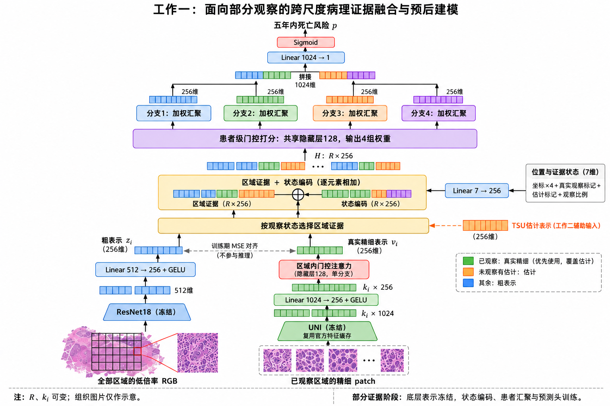
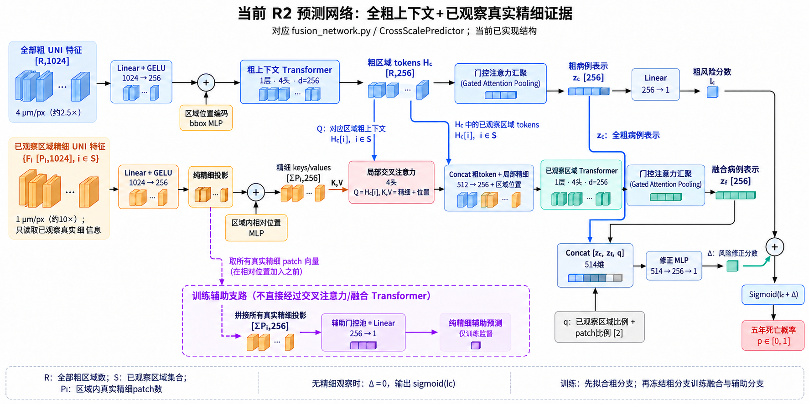
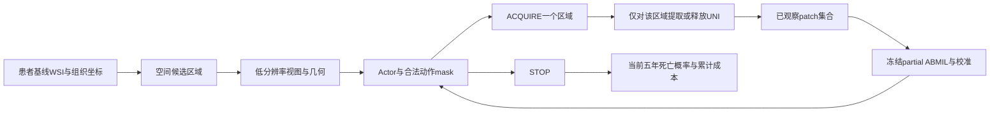

# 长期研究方案与实验重启记录

更新日期：2026-10-14。现行方案：第0.23节R3/W046，413例年度生存曲线，沿用W037的4/1MPP（常见2.5×/10×）；P1/R2为历史实现与对照。初始整理基准为 `main` / `7ed0dcdd023f0dd963dda95a60733729473d4766`；P1文档和S1/S2记录已归档，专用分支为`research/p1-restart`。实际实现/进度以工作日志为准。

## 0. 当前长期研究方案

**W049真实训练完成与过拟合核查（2026-10-14）：用户已自行启动R3，17:45:47正常早停，实际21轮、按五模式平均NLL保留第6轮（源码600fe14，均为人工轮次）。后期训练目标从1.10384降到0.05223、验证平均NLL从1.04414升到1.89655，确认过拟合；两者损失组成不同，不直接当同一量比较差值。已选第6轮zero/full的C-index为0.71697/0.76064、五年AUROC0.73182/0.79218、Brier0.19719/0.17518，存在观察精细后的初步验证收益；尚未隔离真fine内容贡献、独立Test或RL收益。训练248例/93事件、验证81/27，任务可训练参数2,340,615，容量与有限病例/事件是主要风险推断，不是已证明唯一病因。最终best严格重载及9份源码SHA一致，本机仓库外备份SHA一致，GPU空闲；本轮只读诊断/存档，无新推理、改参数、重训、Test或RL。此前W046–W048未启动状态仅为当时记录。**

**W041实现诊断（2026-10-13）：已选R2 checkpoint逐例复算Val84，zero/20%/full同AUROC原因是正负病例对得失抵消（均1132/1620），不是同一预测；精细置零/打乱控制显示当前best对真fine内容响应弱。指标/输入/参数更新检查未发现对应实现错误，但残差可从粗表示再次拟合是源码可见风险，未确认其独立贡献或精细信号强弱。维持0.23与历史权重，未据诊断自动修改结构/尺度/选择规则或重训；详见工作日志W041和实际匿名审计回执。**

**W040首轮拟合完成（2026-10-13）：16:46北京时间流水线完成。粗20轮/选第5轮；融合16轮/选第1轮，之后15轮无选择BCE改善触发早停。最终best粗AUROC0.69877/BCE0.60218，粗＋full细0.69877/0.60427；融合末轮full BCE2.04212/AUROC0.68086，明显过拟合。首轮未显示fine条件收益，不能据梯度/训练完成支持方法有效，继续聚焦预测器而非进入RL；本轮不改结构/参数或重训，后续须区分fine信息、残差对粗表示再拟合及过拟合的影响。权重/完整回执已核对备份，Val用于模型选择，Test未评价。**

**W039状态核查（2026-10-13北京时间13:46快照）：339粗编码完成，粗锚点20轮早停/选第5轮，Val AUROC0.69877/BCE0.60218；融合6轮仍运行，当前best第1轮，full AUROC0.69877/BCE0.60427，最新第6轮full BCE0.81905。后期过拟合迹象，尚未看到fine条件收益；不据进程正常/测试通过称网络有效。不改超参/选择/尺度或提前训练策略，现行结构保持，完成后再核查对照/收益。**

**W038预测器优先实施（2026-10-13）：用户要求先集中预测网络。第0.23结构/输入已落实到`fusion_network`/`fusion_data`/`prepare_coarse_uni`/`train_fusion`；6项软件检查及一例真实Train梯度/冻结/重载检查通过，尚不证明fine增益。单seed41流水线已启动：339例粗编码→粗锚点→fine增量融合；Val固定10/20/40%可获取区域与full的平均BCE选择融合、zero单独报告，实际patch比例另记，Test不读。最多100epochs/早停15是已登记初始配置，不是最佳轮数。当前实际阶段仍须看运行记录，不开展RL/组织辅助或新高层图像获取。**

**W037正式采用（2026-10-13）：用户决定先用2.5×/10×。主实验输入固定4/1MPP、224像素、896/224µm；工作一保持R2全粗＋真部分细融合，无主流程TSU/替换，工作二后续条件化获取/STOP。先复用既有RGB、坐标/区域和官网fine，粗路用已取得的原始UNI重编码；不再以批量原图或5×/20×提取为前置。新契约为`configs/coarse_uni_r2.json`，保留旧2/0.5配置/产物/失败日志，不续其队列。本轮固定方案及输入契约、核查接口和少量Train编码，不启动预测器/PPO/Validation/Test评价。**

**W036资源约束下的主实验建议（2026-10-13，尚未实施）：现有4/1MPP（常见约2.5×/10×）有能力支持组织上下文＋局部形态的双尺度融合和序贯获取研究。最新推荐保留SurGen及R2结构，利用现有RGB用UNI重编码粗路，复用官方1MPP真fine，先做全粗＋真部分细融合；2/0.5升级转为扩展候选，不作为启动预测器研究的硬前提。若用户采纳，正式尺度/区域/执行单需原位修订并登记新配置，不能静默改已经锁定的2/0.5 run；本轮只调研核查/提出建议，没有换配置、下载或训练。两组均有4倍线性尺度差，不等于相同图像内容或效果；10×不能称20×核细节。**

**W035读取来源核查（2026-10-13）：本机整ZIP也下载慢，不应把当前OME-Zarr Range路径当作获得新尺度的唯一方式。官方原始CZI和OME-Zarr是同切片的两个发布格式，本轮HEAD两例CZI分别约319MB/7.64GB，ZIP约5.71GB/95.30GB；建议优先小CZI验收成熟ROI读取/物理MPP/坐标，再判断逐例CZI路线，仍保留2/0.5 MPP与同UNI。当前接口未实现、像素/特征兼容未验证，不能混接不同来源向量或静默改run指纹；研究方案不变，仅数据读取候选新增。未下载、安装或重启；W034停止状态继续有效。**

**W034夜间状态核查（2026-10-13）：数据队列已停止，完整双尺度1/255例，第二例粗2,221/2,221、细12,352/34,516；已保存文件检查通过。实际叶错误为单图8GiB网络上限，缓存8.58GB仅覆盖2.15GB不同源字节，当前读取复用存在工程瓶颈。先优化重叠范围缓存/读取、保持2/0.5 MPP与同UNI及几何不变，验证真实字节/向量可续用后再恢复队列；本轮仅核查/存档，未修改配置、源码或重启/训练。12小时本机代理随后到期，不是05:41停止的根因。下方W033是启动时历史状态，当前实况以W034为准。**

**W033数据准备实施（2026-10-12）：原始UNI授权文件已下载、备份及上传，官方SHA/大小、严格加载及真实CUDA双尺度编码通过；17项软件检查通过。Train255几何已全部完成，PID167610按切片、分块读取官网原像素，提取2/0.5 MPP真实特征；不整张下载WSI，当前经本机EBI限定TLS中转。新特征队列尚未完成；R2预后网络/策略尚未实现或训练，Validation/Test未由此队列使用。源/配置/模型锁定，方案结构不因工程检查通过而称有效。**

**W031接续准备（2026-10-12）：用户要求说明拉取源码、搭建框架和5×/20×重提特征的具体做法并更新工作文档。接续顺序固定为资源/源码版本核查→物理数据契约与提取、模型接口→少量Train图像工程验收→全队列双尺度特征准备→预测器训练。详细执行单原位见0.23。本轮完成说明/存档和远端源码版本查询，未拉取新checkout、配置服务器、下载图像/权重、搭建新算法或启动提取/训练。**

**W030原位修订R2建议（2026-10-12）：用户指出精细价值未解决并要求更强患者组织特异性；0.23原位补全粗基线锚定/细增量监督、正式2/0.5 µm/px目标与自动分块提取成本、组织证据账本/偏好策略和真实可视化。fine-only不必胜coarse，但额外fine条件收益尚未实证；结构、尺度或语义辅助均不能保证产生收益。修订只是当前唯一推荐，实际P1仍4/1，未下载/实现/提取/训练。**

**W029唯一实施建议R2（2026-10-12）：用户要求明确具体方案且允许全部现有内容调整；重新比较数据与任务后，完整推荐规格统一在0.23。推荐保留SR386五年死亡与4/1 µm/px，改为同版本原始UNI双尺度＋粗引导fine融合＋证据条件化PPO/STOP；主流程取消TSU、状态替换、粗细MSE对齐及旧冻结三阶段。0.1–0.22的P1运行/候选按日期阅读；R2尚未实施，不能把文档推荐视为源码/权重已经更新或实验授权。**

**W028讨论补充（2026-10-12）：选区与预测应围绕同一成本/预后目标共同设计，但可用分阶段训练消除相互等待；不把这称作无解闭环或必须端到端联训。RL拟研究的是基于实际观察结果更新下一步获取/STOP，而非证明检测器无法识别组织。医生式流程与SurGen组织资产边界见0.22。W027需求及DSCA适配推荐保持，未采取新架构/数据/训练决定。**

**W027最新需求（2026-10-12）：预测器必须融合“全部粗信息＋已经观察的真实部分精细信息”，粗上下文始终保留；自适应获取/停止属于外部策略，预测器不内置硬选区。最新文献证据、原代码核查和唯一推荐见0.21。需求已经确定，DSCA式适配、主预测器不使用TSU、尺度及训练变更仍是本轮建议，未修改或运行算法。下文0.5–0.9描述已运行P1，不能当作满足新需求的现成实现；0.16新增尺度不是自动执行队列。**

**W026当前顺序（2026-10-12）：原题目保持，用户要求先总结实际预测网络并共同讨论改进，暂缓PPO接续。本轮结构与来源核查见0.20；预测器尚无稳定精细增益，不能让选区策略承担补出预测信号的职责。未修改P1算法/尺度/权重，也未采用R1。该顺序不设固定AUROC通关门槛，下一步为预测器的改进讨论。**

**W025当前决定（2026-10-11）：用户决定不换题目，继续结直肠癌病理预后预测＋强化学习序贯区域选择/停止，以P1现有代码/资产/三个已完成训练为接续基线。第0.1–0.13恢复为P1方法说明，后续0.19记录已核实进度及未完成事项；0.16 R1仍为未采用修改建议，0.17/0.18仅保留选题讨论历史，不自动实施。以下W023/W024状态按当时历史理解，不再是现行指令。本轮只核查和解释进度，不启动新实验。**

**W024当前状态（2026-10-10）：用户已拒绝0.17简单图块分类/蒸馏候选，要求网络与研究内容更充实，并能衔接后续病情诊断。本轮推荐候选见0.18：病理图文证据融合与强化学习辅助诊断问答。仅完成调研与资源/部分源码静态核查，未获采用、未实施；以下W023及0.1–0.17的推荐/下一步均按历史理解。**

**W023当前状态（2026-10-10）：重新选题。用户已解除数据集、预后终点及选区限制，优先可复现、工程规模可控且有两项主要工作的病理相关课题，尽量结合强化学习。P1是既有实现档案，R1新增尺度建议撤回为当前推荐；不继续Q08原图/新尺度准备。当前唯一推荐候选见0.17，尚未登记为实施方案。下文0.1–0.16保留历史语境，不再作为自动执行队列。**

**本节是唯一现行方案。以后在本节原位修改，并更新版本、日期和 0.14 修订记录，不另建并行方案或连续版本文件。** `project_context.md` 只保存摘要和入口，`historical_findings.md` 保存历史证据。用户最新明确决定优先；尚未接受的建议必须标为候选，不能悄悄替换主方案。

**第 1–9 节完整保留为交接和早期方案档案。** 其中的“当前”“下一步”“推荐”、预测器先达标的安排、64 区域/32 patch、单头 ABMIL 主模型、增量奖励、外五折/内三折等均按历史日期理解，与本节冲突时以本节为准。历史任务单和文献中的运行命令不是执行授权。

### 0.1 题目、研究目标与两项主要工作

暂定题目：**《基于跨尺度证据融合与强化学习序贯区域选择的结直肠癌病理预后预测研究》**。

研究对象仍为历史 SR386，任务为患者级五年死亡二分类。目标是在取得低成本的全局粗视图后，根据已经观察的精细证据决定下一步获取哪个区域或停止，研究预测质量与证据获取成本的关系。不自行改为其他数据集、癌症特异死亡或 Cox 生存分析。

| 论文主要工作 | 方法组成 | 可交付内容 |
| --- | --- | --- |
| 工作一：面向部分观察的跨尺度病理证据融合与预后建模 | patch→区域→患者分层注意力；粗细表示对齐；零精细证据、部分证据及完整证据联合训练 | 患者标签/划分与质量控制清单、双尺度区域研究数据、网络结构、预测及部分观察对照、注意力与病例展示 |
| 工作二：预算自适应区域选择与停止决策 | 预算与成本偏好条件化的 masked PPO；区域获取与 STOP；TSU只保留为既有P1模块和可选讨论项 | 环境与策略、预算曲线、停止分析、方法消融、患者获取轨迹与成本展示 |

这两项是硕士论文的主要研究内容，属于成熟方法适配与组合，不宣称发明全新的注意力或 PPO。派生区域和轨迹不能算作新增独立患者；不承诺自制 2000 例临床数据。书面工作量由数据整理、两个方法章节、对照/消融及病例系统共同体现。

### 0.2 选题为什么成立，以及能承诺什么

直接输入完整 UNI bag 的 MIL 是必须尊重的强基线。其预测可能更好，但通常需要取得候选范围内的全部精细特征。本研究的适用情景是**新 WSI 尚未完成精细提取**，希望用较少的精细证据取得可接受预测，而不是保证超过全量 MIL 的准确率。

粗视图直接预测、随机/固定选区也可能足够好；它们是本研究的比较对象。检测、分割或肿瘤间质比例能提供相关信息，但局部组织检测目标并不自动等于患者级五年死亡预测；可以用于相关工作讨论，不另开大规模像素标注支线。由此可以合理判断：这个课题有可研究的问题、成熟的实现基础和适合硕士的范围，足以形成开题方案。

上述判断不等于结果已经成立。不能保证预测器完美、PPO 显著优于随机、每次获取都改善、四档成本偏好必然控制预算，也不承诺具体 AUROC 或节省百分比。预期成果是完成系统及可信比较、解释质量/成本取舍；性能增益应作保守期待。RL 无法补出数据本身没有的预后信号。若优势有限，仍如实报告适用条件和负结果，不自行换终点或删除强基线。

2026-10-10 可行性证据纠正（W018）：初始已经输入全部粗视图，若精细获取没有额外预测收益，单凭比全量少获取不足以支持RL优势；立即STOP会是直接竞争方案。已有文献支持多尺度预后研究，但没有“精细必然强于粗图”或“多尺度必然提升”的跨任务定论：

- [HiMT，ICPR 2022，原文表III](https://arxiv.org/pdf/2211.16632)：五种TCGA癌症、含基因输入的模型中，5×/20×/三尺度平均C-index分别0.641/0.663/0.673；BRCA单5×为0.612，三尺度为0.606。每尺度采样1000个patch，三尺度总数更多，不能将差异全部归因于纯尺度作用；也不是SR386五年二分类的效果承诺。
- [CrossFusion，作者v2原文表1](https://arxiv.org/html/2503.02064v2)：TCGA-COAD上，文中只用20×的w/o F&C为C-index0.631±0.052，多尺度为0.694±0.053。这支持该模型/队列下多尺度输入有价值，但该消融同时改变多个尺度，不能解读为单独证明在全粗图上追加fine的收益，更不能换算为本项目AUROC。
- [Bioinformatics 2022乳腺癌生存研究，原文表2及讨论](https://academic.oup.com/bioinformatics/article/38/14/3629/6604265)：RGB的原分辨率scale1为C-index0.551，下采样scale8为0.678，组合8+1为0.675；作者明确报告未观察到合并其他尺度的C-index改善。这说明较低分辨率在一些预后任务中已很强，分辨率与性能没有必然单调关系。

主参考[SASHA原文4.1](https://arxiv.org/html/2507.05077v5)验证的主要是CAMELYON16正常/病变分类和TCGA-NSCLC肿瘤分型，扩展仍为诊断分类，不是患者预后。其选区结果提供工程借鉴，不能当作本任务选区收益已获支持。当前P1同样需要区分“状态替换”和“同时保留粗细信息的融合”；本轮仅纠正论证，具体架构修订须讨论后登记，未改网络/训练/奖励或启动实验。

### 0.3 数据、标签与划分

- 以 SR386 的原始患者元数据、患者/切片映射和历史划分为起点；先核实五年死亡标签方向、时间单位、随访不足五年的处理及纳入规则。历史“423 患者、255/84/84”不能代替实际名单。
- 优先查找独立备份、公开 SurGen 数据与特征，不能假定全部必须从零生成。旧服务器文件已由用户报告丢失，历史路径和 SHA256 仅是线索。
- 同一患者的全部切片、区域、状态归于同一划分。Train 拟合表示与模型，Val 选择配置/checkpoint，Test 在协议锁定且另获执行授权后使用。拟合和选择用途均记录。
- 若原划分确实无法恢复，重新划分需要用户明确决定；不默默照历史数量造名单。主方案不强制 5×3 OOF 集成，也不把 Train 奖励称为严格独立 OOF。将来若增加 OOF，外层隔离须覆盖模型选择、校准和拟合预处理。

### 0.4 双尺度区域与 UNI 的处理

**区域在精细 UNI 提取之前由组织范围与空间几何定义。** 采用固定物理范围的粗区域，区域数量 R 随组织面积变化；精细 patch 通过坐标和尺度关系映射到区域。保留切片 ID、MPP、物理范围、坐标单位、步长、组织有效比例和 patch 映射。边界区域使用有效性 mask，不为满足固定数量伪造组织。

粗输入为真正的低分辨率 RGB 区域视图，保持长宽比例后缩放/补边至 224×224，使用外部预训练且冻结的 ResNet18 提取 512 维向量。粗路径不依赖全量 fine UNI。已执行P1的物理规格如下；该规格是接口工程候选，不是性能证明的最佳尺度。

精细输入使用冻结的原始 UNI，单 patch 输出 1024 维。优先复用官方 SurGen 特征及坐标；公开协议中 224×224、1 MPP 是恢复线索，必须核对实际缓存版本和坐标映射。预计算特征用于模型训练及证据访问模拟；真实部署时才对被选区域读取精细 patch 并提取 UNI。

2026-10-10尺度核查（W020）：`configs/regions_p1_trial.json`与`kt2028/regions.py::crop_region`明确coarse覆盖896×896 µm并直接EXTENT采样为224×224，因此网络有效采样为4 µm/px；约3.559 µm/px只是读取的原生金字塔层，不是最终网络MPP。[SurGen已锁定公开提取协议](https://github.com/CraigMyles/SurGen-Dataset/blob/55c9bcb74ed7c8d35ca944af24398b11e5b960bf/reproducibility/README.md)指定fine为224像素、1 µm/px，即224 µm视野；当前fine映射采用这一协议。缓存数组没有自描述MPP，三例图像叠加核查不能代替全部缓存与原像素重新核对。

若用常见20×≈0.5 µm/px作便于交流的标度，上述两路约相当于2.5×/10×，不是5×/20×；它们仍然构成多尺度。数字扫描倍率不是统一的MPP换算规则，图名中的40X也不是模型实际输入倍率。须同时登记物理采样间距、输入像素、物理视野、组织覆盖与编码器；改变固定224输入的MPP会同时改变单patch视野，不能把结果全归因于分辨率。

W027补充：[SurGen原论文表1](https://academic.oup.com/gigascience/article/doi/10.1093/gigascience/giaf086/8277208)同时登记40×与0.1112 µm/px；本仓库`records/server_s2_20261009/coarse/receipt.json`三例level0的MPP也约0.11123。所以上段2.5×/10×只能是常见标度下的交流近似，不能作为本数据实际物镜倍率。正式规格一律以4/1 µm/px、224像素及896/224 µm视野为准；候选“5×/20×”应明确写目标2/0.5 µm/px，而非声称扫描倍率存在统一换算。

**64 区域、每区域 32 patch 已撤回为固定定义。** 它们是早期工程候选，不是文献证明的最优参数。当前按物理范围确定区域，按粗细尺度关系确定区域内 patch 数。例如同样像素尺寸、线性尺度比为 4 时可对应 4×4 个精细视野，这只是几何说明，不表示已经选定 16 patch。不能由这个例子写死新数字，也不采用旧 10 簇、PCA 或四形态槽作为主依赖。

### 0.5 工作一：部分观察预后预测器

**W027需求覆盖：以下结构图/层数/训练为已运行P1档案。后续必须保留全粗分支并融合已观察真fine，最新推荐只见0.21；旧替换设计不再作为新需求的推荐。**

主结构借鉴 **SASHA 的 HAFED 分层特征聚合及跨尺度思想**，适配患者级五年死亡；ABMIL 保留为基线。复用的是网络思想与可核查代码，不是把其他任务分类 checkpoint 直接叫作本任务预后模型。

2026-10-10 源码核对架构（`kt2028/network.py` / checkout `9dd8fe0d1a2a922ad7b51fda0830dd70b84ded14`）：两级门控注意力的多实例学习网络，先把 patch 汇聚成区域，再把区域汇聚成患者。下图是当前实现的信息流；预训练提取器始终冻结，自建模块的冻结状态随训练阶段变化。UNI 路径当前复用官方特征缓存，图不表示已完成实时精细提取。



按用户提供的论文插图风格，使用内置生图模型生成；图中组织图像仅作输入示意，不是本队列病例或实验结果。TSU在此仅显示为工作二的外部辅助估计输入；其具体结构仍见0.6。完整生图提示词见[生成记录](figures/p1_work1_architecture.prompt.txt)。

实现细节：两级门控注意力均使用两路 `Linear(256,128)`，分别经过 tanh/sigmoid 后逐元素相乘；区域内打分层为 `Linear(128,1)`，患者层为 `Linear(128,4)`，各分支沿实例维 softmax 后加权求和。区域融合按状态选择一个256维证据向量，再加上7维状态的线性编码，并非粗细直接拼接。输出头当前只有一个线性层；四分支不是四种医学组织或四个专家。真实 fine 优先于任何估计，TSU 估计不增加真实观察比例；当前比例按区域数计算，不能当作已获取 patch 或预算比例。

2026-10-10解释补充（W026补全full边界）：`EvidencePredictor.forward` 对已观察区域以fine替换coarse，而非同时保留两路；full取得全部可获取区域的fine，这些区域的图像证据token来自fine。若某个RGB候选区域没有缓存fine，loader不会虚造fine，该区域仍保留coarse，或在partial流程启用TSU时被估计；full的真实观察比例因此不保证为1。coarse_latent虽在返回值中仍存在，却没有独立全粗分支进入患者预测头。因此zero/full比较是本网络的粗/细替换状态比较，不能称为“全粗信息”对“全粗信息＋全细信息”的直接互补消融。替换设计借鉴SASHA状态更新，但其适配预后收益尚未成立；不从一次性能接近推导精细信息在领域内没有价值。

三个预测器训练阶段的输入/目标：完整候选fine训练局部与患者网络（BCE）；冻结fine后训练粗投影/TSU（MSE）；冻结fine/coarse/TSU后训练状态编码、患者汇聚及输出头（零/随机/完整证据 BCE）。标签只作训练目标，不进入推理输入。TSU主要归于工作二，当前已接入部分证据预测流程；其同配对表示误差未优于直接coarse的事实见W011/Q06，不把架构存在或训练完成当作有效性结论。

局部 fine 聚合器输出统一潜空间表示；coarse 投影以 Train 的真实 fine 区域表示为对齐目标，使用 MSE。患者多分支注意力处理可变区域集合，候选潜维度 256、候选分支数 4。四分支是学习到的汇聚通道，不是四种已标注组织，也不是自动成立的四专家 MoE。

零 fine 时仍可由全部粗视图预测，不只依赖一个空集常数。完整和随机部分观察状态均参与训练，包括零 fine；患者二分类损失为 BCE。预测概率的辨别、校准及不同证据量下的行为在未来评价中报告，不许宣称天然可靠。

**需要自己训练本任务的预后模块。** UNI、ResNet18 可复用预训练权重；目前没有核实到适配 SR386＋五年死亡＋此部分观察接口的现成预后 checkpoint。原 E2、teacher、旧校准器均不作为新主方案的必需资产。成熟 MIL 提供可实现性依据，不能保证每名患者都预测准确。

### 0.6 TSU：相似区域的证据传播

**本节保留既有P1实现说明。W027建议新主预测器不估计未观察fine；TSU不是满足全粗＋真实部分fine需求的必要机制，尚未删除源码或重新训练。**

获取区域 j 的真实 fine 后，依据可见 coarse 的余弦相似度找到相关的未获取区域 i。小型 MLP 使用 `[z_i,z_j,v_j]` 估计其 fine 表示，并更新当前未观察状态。训练监督只来自 Train 的区域真 fine 对，候选相似度阈值为 0.9。

实现时明确保留“真实已获取/仅估计”标记；估计区域仍允许被获取，估计永不覆盖已取得的真 fine。不把估计计为新获取证据。推理输入不能包含未获取区域的真 fine 或患者标签。TSU 是帮助决策的表征估计，不能宣称实际发现了未知组织。

### 0.7 工作二：Actor-Critic、动作与预算

初始全部廉价粗视图可见，**无已观察 fine**；第一个 fine 由 Actor 决定，也允许立即 STOP。状态含当前可见/估计的区域表示、几何、真实获取 mask、患者证据汇聚与风险、已花费成本、剩余预算和成本偏好 λ，不含患者标签。

Actor 对候选区域共享打分，再输出一个 STOP 分数；Critic 输出预期累计奖励，不是死亡概率。动作是 `ACQUIRE(i)` 或 `STOP`；已获取、无效、预算不足的候选必须 mask。获取后更新 fine、TSU、概率和成本。预算耗尽则终止并计算终末预测损失；推理不需要真实标签。

主优化采用 MaskablePPO。可变 R 需实现候选 padding/mask 与共享打分接口，或明确候选数量上界；SB3 的固定 Discrete 接口不会自动适配任意 R，不能写成已完成。硬预算 B 保证不超支，λ 表达成本偏好；二者不能混称。训练预算/λ 的采样范围在服务器阶段记录。

### 0.8 奖励与成本：现行定义

主方案采用**获取成本＋终末预测损失**，不沿用旧 Dense 增量效用，也不直接搬用文献中每步扣交叉熵的奖励：

```text
ACQUIRE(i)：r = -λ c_i
STOP：      r = -BCE(y, p_T)
若获取动作导致预算耗尽：该步再加一次 -BCE(y, p_T)
γ = 1；整条轨迹 R = -BCE(y, p_T) - λ Σ c_i
```

终末损失每条轨迹恰好记一次；立即 STOP 也计当前粗视图预测损失。标签只用于 Train 监督/奖励和离线评价，不能输入 Actor 的推理状态。GAE、PPO 的候选默认值见 0.10，不是效能保证。

代理获取成本 `c_i = n_i / N_ref > 0`，n_i 为该动作实际取得的精细 patch 数；N_ref 为全协议共用的参考量。若有重复 patch，先规定是否缓存及其实际新增计费规则，不重复虚增成本。不采用每患者 min-max，不把最便宜区域设为零。此前 2048 来自 64×32，**不是自然的全 WSI 总量**；N_ref 和 λ 尺度应在具体配置中同时确定，不能默认恢复这个分母。

缓存实验报告“获取 patch 数/代理成本”，不能直接写“端到端算力节省”。未来小规模真实 WSI 计时分别记录粗视图、ROI 读取、UNI、预测器、策略、I/O 与初始化；训练阶段的全量预计算成本单独披露。若只处理受限候选库，“全候选”不称作“全 WSI”。

### 0.9 训练顺序与实现边界

采用**分阶段训练**，撤回讨论中的预测器与 PPO 交替更新建议：

1. 冻结 UNI，用 Train fine 特征训练局部聚合和患者级完整证据预后网络。
2. 冻结 fine 局部聚合器，以 Train 区域表示训练 coarse 对齐及 TSU。
3. 冻结底层表示和更新器，使用完整/随机部分状态训练患者预测头，含零 fine。
4. 冻结整个预测器与 TSU，再训练 masked PPO，避免奖励来源在策略训练期间不断变化。

这只是模块依赖与稳定训练安排，**没有“预测器先达到指定 AUROC/完美可靠才允许研究策略”的开题门槛**。用户已取消旧的预测器优先限制。实验中仍须检查实际模型行为，但不把一整套预实验作为敲定开题的前置条件。

本地 `msrlsurv/` 是早期单头 ABMIL、fine-only/空集先验和增量奖励的实现草稿，与上述 HAFED、TSU、终末奖励不一致；不能据目录存在声称当前方案已经实现。保留草稿，今后在服务器任务中决定适配范围；第一步盘点不运行其训练命令。

### 0.10 参数的来源与状态

2026-10-09 S2 训练接口登记首个[工程候选配置](../configs/predictor_p1_candidate.json)：latent 256、四分支、TSU 0.9；AdamW 1e-4、weight decay 1e-4、30 epoch/阶段、病例 batch 2、梯度裁剪 5、seed 41；对齐每病例最多 128 对，部分状态采样零/完整各 25%、其余为均匀中间获取数量。它们是工程起点，不是性能最优值或全部实验最终配置。模型选择固定为最小 Validation 阶段目标，平局保留首次：full 为 BCE，align 为对齐＋TSU MSE，partial 为固定零/随机/完整状态 BCE 的等权平均；外层 Test 不参与。初次接口检查未优化；截至2026-10-10，full/align/partial首个候选已各完成30轮并重载核实，证据见工作日志W009–W012/W016。配置内初始status是登记时状态，当前训练事实以run/完成回执为准。以后改变这些运行选择须在配置和日志中记录，PPO成本/预算仍未锁定。

| 项目 | 当前状态 | 确定依据与后续记录 |
| --- | --- | --- |
| 五年死亡、患者级划分 | 固定任务；原始标签与名单待恢复 | 用户研究目标；必须以临床元数据/名单核准 |
| fine UNI 1024 维、coarse ResNet18 512 维 | 选定的结构接口 | 所选提取器输出；权重版本/数据协议需登记 |
| 粗视图输入 224×224 | 方案的预处理选择 | 预训练视觉网络接口，保留物理视野与长宽比 |
| 区域物理范围、粗 MPP、fine 步长、组织阈值 | 尚需图像元信息支持的配置 | 按物理几何映射，不从旧 64/32 反推 |
| 区域数 R、区域内 k_i | 可变，由组织范围与尺度决定 | 不固定 64/32，也未选定固定 16 |
| 潜维度 256、注意力 4 分支、TSU 阈值 0.9 | 工程候选默认 | 控制规模、参考成熟结构；不是验证最优或医学分类 |
| 部分观察采样 | 覆盖零、完整、中间状态 | 实际采样分布随可变 R 固定到运行配置，不照搬旧离散列表 |
| B 为 128/256/512/1024 patch；λ 为 0/0.25/1 | 早期候选范围 | 区域几何与 N_ref 确定后核对可达性/尺度，再记录最终范围 |
| γ=1 | 选定的奖励目标 | 保持终末 BCE 与累计成本的同一 episode 目标 |
| GAE 0.95、PPO clip 0.2 | 常规工程候选默认 | 算法配置，不是由临床数据推导的最优值 |
| 学习率、批大小、迭代量、候选上界 | 服务器阶段配置 | 依据资源与 Train/Val 选择范围登记，不虚构已定数值 |

“方法已固定”指研究问题、模块职责、信息权限、奖励目标和训练顺序已经明确；配置表内仍待核准的物理参数与运行规模不是已经实验确认的数值。不得在以后摘要中将候选默认为最终参数。

### 0.11 实验安排与预期产出

2026-10-10实际进度补充：full/align/partial各完成首个seed41/30轮，权重重载核实且双份备份。full选第2轮（Val AUROC0.67963/BCE0.60787），align选第30轮（Val总MSE0.13817），partial按固定三模式平均BCE选第6轮（平均0.61067）。partial的zero/random/full Val AUROC0.67531/0.67778/0.68025、BCE0.62466/0.60123/0.60610；random包含19零/42中间/23完整状态，非固定预算。当前精细证据排序增益有限；同权重random关闭TSU的探索诊断AUROC0.69568/BCE0.58919更好，不替换选中模型、不当作重训消融或独立Test。证据及限制见W009–W012/W016，TSU仍为待比较模块。接下来完善成本/预算与选区STOP接口，不新增AUROC通关门槛。PPO尚未训练、Test未用、工作一的全部对照/消融未完成；下面仍为计划，P1方法未改。

以下是服务器阶段的实验计划，第一步盘点不执行。优先覆盖两个章节的核心比较，再按资源完成消融，不扩展为无边界的模型大赛。

| 部分 | 核心比较 | 关键消融/展示 |
| --- | --- | --- |
| 工作一 | coarse-only；fine ABMIL；完整候选 HAFED；部分观察 coarse/fine 融合 | 单/多注意力分支、对齐、部分状态训练；不同证据量及病例注意力 |
| 工作二 | 随机选区、空间覆盖、coarse 注意力 Top-K、固定预算 PPO、含 STOP 的 PPO | 去 TSU、去 fine 历史、去 STOP；预算、停止分布及患者轨迹 |

选区比较共用预测器、候选库和预算定义，避免不同预测器导致伪选区优势。报告 AUROC、BCE、Brier、质量/成本曲线、获取量与停止统计；概率诊断如需校准器，其拟合/选择集合单独登记。主要方法计划 3 seed，患者级置信区间用于评价差异；同患者多轨迹不能当作独立样本扩大统计量。具体重复规模在运行协议中锁定。

部署成本用小规模真实 WSI 案例补充，先区分缓存证据模拟与端到端提取。预期能完成可复现对照、病例解释和成本分析；不预填模拟指标，不假定 PPO 必然胜出。若 coarse-only 接近完整模型，优先如实解释额外 fine 的边际收益，不隐藏该结果。

### 0.12 资产缺口、下一最小工作与停止条件

历史源码和上传汇总在仓库中；服务器上的原始图像、元数据、缓存和权重已报告丢失，能否从独立备份/公开来源恢复须逐项核对。旧 PCA/四中心/teacher/E2/PPO checkpoint 不是本方案必需品，但其历史记录保留。新方案依赖患者标签与名单、fine 特征和坐标、粗视图对应原始图像/金字塔、提取器版本及未来服务器；公开链接不等于本地已有文件。

2026-10-09 新服务器 S1 实际核查补充（不代表旧服务器资产找回）：上传的 UNI ZIP 校验通过，已在独立目录整理 SR386 的 427 个 Zarr、2,203,176 个 patch，增加 8,508,946,570 字节。官方五年 CSV 的 255/84/84 个 case 全部匹配特征，case 无跨划分交集；4 个有特征 case 无五年标签，保留文件但不进入有监督清单。标签方向来自上传官方源码：1 为五年内死亡，0 为生存五年；原始随访与独立临床身份表未提供，不能声称重算了结局。CSV 的 `slide_id` 是 split 内占位编号，按 `case_id` 的整数 T 编号规范化映射真实切片，不按占位字段 join。原始图像未上传，数组值解码/有限值及坐标几何检查仍待进行。[审计完成回执](../records/server_s1_20261009/completion_receipt.json)和[数据契约](../records/server_s1_20261009/data_contract.json)保存实际证据，清单与数据留在服务器。

原图存储的处理路线：不完整下载整套 CZI 或 OME-Zarr。官方 [S-BIAD1285](https://www.ebi.ac.uk/biostudies/bioimages/studies/S-BIAD1285) 于 2026-08-03 增加 OME-Zarr；服务器实际读取官方文件索引得到 427 个 SR386 图像 ZIP，并在一个真实 SR386 ZIP 上验证 HTTP Range，约 49 KB 即取得 ZIP 索引和多尺度/物理元信息，详见[远程访问记录](../records/server_s1_20261009/remote_range_probe.json)。作者 [raw2features 示例](https://github.com/CraigMyles/raw2features/blob/main/notebooks/02_visual_walkthrough.ipynb)提供另外的云端访问线索，但该展示存储首次列到仅 4 个图像前缀，不能认为已覆盖全部病例。后续以实际文件索引和病例映射为准，按低倍率层/区域获取像素并缓存；少量展示缩略图不能替代正式 coarse 输入或端到端计时。现阶段不改为“全 fine 均值充当廉价 coarse”。

S1 另完成一张真实 SR386 RGB 缩略图的 CPU 读取：从 5,027,804,552 字节的官方图像 ZIP 按 Range 传输 634,578 字节，解码为 `[198,219,3]`，ZIP CRC、分片索引 CRC32C、PNG SHA256 检查通过；本地已查看图像。详见[像素访问回执](../records/server_s1_20261009/coarse_access_example/receipt.json)和[真实缩略图](../records/server_s1_20261009/coarse_access_example/thumbnail.png)。这是读取可行性的实例，不是全部病例/正式区域尺度已经通过验证；只写审计工具，不将该手工探针当作正式 Zarr 生产读取器。第一步未安装额外依赖，未提取 coarse 神经特征、未运行训练或模型评价。

2026-10-09 S2 后续：用户已授权环境配置和继续数据接口工作。427 个 fine Zarr 全量解码检查完成，2,203,176 个 patch 无非有限值、全零行、重复坐标或负坐标；427 个切片均有官方图像索引，423 个已标注 case 无缺失匹配，见[数值审计汇总](../records/server_s2_20261009/fine_audit_summary.json)。上传 `WholeSlideImage.py` 与 `dataset_h5.py` 表明 coords 是扫描包围框内相对原点的 level-0 像素坐标；224 µm 视野按原图 MPP 换算原图 patch 大小，再缩放为 224 像素输入，不能把 coords 或 patch 大小直接解释为目标采样分辨率像素。实际 OME-Zarr 原点和组织对应关系仍需图像核准。

服务器项目环境 `/root/autodl-tmp/KT2028/.venv` 使用原 miniconda 的系统包，保留 torch 2.8.0+cu128 / torchvision 0.23.0+cu128，项目默认阿里云 HTTPS PyPI，实测清华源作为备用，缓存位于数据盘。依赖检查、5090 CUDA 运算、ResNet18 前向通过；官方预训练 ResNet18 权重已下载并校验 SHA256，真实缩略图产生有限的 512 维输出，仅为软件检查。见[环境检查](../records/server_s2_20261009/health_check.json)、[权重回执](../records/server_s2_20261009/resnet18_weights_receipt.json)和[配置说明](../records/server_s2_20261009/README.md)。该环境依赖现有基础环境，锁定清单不等于跨服务器 CUDA 一键重建文件；尚未训练任何模型。

当前下一项最小工作为 **S2 真实区域 coarse/fine 接口构建**。输入：S1/S2 审计清单、官方 case 划分、fine 坐标和 UNI、已验证的官方多尺度 RGB 读取器及物理元信息。输出：候选物理视野/步长登记、真实区域 RGB 裁剪、细 patch 归属和边缘有效性标记、缓存与成本接口；先在少量 Train 病例完成配准和输入检查，再扩展全队列。正式区域尺度尚未锁定，最低分辨率展示缩略图不作为正式区域 coarse 输入。范围不含训练或预后指标，不再重复已完成的解压、全量 fine 审计与官方划分映射。

需要用户另行提供或决定的仅有资产/备份位置、旧名单无法恢复时是否重划分、服务器资源与时间安排。架构、动作、奖励和两章内容按本节推进，不重新把全部技术选择交回用户。

**2026-10-09 用户已提供新服务器并授权开展第一步。** 当前执行资源/环境核查、上传数据完整性与格式检查、数据契约和双尺度接口盘点，可编写必要审计工具、生成真实派生清单并在独立目录整理特征。第一步不运行训练或 Validation/Test 评价，不启动旧阶段任务或大量 WSI 下载。未来每项运行需记录方案版本、源码 commit、资产版本/摘要、配置、seed、checkpoint 与结果对应关系。

S2 已在三张 Train 实例以成熟 Zarr 3.4 ZipStore/codec 完成真实多尺度元信息和最低层 RGB 解码，合计传输 2,086,108 字节；level-0 MPP 均为 0.1112310496 µm。坐标叠加图已查看，总体落在组织范围，部分边缘 patch 中心越界与允许边缘填充的提取逻辑相容；正式接口仍需标记有效范围和核准逐区域对齐。见[三例读取回执](../records/server_s2_20261009/coarse/receipt.json)及工作记录 W004。这里只确认三例软件读取与粗略几何，正式 coarse 裁剪和全队列物理映射尚未完成。

### 0.13 文献和源码的具体用途

2026-10-09 S2 并行准备：已拉取 SASHA 作者仓库，锁定 `6385fe6bfcf4f1591b8f691ada2407c83002f62e`，核查 HAFED 两级门控注意力、FGlobal 和原环境。当前 `kt2028/network.py` 是按本节 P1 信息权限编写的首版接口，借鉴分层汇聚及三向量 TSU，不声称原论文完整 HAFED 损失/训练复现。保留真实观察与估计的区别，不搬用原环境的访问标记或每步分类奖励。网络、共享区域/STOP 打分和 episode 经 13 项软件检查及三例 Train CPU 前向检查；尚无拟合权重、训练编排或 SB3 padding/rollout 适配。检查用 N_ref 非正式成本协议，详见 W006 与[源码/检查证据](../records/server_s2_network_20261009/implementation_check.json)。P1 方法未改。

| 来源 | 本方案使用范围 | 尚未验证的边界 |
| --- | --- | --- |
| [SASHA 论文](https://arxiv.org/html/2507.05077v5) / [作者源码](https://github.com/coglabiisc/SASHA) | HAFED 分层聚合、跨尺度表征、TSU 相似证据传播、序贯处理基础 | 未在本任务运行；复用前锁定 commit；原任务/奖励/停止机制不能直接当作本方案 |
| [ABMIL](https://proceedings.mlr.press/v80/ilse18a.html) / [作者源码](https://github.com/AMLab-Amsterdam/AttentionDeepMIL/tree/eb0434ba2795711a45d693d60120ae53532b1b93) | 注意力池化基础与强基线 | 需训练五年结局头，非即用预后 checkpoint |
| [MHAttnSurv](https://pmc.ncbi.nlm.nih.gov/articles/PMC10148238/) | 多注意力病理预后建模的参考 | 不直接移植生存损失或承诺多分支一定提升 |
| [RLogist](https://ojs.aaai.org/index.php/AAAI/article/view/25467) / [作者源码](https://github.com/tencent-ailab/RLogist) | WSI 强化学习观察与选择的相关工作 | 已读入口不等于完整环境复现，主环境仍需适配 |
| [MaskablePPO 文档](https://sb3-contrib.readthedocs.io/en/master/modules/ppo_mask.html) | PPO/GAE/action mask 工具基础 | 需集合动作接口与预算/STOP 适配，未集成运行 |
| [SurGen](https://github.com/CraigMyles/SurGen-Dataset/tree/55c9bcb74ed7c8d35ca944af24398b11e5b960bf) / [公开特征](https://zenodo.org/records/14047723) / [原始图像](https://doi.org/10.6019/S-BIAD1285) | 数据恢复线索、UNI 特征及坐标优先复用 | 本地资产未恢复，患者映射/标签及与历史 NPZ 等价性未核实 |
| [ZoomMIL](https://arxiv.org/abs/2204.12454) / [付费特征分类](https://ojs.aaai.org/index.php/AAAI/article/view/4287) | 高效多尺度 MIL 与质量/成本决策的问题依据 | 作为相关工作，主结构不继续堆叠它们的所有模块 |

文献支持方法可实现性的推断；本项目性能仍未验证。复用时记录真实来源、固定版本和适配范围，不把组合方法写成原创算法。旧文献盘点与源码核查详情保留在第 9 节。

### 0.14 修订记录与后续维护

| 日期/版本 | 变更与原因 | 影响范围 |
| --- | --- | --- |
| 2026-10-13 / W038，R2预测器实施 | 用户要求聚焦预测网络；落实同UNI粗重编码、仅已观察fine加载、粗锚点＋真fine残差/纯fine辅助及训练入口 | 单seed预测器流水线启动，Val选择用途与区域预算单位明确；测试只证明实现，不写性能结论，不推进策略 |
| 2026-10-13 / W037，R2采用4/1MPP | 用户明确先用2.5×/10×，避免批量高层图像获取；复用现有RGB/fine、同UNI粗重编码 | 原位修订0.23正式尺度与接续契约，旧2/0.5执行单转扩展历史；R2预测器/策略待实现训练，不自动沿用P1或旧run |
| 2026-10-12 / W033，R2数据准备实施 | 用户授权开始；取得UNI访问后将权重核验、真实双尺度读取、网格/编码/中转接口具体实施 | 实际代码/接口与工程验收，不改预后/策略规格；完整权重/GPU前向/向量队列仍按真实状态登记 |
| 2026-10-12 / W031，R2准备执行单 | 用户要求明确源码复用、框架与5×/20×提取如何衔接；固定工程准备、验收、批量处理及交付顺序 | 原位补0.23，锁定候选源码commit，尚未克隆/搭建/提取；不改算法规格或进入训练 |
| 2026-10-12 / W030，R2原位完善 | 用户追问精细增益、尺度和组织特异性展示；纠正未解决收益的表述，推荐锚定粗基线/纯细监督、2/0.5 MPP、语义证据账本与偏好策略 | 仅原位改0.23；两路新尺度/语义辅助为待取得资产，未改源码/训练/实验，不新增并行方案 |
| 2026-10-12 / W029，R2唯一具体推荐 | 用户解除所有现有内容约束并要求定案；比较MMR/TCGA后保留现有任务，固定同UNI双流与条件化获取的具体接口/训练/对照 | 新增0.23及阶段排期；旧P1完整保留，R2权重/粗UNI特征/策略均未实现，不运行实验 |
| 2026-10-12 / W028，序贯决策合理性讨论 | 用户质疑预测/选择死循环、检测替代与医生启发；核查主动特征获取、病理观察、CRC间质预后及官方组织筛选源码 | 新增0.22，区分软利用/主动获取、功能耦合/训练分阶段；不自动实施联合训练或组织检测、不改奖励/终点 |
| 2026-10-12 / W027，融合需求与文献调研 | 用户明确全粗＋真实部分细、预测器不负责获取；扩大预后原文及作者源码核查，优先推荐DSCA适配 | 新增0.21并澄清扫描倍率/MPP；TSU不再列为必须工作；需求固定、候选尚未实施，未改算法/资产/训练 |
| 2026-10-12 / W026，优先预测器讨论 | 用户认为精细增益问题先于RL，要求厘清结构与依据；核查P1与SASHA原始HAFED及训练差异 | 新增0.20；修正full的空fine候选区域边界；暂缓PPO，未改算法/权重/输入资产 |
| 2026-10-11 / W025，恢复原课题 | 用户明确不换题目；恢复原预后＋RL，以已实施P1为接续基线 | 三个预测器阶段与旧资产保留，新增0.19进度核查；R1未采用，分类/问答转历史；无算法或实验变更 |
| 2026-10-10 / W024，重新调研 | 用户拒绝0.17，要求更丰富的研究内容及诊断衔接；新增0.18问答方向候选及排除依据 | 只改文档；旧算法/数据/实验保持；不将候选升格为实施方案 |
| 2026-10-08 历史草案 | 单头 ABMIL、64/32、增量奖励及较重 OOF 协议；详见第 9 节 | 已归档，不再作为主实现说明 |
| 本次归档前的讨论 | 用户要求两个主要研究内容、可说明的工作量与明确方法，并解除“先预测器达标”限制；采用 HAFED/TSU 与预算/STOP 两章 | 研究组织、主网络、部分观察与决策接口 |
| 2026-10-09 / P1 | 固定分阶段训练、终末 BCE＋正成本奖励；撤回固定 64/32，按物理尺度构造可变区域；澄清预后头需训练且无完美保证；统一长期入口 | 当前第 0 节为现行方案，AGENTS/上下文同步；本地早期代码标为草稿 |
| 2026-10-09 / P1，S2 接口配置 | `configs/regions_p1_trial.json` 登记 4 µm/px 目标和 896 µm 非重叠视野（224×4），由实际约 3.559 µm/px 原生层裁剪；RGB 组织阈值定义候选，fine 以有效图像交集中心唯一归属并保留边缘比例 | 实现接口用的首版几何配置，不是经性能验证的最优值；k_i 与 R 可变，完整候选不等于原 WSI 全 patch；无网络/奖励改变 |
| 2026-10-10 / P1，证据与解释纠正 | 补充多尺度预后原文正/负证据，明确SASHA诊断任务迁移限制和当前fine替换coarse的源码事实 | 修订0.2可行性论证与0.5解释，未修改算法、配置、数据终点或启动实验；融合修订仅为待讨论建议 |
| 2026-10-10 / P1，尺度核查与R1建议补充 | 确认已执行模型为4/1 µm/px两路；补充CRC低倍预后/局部形态依据，将R1从只改融合扩展为物理配准的组织—局部细节建模候选 | 0.4记录实际尺度；0.16推荐5×/20×起始对、共同病理编码器与局部坐标。建议尚未采用，原P1源码/配置/结果保持；新增尺度需原像素和权重，不能由缓存放大得到 |

以后调整先修改第 0 节对应正文，再追加简短修订项：日期/版本、旧→新、理由、影响的模块/配置/实验。摘要同步指向本节，不复制一套全文。不要仅在对话中答应修改而留下旧正文，也不要将历史结果、未获认可的想法或未验证代码升格为现行决定。

每项实际工作的进度、产物、缺口及下一步统一维护于[长期工作记录](work_log.md)，操作规则见[AGENTS.md](../AGENTS.md#长期协作与记录规则)。2026-10-09 建立此接续机制，方法未改变，方案版本仍为 P1；文档维护记录见 W002。

### 0.15 约两个月的实施工作安排

这是 P1 的执行安排，不另建一套方法方案。周次为从本次服务器接手起的建议排期，依据真实资产和进度滚动调整；不保证按日完成所有实验。实际完成情况只记入工作日志。开题文字/结构图可与数据、代码工作并行推进，不以所有实验完成为开题前提。

| 阶段/建议时段 | 输入与实际工作 | 可交付物与结束条件 |
| --- | --- | --- |
| S1，第 1 周：服务器与数据接手（当前执行） | 资源、已上传包和元数据；检查哈希、格式、case/特征映射、划分、标签编码、粗图像资产；只整理所需 SR386 | 服务器事实记录、审计工具/汇总、可追溯样本清单、可复用与缺失资产、粗细接口规格；缺项明确列出，不造数据或启动训练 |
| S2，第 1–2 周：双尺度数据与实现接口 | S1 清单、真实 WSI/低分辨率图像、已核准尺度；锁定物理区域映射和成本单位；适配成熟代码并检查信息权限 | 真实 coarse/fine 区域数据、配置、网络/环境接口及软件检查；图像未到位则先做可独立的 fine 读取/网络接口，不以 fine 均值冒充粗图像 |
| S3，第 2–4 周：工作一与部分观察训练 | 固定划分和接口；按 0.9 的前三阶段训练，完成核心预测对照 | checkpoint、训练来源、部分证据结果与网络/病例图；按预设模型选择规则完成，不设指定 AUROC 通关门槛 |
| S4，第 4–6 周：工作二与选区/停止 | 冻结预测器/TSU、预算协议；实现并训练 masked PPO，核查奖励与终止 | 可重放轨迹、策略 checkpoint、核心预算/选区/停止比较；信息与成本记账一致，不自行变更目标 |
| S5，第 6–7 周：必要对照、消融与成本 | 主协议、剩余资源；优先关键消融、主要重复和小规模真实 WSI 成本 | 真实结果表、患者级不确定性、预算曲线、成本限制；可选扩展不挤占两章核心交付 |
| S6，第 7–8 周：开题/论文材料整理 | 已完成方法、真实证据及保留的缺口/负结果 | 两章方法说明、工作量清单、结构图、实验计划/实际结果分区、报告或答辩材料；不将计划写成已取得的结果 |

每阶段结束先更新日志和产物索引。新实验开展前登记具体运行范围；表中的后续路线不自动触发全部阶段。S1 的服务器路径、完整性与映射结果见 W003 及对应真实审计产物。

### 0.16 2026-10-10 明确修订建议 R1：保留粗信息的精细证据补充

**状态：用户要求整理并给出明确结论，本节是明确推荐的修订方案，尚未实施，也未替换0.5–0.9的P1运行协议。** 不另建方案文件。后续采用时原位修订上述正文、配置及版本，再实施；不能将本节建议混称为当前网络已具有的功能。

**结论：保留SR386五年死亡二分类与“多尺度预后＋序贯获取/停止”方向；推荐将预测器改为全粗分支始终保留、真实已观察fine作条件残差补充。TSU退出必需主链，保留为后续消融候选。** 当前替换状态的结果不支持直接把既有权重交给PPO期待其补救。研究方向有多尺度预后文献依据，当前实现及策略收益尚未成立；不是保证精细必强于粗信息，也不恢复指定AUROC通关门槛。

**W020纠正：仅将“替换”改成“粗＋细”还不足以解释多尺度如何提供预后信息。** 预后是任务目标，自适应获取是方法问题，PPO是第二项工作推荐的策略实现，其优于简单策略仍为假设；不把当前结果包装成强化学习优势，也不因讨论主次就自动放弃第二项工作或改变题目。

具体生物学依据：低倍率可表征腺体/肿瘤—间质组织结构及邻接关系，高倍率可补充局部细胞簇与细胞形态；这些是尺度设计的依据，不是已证明模型在自动测量对应医学指标。[Wulczyn等CRC预后原始研究](https://pmc.ncbi.nlm.nih.gov/articles/PMC8055695/)的预测器使用5×、256像素、512 µm视野，两个独立队列五年疾病特异生存AUC约0.70/0.69；其20×肿瘤ROI模型也须计入流程，不能称整个系统只需要低倍。肿瘤—脂肪邻接形态是其重要预后特征。[SACURA前瞻性研究](https://ascopubs.org/doi/10.1200/JCO.18.02059)支持侵袭前沿小细胞簇/肿瘤出芽的预后价值，[ITBCC原始建议](https://eprints.whiterose.ac.uk/id/eprint/119832/3/Recommendations%20for%20Reporting%20Tumor%20Budding%20in%20Colorectal%20Cancer%20based%20on%20the%20International%20Tumor%20Budding%20Consensus%20Conference%20ITBCC%202016%20author%20accepted%20version.pdf)用规定物理面积的20×视野计数。人工显微观察协议不是网络最优倍率的证明；上述DSS/RFS与本任务五年死亡二分类不同，数字不可当成本数据预期。

机制推断：完整高分辨率原像素原则上包含其低分辨率视图的信息，但“所有高倍率局部UNI向量的bag”不等于保留完整原像素及组织结构。局部切块、冻结编码和无空间关系的汇聚会压缩/丢失跨patch关系；低倍率提供直接的较大视野组织表征，空间配准再让局部证据具有所在组织的上下文。因此多尺度主要增加表示与建模的便利，而不是创造高分辨率原图中不存在的信息。全细输入的强空间模型仍可能达到相近或更好效果，不能称多尺度在信息论上必然占优。

**明确推荐的后续起始尺度候选为组织结构5×（2 µm/px）＋局部细节20×（0.5 µm/px），暂不增加40×；不是现在已更换的协议，也不是已知最优尺度。** 固定224像素时分别覆盖448/112 µm。可采用448 µm物理父区域，精细子视野在其中对应4×4完整网格，边缘/组织筛选后实际数量可变；这是224、MPP与物理覆盖导出的几何关系，不是性能调参得到16个patch。该候选将改变现有896 µm区域、候选数、映射及成本，不能直接沿用旧区域NPZ或权重的含义。

W021医生阅片启发：用户提出先看全片概览再放大重要区域。[原始工作流观察研究](https://pmc.ncbi.nlm.nih.gov/articles/PMC3519008/)记录2×/4×概览、10×/20×确认及40×/60×细胞观察；[2022阅片行为研究](https://pmc.ncbi.nlm.nih.gov/articles/PMC9082631/)支持低倍评估后决定高倍区域，但不支持所有医生固定1×→20×/40×。数字阅片“整片适屏缩略图”是覆盖范围/显示状态，实际MPP取决于组织尺寸和缩略图像素，不能等同于固定1×或把整片压缩成224像素后仍称1×。

该启发建议用于观察流程：全局导航图与空间组织分布→选择物理区域→取得局部细节→更新预后及决定继续/停止。全局导航图和5×局部组织表征职责不同，后者不是整片缩略图的替代。现有P1虽初始可见全部粗区域，但没有独立全图空间编码分支，不混称已完成医生式全局导航。全局概览可由现有低倍率RGB进一步降采样，不需要新增原WSI下载；采用何种导航编码、是否使用5×局部表征及是否允许变倍率动作仍待方法决定。本轮不把候选方案自动扩为三路网络或新增40×动作。无本数据医生轨迹标签时只能称受阅片方式启发，不称已模仿真实轨迹；诊断行为依据不直接证明五年死亡预测收益。

为区分尺度与编码器，科学比较建议两路使用同一版本、冻结的UNI；同时记录预处理、各路组织范围与物理位置。不同倍率下同编码器不保证表现相同，也不能把相同输入像素误写为相同物理视野。现有ResNet18/UNI混合路线保留为已执行工程候选；低成本部署是否需要轻量粗编码器应单独作为实现取舍，不将其性能差异归为尺度效应。latent256仍是工程起点。推荐网络定义在下表中原位补充：

| 模块 | 推荐输入与结构 | 输出及信息权限 |
| --- | --- | --- |
| 全粗基础预测 | 所有低倍UNI1024→Linear256/GELU；单分支门控注意力汇聚；Linear256→1 | 区域z_i、患者h_c256、基础logit ell_c；先独立用五年标签训练，选中后冻结可训练粗分支，后续永不被fine覆盖 |
| 区域精细汇聚 | 仅已获取区域的UNI1024→Linear256/GELU；加入父区域内规范化坐标2→256位置编码；该区域z_i作query、其真实精细子patch作key/value，单层局部交叉注意力 | v_i256；明确哪种局部证据位于哪个组织背景，不将两路无配准拼接；没有获取的区域不传真实fine，R和区域patch数均可变。位置编码/注意力只是空间建模，不保证解释成组织医学类别 |
| 条件证据汇聚 | 每个已观察区域concat(z_i256,v_i256,规范化box4)→Linear516→256/GELU；h_c作一个query，真实已观察区域作key/value，单层交叉注意力（首版4头） | h_f256；不采用TSU估计作真实输入；空精细集合绕过此模块。聚合/交叉注意力不解释成医学组织类别或新增专家 |
| 预测补充 | delta=MLP([h_c,h_f])，512→128/GELU→1；alpha=sigmoid(MLP([h_c,h_f,rho]))，513→128/GELU→1，rho为真实获取区域数/R | ell=ell_c+alpha·delta，p=sigmoid(ell)；空集合硬置alpha=0，严格等于冻结粗模型。门控允许下调精细贡献，不保证实际训练后非空状态的指标不劣于粗模型 |

这种“粗基础＋精细补充”是本任务适配设计，不声称来自CrossFusion的原始公式。它解决获取时丢掉粗输入的结构问题；该结构问题是不是此前性能接近的原因尚未验证。第一阶段训练独立粗分支；第二阶段固定粗分支，联合训练fine投影/局部汇聚、区域融合、交叉注意力、残差头和门控，使用完整状态及随机非空部分状态的等权BCE，不再以fine表示MSE蒸馏/TSU训练作为必要阶段。部分状态数量无放回随机，含单区域；单区域病例合法。正式运行前登记具体采样及checkpoint规则；初始只做一套候选，不扩为模型网格。第三阶段冻结整个预测器训练策略。预训练图像提取器始终不更新。

源码复用范围：[ABMIL](https://proceedings.mlr.press/v80/ilse18a.html)门控汇聚；[CrossFusion作者实现](https://github.com/RustinS/CrossFusion/blob/df5473de130e4a25de944f12407dc51d0d1d2985/models/CrossFusion.py)的CrossAttention/残差思想。2026-10-10以git ls-remote锁定作者HEAD `df5473de130e4a25de944f12407dc51d0d1d2985`，读取该commit的模型、训练入口和MIT许可证；模型文件SHA256 `bbdc6557f8f683b8fad8b64c47bcc514a1cea17127b193cac7dfdbc701d292c6`，训练入口 `cf3b811151bcc1c8dc406dd449e7570452ab0988956ad36babd545558b3d5e54`。原实现需要三个尺度、共有backbone_dim、四时间区间hazard/随访与删失；CrossAttention没有观察mask/空集接口、构造中指定cuda，不能整套即用。未来只适配可复用模块，补输入维度、空集/mask与设备接口，预测头采用本任务单logit/BCE，不增加缺失随访标签、不复刻其方形填充卷积网格。尚未复制模块或运行其代码。

工作二保持ACQUIRE(i)/STOP、初始全粗可见但无fine、允许立即停止；状态保留全部z_i、已观察v_i/mask、患者粗/细摘要、当前概率、成本/剩余预算/λ，推理不含标签。共用N_ref的正patch代理成本、获取奖励−λc_i、终止奖励−BCE、gamma1继续沿用；不改成每步扣完整BCE、不免费获取、不强制首块。主对照必须同时有立即STOP、同预算随机、粗注意力Top-K；使用同一个冻结融合预测器。TSU不作为第二章必须有效的前提。

最小实验安排：独立coarse-only、直接完整UNI的fine-only ABMIL、上述融合模型，三项提供工作一的核心比较；同一融合模型再比较零fine/固定预算随机部分/完整候选。fine-only ABMIL是已计划的对照，避免只凭当前分层fine模型判定UNI无效；它不作为新主模型或额外的大规模前置研究。先完成首个固定seed候选与协议诊断，再按原论文安排补主要重复和关键消融，不根据结果挑seed。策略比较沿共同预测器与成本；Test仍需协议锁定和授权。工作量由双尺度数据整理、部分证据模型及对照、序贯环境/策略、预算曲线和病例轨迹体现，不宣称新增临床患者。

**保守预期与判断边界：** 文献支持互补的可能性，不能承诺本数据大幅精度提升；结构上保留粗信息也不保证fine有用或PPO优于随机/Top-K。若合理融合和必要对照仍持续显示fine无额外收益，则本数据/模型下额外获取的价值不足，不能将退化为立即STOP包装成RL成功，也不无限增加模型/实验维持论点。

**当前效果接近的原因应分层判断：** 已确认当前采用不同域编码器、fine覆盖coarse、coarse被MSE拟合fine、partial阶段冻结fine投影/局部汇聚；完整模型后期Train拟合加强而Val概率误差上升。推断这些会使互补学习与泛化困难，比“多尺度没有价值”更具体，但各因素的因果贡献尚未隔离。1 µm/px可能不足以保留某些细胞细节，4 µm/px可能弱化腺体细部；这是合理假设，不能宣称2.5×/10×一定无效，或20×一定解决问题。相同组织面积下20×相对10×、40×相对20×各约增加4倍224子patch；更高倍率同时缩小单patch上下文，不推荐无限加倍率。

**新增尺度资产边界：** 现有1 µm/px的UNI向量不能生成0.5 µm/px向量，现有低倍率RGB放大也不能成为真实5×细节。需核对可按位置读取的更高分辨率原像素、对应UNI原始权重/预处理，以及国内网络Range读取的成本；服务器是否具备该权重尚未核查。无须默认整包保存原WSI，但已完成低层读取不等于高层读取吞吐可用。若只能使用现有资产，应将工作称为2.5×/10×候选下的部分观察工程研究，不伪称已测20×。

2026-10-10公开发布核查（W021）：[官方Zenodo v1.0.0](https://zenodo.org/records/14047723)明确发布单个16.8GB `SurGen_UNI_patch_embeddings.zip`，224×224、1.0 µm/px、1024维UNI及坐标；文件MD5 `6668206cc5e0ae0cee00ee554cb2e410`与S1上传包核查一致。[作者研究门户](https://research-portal.st-andrews.ac.uk/en/datasets/patch-level-uni-feature-embeddings-from-colorectal-cancer-whole-s/)说明相同协议。[官方仓库当前README](https://github.com/CraigMyles/SurGen-Dataset)提供原CZI及2026-08新增的OME-Zarr ZIP，两者是同批切片的格式选择；官方公开入口未找到分倍率1×/5×/20×/40×UNI包。OME金字塔多尺度图像不是多尺度特征。标签/划分和已核验包无需重下载，真实5×/20×/40×需获取相应原像素并编码；概览可复用低层RGB、10×可复用官方特征。可沿既有HTTPS Range路径按需读取/逐例处理并仅留特征，避免同时存全队列原图；高层传输吞吐尚未验证，训练与全量对照仍有像素传输成本，不能承诺几乎无需下载。

W022提取与格式契约澄清：新尺度由程序自动读取原像素、按物理MPP切块、预处理、批量UNI前向、保存，不要求人逐块截取或训练图像编码器。[已锁定SurGen提取入口](https://github.com/CraigMyles/SurGen-Dataset/blob/55c9bcb74ed7c8d35ca944af24398b11e5b960bf/reproducibility/extract_features.py)加载原始`MahmoodLab/UNI`/ViT-L16、严格载入现成权重、eval/no_grad输出并写`features`与`coords`；[图块读取](https://github.com/CraigMyles/SurGen-Dataset/blob/55c9bcb74ed7c8d35ca944af24398b11e5b960bf/reproducibility/datasets/dataset_h5.py)处理CZI包围框offset、源坐标、INTER_AREA缩放及ImageNet均值/标准差。OME-Zarr选择性读取需适配读取层与坐标/像素处理，不是原CZI命令直接即用；不自行替换成当前UNI仓库示例默认的UNI2-h（1536维）。预后网络的训练与冻结UNI提取是不同工作。

拟采用与已上传包兼容的Zarr v2：每切片/每尺度独立保存`features[P,1024] float32`及`coords[P,2] int64`，第i行特征对应第i行原图坐标，统一当前约定的level-0相对图像包围框坐标并登记原点/轴序。P随尺度和组织筛选变化，不能按行号对齐不同尺度。增加MPP、物理patch范围、父区域映射、源图、UNI权重摘要/版本及预处理记录；不截维/PCA或未经登记额外归一化，不覆盖官方文件。文件结构兼容不保证原像素/权重/预处理数值复现，也不等于当前固定512维coarse的P1区域加载器自动支持新UNI分支。

采用新尺度前建议先在少量Train图块按官方1 MPP坐标重新提取，与已有官方向量比较误差/余弦及图像位置，核实RGB通道、边界填充、重采样、权重和坐标原点；不凭“都是1024维”判定同一表示，不要求不同GPU/读图实现必然逐位相同。公开包未附每次提取的完整权重摘要，当前尚未运行此核对；若出现无法解释的明显差异，先解决来源/预处理或统一重提相关表示，不盲目混用。再检查新尺度有限数值、feature/coords行数对应、空间嵌套和保存后重载。该核对是提取管线验证，不是预后训练/算法有效性证明。[UNI官方获取说明](https://github.com/mahmoodlab/UNI#1-getting-access)要求账户申请并登录下载权重；已有特征包不含UNI提取权重，本服务器该权重仍待核查，不要求用户现在重复下载数据或发送凭据。本轮未实施管线或下载权重。

下一最小工作建议改为：输入已有源图元信息/访问入口、官方fine协议与资产清单，明确5×/20×的物理采样、位置映射、同版本编码器及局部坐标契约，核对高分辨率选择性读取和UNI权重的可用性，输出可执行数据规格与资源缺口；本步不训练、不自动下载像素/权重、不改算法。核心比较仍为同域编码器下单粗、单细和配准融合三项；采用新尺度后再锁定新运行协议。已有10×缓存可作后续参考，暂不展开2.5/5/10/20/40的全组合网格。本轮仅核查、讨论及文档存档，没有修改算法、运行配置、权重或启动作业。

---

### 0.17 2026-10-10重新选题：病理图像鲁棒分类与强化学习辅助轻量化（W024已被用户拒绝，保留历史）

用户最新范围允许换数据、换终点、放弃WSI选区；“病理图＋强化学习”是优先关键词。推荐题目为《基于染色增强与强化学习知识蒸馏的病理图像分类方法研究》。本节取代R1作为当前讨论建议，不表示用户已接受全部细节或已经更换实际数据。旧实验、数据和权重保留。

**任务与两项工作。** 主任务改为公开病理图块分类。工作一复用RandStainNA与现成CNN，研究染色变化下的分类鲁棒性，形成普通增强/染色增强的对照、分类模型及教师池；工作二复用多教师知识蒸馏，让强化学习在训练时决定各教师的指导权重，把知识传给一个轻量学生网络，形成普通训练/单教师/等权多教师/RL多教师比较与部署实测。RL作用在训练过程，部署仅运行学生；不把蒸馏称为病理选区或PPO。两个章节分别回答鲁棒表征和模型压缩，借鉴方法须按来源表述，不宣称原始发明。

**数据建议。** 主数据PatchCamelyon（PCam）：官方327,680张96×96 RGB图块，262,144/32,768/32,768划分，无WSI跨split重叠，标签指中心32×32区域是否含肿瘤组织。官方压缩图像约6.1+0.8+0.8GB，提供来源切片metadata；这是图块数，不是患者数。使用已裁图块无需整片WSI/UNI权重/新增倍率提取。官方列出Zenodo与百度AI Studio镜像，尚未验证中国服务器吞吐或下载文件；按原始校验值核对镜像。NCT-CRC-HE-100K/CRC-VAL-HE-7K九类组织分类作为第二验证候选，不能把缺少训练患者映射的随机图块划分说成严格患者级独立，也不能用7K反复调参后再作独立Test；第二队列的登记应单独明确。

**直接依据与核查范围。**

- [PCam官方](https://github.com/basveeling/pcam)：公开图块、划分、metadata、校验值和基线。官方GDenseNet表列Acc89.8%、AUC96.3%；只说明该诊断任务已有明确可学习信号，不是我们模型的结果或保证。
- [RandStainNA，MICCAI2022](https://arxiv.org/abs/2206.12694)及[作者实现](https://github.com/yiqings/RandStainNA)：提供染色增强、统计与分类参考。HEAD由git ls-remote核对为`4897b0337ed2cdac41d0332dbfd6a1bde2b96598`；本轮读README与使用入口，没有运行。拟合染色分布只使用Train，扰动测试与真实跨中心泛化区分。
- [MTKD-RL，AAAI2025原文](https://arxiv.org/html/2502.18510v1)及[作者实现](https://github.com/winycg/MTKD-RL)：HEAD`4e2b62adb2bab0d3fde4118e19c4ac2fb8006991`；已读取教师/学生训练入口、train_loops中的状态/动作/奖励/agent更新。作者提供train_baseline.py、train_student_avg.py、train_student_rl.py，公开例子为CIFAR-100，不是已经完成PCam适配。论文状态含教师特征、logits、分类损失与师生差异，动作为蒸馏权重，奖励以学生分类及蒸馏损失的负值构造。只在训练使用标签，测试不运行agent或教师。
- **源码与论文不能混写。** MTKD-RL论文式6–8是逐教师奖励、min-max/均值处理与所述策略梯度；实际公开train_loops.py使用合并加权损失构造逐样本reward、batch标准化后clamp[0,1]，train_agent对全1目标做reward加权BCE；调用发生在optimizer.step后但reward沿用已有logits，未重新前向衡量更新后改善。该差异是已见事实，不声称已实现标准REINFORCE/PPO、验证了有效策略梯度或作者代码开箱即用。实施前须由助手完成实现语义对齐并登记采用论文版还是发布版；这是源码工作，不交给用户做大规模探索。
- 扩展检索还核对MuRCL（有feature/cluster接口与训练、PPO源码）、PAMIL（训练入口缺失issue仍开放）、RLogist（原WSI入口）、PANTHER（现成特征表征）、LENS（RL集成选择，旧Python/HPC适配）。不因有GitHub链接一律称成熟即用；本轮不再把选区设为必选，也不并行启动这些方向。

**推荐结构。** 训练时图块经过统一、标签保持的增强，输入预训练CNN教师与轻量学生；冻结教师，策略网络读取教师表现和师生差异，为类别概率/特征蒸馏分配权重；学生同时学习真实标签与教师。拟用三种现成中等CNN组成教师池（ResNet34、DenseNet121、EfficientNet-B0），MobileNetV3-Small为学生；这是资源约束下的工程候选，非原文相同模型或已实测最优配置。PCam不得使用改变中心标签语义的任意随机裁剪。推理为图块→学生→肿瘤概率。

**受控范围与成果。** 不做架构大搜索或从头训练基础模型。先完成数据协议/源码语义核对，再教师训练、染色增强比较、普通/等权/RL蒸馏比较和学生部署；对照共享数据与教师。报告AUROC、准确率、F1、染色扰动下降、参数量、模型大小、实际延迟/显存；训练总成本与部署成本分开。核心比较登记后重复，不事后挑seed；Test只作锁定后的评价。约八周排期是工程估计：第1周规格/适配，第2–3周教师及工作一，第4–5周蒸馏及工作二，第6周核心重复与消融，第7–8周系统、图表、写作与缓冲。

**预期边界。** 更小网络与单模型部署提供事先可定义的结构性压缩目标；准确率保持和RL相对等权蒸馏的增益是待实测结果。原论文ImageNet ResNet18 AVER(KD+FitNet)71.56、MTKD-RL72.82，不能换算成本任务收益。推荐理由是任务信号与算法来源有直接依据、图像资产可负担、两项工作能分别完成；不保证论文录用/毕业、性能提升或确切工期。

**下一最小工作。** 输入为本候选、PCam官方清单、上述锁定源码；输出一页可执行实验规格与源码复用/差异表，明确两章、数据划分、教师/学生、RL真实更新规则和对照。范围是选题讨论与静态核查；本轮未安装、下载数据/权重、改算法或训练。

### 0.18 2026-10-10重新调研：病理图文证据融合与强化学习辅助诊断问答（W025不换题目，保留讨论历史）

**用户需求与判断。** 简单肿瘤二分类与压缩不足以满足用户对研究内容和后续诊断衔接的要求。本轮推荐题目《基于图文证据融合与强化学习的病理图像辅助诊断问答方法研究》。输入为病理图像与诊断相关问题，输出为问题答案及可追溯参考材料；形态描述属于模型预测，不把生成的解释自动当作真实影像证据。疾病类别、组织形态、鉴别问题可成为后续临床多模态系统的病理信息接口，但现有教学问答数据不支持宣称已完成患者级综合诊断。该候选为已有组件组合与适配，不宣称有整套现成项目可以一键复制。

**工作一：面向诊断问题的病理图文证据检索与融合。** 复用冻结的PLIP图像/文字编码器建立训练集参考库，用输入图像相似度与问题语义相似度检索参考图文；检索时不输入当前样本答案，训练时排除自身及同图其他问答，评估库不得含Validation/Test或其近重复。生成网络以Qwen2.5-VL-3B-Instruct为工程起点，使用原有视觉编码器、视觉到语言连接模块与语言解码器，将目标图像、问题、参考资料及来源ID联合输入，冻结大部分参数，只训练LoRA适配参数。初版参考库只用训练划分已有问答/说明，不先建立复杂知识图谱或整套教科书语料。参考材料不是当前患者的实测证据。比较无检索、文字检索、图文检索，以及参考资料缺失/干扰下的问答表现；检索分数权重和数量由开发集决定，不预称最优。

**工作二：基于可核验答案奖励的病理问答强化学习。** 复用工作一网络，固定检索库/检索器，通过GRPO对同一输入生成若干回答，以参考答案评估并更新生成器LoRA；状态为图像、问题、检索上下文和已有输出，动作为生成下一个token，完整回答获得终末奖励。主奖励为选择题答案或规范化短答案正确性，格式仅作辅助；不以“推理写得长/像医生”直接奖励，不声称答案奖励能验证中间解释。开放短答案需登记同义词/规范化规则；多选题和开放题分别评价。训练标签只用于监督和奖励，不进入评估推理。比较普通监督微调、同预算继续监督训练、GRPO，以及检索×GRPO的2×2组合；报告错误类型与答案/解释不一致。奖励适配和检索组合属于本课题工程工作，不是原论文已经验证了完全相同的系统。

**数据与规模（只查发布元数据，未下载）。**

- [PathVQA官方说明](https://pathvqachallenge.grand-challenge.org/Data_Info/)列4,998幅图、32,799组问答；这是图像/问题数，不是患者数。官方旧GitHub链接本轮返回404；[HF社区镜像](https://huggingface.co/datasets/flaviagiammarino/path-vqa/tree/main/data)实际列出13份Parquet，合计低于1GB，包含train/validation/test。可作为无需申请的主实验起点；镜像与原版一致性、按图/来源去重、题目类别与肿瘤相关数量尚未逐样本核验。不能只报yes/no总分，需分开放题、形态/疾病相关题报告；不假定全是H&E或肿瘤图片。
- [PathMMU官方发布页](https://huggingface.co/datasets/jamessyx/PathMMU)列33,428题、24,067图，带答案解释，验证/测试经病理专家检查。HF页面列1.94GB，但仅包含直接托管部分图片，不能称整个数据集仅1.94GB。需要表单和匹配HF邮箱授权，其他来源图片另按作者说明取得。作为更难的第二数据集候选；申请和完整资产未取得，不作为当前已可用资产。若只评公开可取得子集，须明确子集，不能冒充完整基准成绩。
- 原始教学图片可能已被基础模型预训练见过，不能仅靠新划分保证预训练完全独立；需披露模型已知数据来源并防止本项目可控的数据泄漏。

**已核查的直接来源与复用边界。**

| 来源 | 支持的部分 | 本轮核查与限制 |
| --- | --- | --- |
| [PLIP，Nature Medicine 2023](https://github.com/PathologyFoundation/plip) | 病理图像与文本共享表征、检索组件 | 有图像/文本编码接口及公开权重链接；不直接生成诊断 |
| [CLOVER，Nature Computational Science 2025](https://github.com/JLINEkai/CLOVER) | 病理图文指令学习、冻结主体/适配训练思路 | 原BLIP-2目录有训练入口；新版Qwen仓库主要给推理与LLaMA-Factory入口，不称完整新版训练配方已核验 |
| [Patho-R1，AAAI 2026](https://github.com/Wenchuan-Zhang/Patho-R1) | 病理VLM结合强化学习有直接先例 | 作者采用3.5M图文预训练和500k推理SFT；有推理/权重，不复制其全量预训练。训练数据发布缺口仍需区分 |
| [MedVLM-R1](https://github.com/JZPeterPan/MedVLM-R1) | 小模型医学问答GRPO训练参考 | 2B原文主要MRI/CT/Xray，不能将其收益搬到病理。实际读取train_script.sh与grpo.py，存在训练入口，奖励为字母答案和格式；不能原样用于PathVQA自然语言答案 |
| [TRL GRPO官方文档](https://huggingface.co/docs/trl/grpo_trainer#training-vision-language-models) | 实际训练框架 | 明列Qwen2.5-VL-3B、多模态输入、LoRA/4bit支持；框架支持不等于当前5090已跑通 |
| [Patho-AgenticRAG](https://github.com/Wenchuan-Zhang/Patho-AgenticRAG) | 病理知识检索与回答的研究依据 | 多模型服务部署范例，不能把原套多GPU流程承诺为单卡即用；本候选不复制完整多智能体部署 |

**对其他方向的取舍。** [HACT-Net](https://github.com/histocartography/hact-net)细胞图＋组织图七类乳腺病理分类很适合形态量化/分型，有构图、训练、推理、权重入口，是偏传统视觉的强备选；其BRACS旧版入口与老依赖需适配，没有据此找到可直接复用的RL完整链条，不硬加RL。[HistGen](https://huggingface.co/datasets/david4real/HistGen/tree/main)报告生成有代码和特征，但文件页14份21.5GB分卷＋20.7GB末卷约321.7GB压缩，超出已有200GB盘的历史配额，不作为首选。[PathChat-SegR1](https://github.com/yul945562-bit/Pathseg)文字引导病理分割与RL更贴近定位，作者README明确私有临床数据及训练权重不公开，当前只作方法参考。[PathReasoner-R1](https://github.com/cyclexfy/PathReasoner-R1)论文称代码可用，但本轮仓库仍写code/model/dataset将发布，不计入即用资产。Path-RAG实际是借助组织结构选关键图块，不应误写成直接检索外部教科书的同一实现。

**资源、成果与保守预期。** 以单个3B模型、冻结视觉主体、LoRA/必要时4bit及短输出控制训练开销，PLIP参考特征离线缓存；单卡32GB可行性是基于已有框架的工程推断，尚无本机显存/速度实测，不承诺原7B多模型配方可跑。交付可以包括：可追溯图文参考库、工作一问答模型及证据检索消融、工作二奖励/GRPO及同预算对照、按问题类型的错误分析、显示图片/问题/答案/参考来源的系统。可以合理期待领域微调改善基础模型适配；不承诺RL一定优于监督训练或量化提升，也不把生成解释的流畅度当诊断正确性。首版评价限可核验答案，开放完整报告不列为必达目标。

**下一最小工作（仍是方案讨论）。** 输入本节与原始发布文件清单，输出一页开题规格：确定诊断问答的具体题型范围、主/辅数据边界、两章结构与基线、奖励/指标、复用和自写部分。主数据无需用户先做未知探索实验；PathMMU申请若采用才需要用户账号操作。本轮不触发申请、下载、安装、算法实现或服务器作业。

### 0.19 2026-10-11恢复原课题：实际进度、结果及接续范围

用户明确不换题目。继续0.1原题目和五年死亡任务，以P1已经实现的4/1 µm/px区域输入、状态替换预测器、TSU及获取/停止环境为基线。并未明确接受0.16 R1的粗细并存、共同UNI或5×/20×方案；不能把“继续原题目”自动解释成批准这些变化。

**数据和输入已完成到哪里。** 新服务器上传官方16.8GB UNI数据包，SR386已解压/核查，427份切片特征覆盖423个有监督case，官方Train/Validation/Test为255/84/84，按case无交叉。临床独立患者映射/原随访仍是Q01，不能将case数自动称为已核实患者人数。423份低分辨率区域RGB、冻结ResNet18的512维coarse、fine坐标/区域索引已构建；每case41–733区域，总156,395区域。区域物理边长896 µm，coarse为224像素即4 µm/px；官方fine为224像素、1 µm/px，UNI1024维。完整候选包含2,175,619个已归属fine patch，不等于原WSI所有patch。粗细不仅分辨率/视野不同，编码器也不同；简化RGB降采样说明不代表已经对两路使用相同网络。没有固定64区域/每区32patch，也没有新20×/40×fine提取。全部原始高分辨率WSI未整包保存，现有训练依靠预计算fine。

**网络和训练。** `kt2028/network.py`先将UNI patch投影1024→256并用区域内门控注意力汇聚；coarse投影512→256。每个区域按观察状态取coarse/TSU估计/真实fine其中一个表示，再加入几何与真实观察/估计/比例状态，经四分支患者注意力和一个预测头输出五年死亡概率。当前真实fine替换该区域coarse；full不保留独立全粗分支。四分支不是四类组织或四个专家。分阶段冻结实现见`training_stages.py`：

| 已完成训练 | 解决的问题与训练对象 | 实际产物/结果 |
| --- | --- | --- |
| full：完整候选精细证据 | 先训练patch→区域→case的预后网络，不训练UNI | 30轮，按Val BCE选第2轮；Val AUROC0.67963、BCE0.60787 |
| align：粗细表示对齐/传播 | 冻结fine与预后模块，训练coarse投影及TSU估计器 | 30轮，选第30轮；Val对齐MSE0.05881、TSU MSE0.07936。TSU同配对误差未优于直接coarse |
| partial：适应观察量变化 | 冻结fine/coarse/TSU，训练状态编码、患者汇聚及预后头；Train包含零/中间/完整观察 | 30轮，按三模式Val平均BCE选第6轮；zero/random/full AUROC0.67531/0.67778/0.68025 |

每阶段只有seed41，30轮是登记的初始计算配置，不是最佳轮数证明。full后期明显过拟合；partial后期Val平均BCE也恶化，不用增加轮数解释为必然提升。三模式Val各84例且用于选择权重，不是独立Test；AUROC是风险排序而不是分类准确率。random包含19例zero/42例中间/23例full，不是固定预算随机策略对照。full/zero BCE0.60610/0.62466说明概率误差并非完全相同，但当前没有明显精细排序增益。关闭TSU同权重的探索性random诊断AUROC0.69568/BCE0.58919，优于启用0.67778/0.60123；不是重新训练的正式消融，不自动删除TSU或替换模型。

**强化学习已写什么、未完成什么。** `SharedActorCritic`已有可变区域共享打分、STOP、Critic与合法动作屏蔽，`AcquisitionEpisode`已有零fine起始、预算/重复获取约束、真实fine读取、TSU更新、获取成本及只记一次终末BCE。已有CPU/真实Train前向与奖励记账检查记录；本轮只静态复核，不重跑测试。SB3固定动作维度的padding/掩码/rollout/训练适配仍未完成；共同N_ref、预算、λ及训练规模未登记。没有P1 PPO run、训练策略权重、固定预算随机/注意力/立即STOP正式比较、质量—成本曲线或真实按需UNI端到端计时。旧Dense策略是协议受影响的历史结果，不能补成P1已完成RL。

**本轮真实资产确认。** 北京时间2026-10-11约18:06 SSH只读核查：服务器三份completion均30轮、best.pt各约4.03MiB，SHA与完成回执、仓库记录及本机备份一致；区域summary完成423/423、pending0。GPU RTX5090约32GB，查询时0MiB/0%；数据盘剩125,493,227,520字节（约116.9GiB）。服务器Git干净，HEAD仍3f6ddf8；本机开工2c688ed，最近选题调研文档尚未同步服务器。首个SSH命令遇Windows/远端引号解析失败，第二次默认python不存在，随后改静态base64传参和已记录.venv绝对路径成功；未安装或改环境。这些检查不重新计算预测指标；指标来自已存W010/W011/W016重载核查。

**未完成与下一最小工作。** 工作一已有首个能运行的部分观察预测器，论文对照/消融/可靠性评价未全部完成；工作二只有模块/episode基础，训练和结论仍未完成。Q01临床来源、Q05一个Test坐标异常、Q06 TSU无增益、Q07状态替换解释保持开放；Q08新尺度只在后续明确选择修改时相关。本题目接续建议首先用当前冻结partial权重、实际patch成本和Train分布登记共同成本/预算/λ，再完成可变区域PPO接口及真实Train轨迹检查，输出固定配置、可训练接口、即时STOP/随机轨迹与终末记账核查；不设AUROC门槛，不预设RL能产生新的预后信号。本轮到进度说明与文档存档为止，没有启动上述实现/训练、Test或新倍率下载。

### 0.20 2026-10-12预测器结构与依据核查：当前瓶颈及改进讨论输入

**范围与判断。** 开工`dff1c02a3e9762c89979086b7753e4350cff5551`、工作区干净。本轮读取当前network/training_stages/training_data/train_predictor/regions/data源码、训练配置及已存重载记录；对照锁定SASHA源码6385fe6与作者v5原文、ICML2018注意力MIL原文。没有新服务器实验或指标。用户要求先讨论预测器，W025的下一最小PPO工作暂缓。当前没有可靠的精细证据增益，预测器是合理的优先问题；三模式总体AUROC接近不证明每个病例精细效用均为零，且BCE/模型结构等限制尚在，不能直接写成RL领域或课题已被证伪。

**实际输入输出。** 当前自建`EvidencePredictor`不同于旧E2，也不是即用的预训练预后模型。单case包含全粗矩阵C[R,512]、区域框[R,4]、已观察fine字典i→F_i[k_i,1024]、可选估计字典i→[256]；R与k_i可变，fine为空允许。粗向量来自冻结ImageNet ResNet18的896µm区域视图（224像素、4µm/px），fine按官网224像素/1µm/px协议映射缓存UNI；尺度/视野和提取器同时变化，不能纯归因尺度。标签为官方五年死亡二分类，只进入监督损失，不在forward输入；无临床变量、随访时间/删失输入、Cox或生存曲线。输出logit与sigmoid风险概率，内部另返回区域token、4×R注意力、1024维case汇聚、观察/估计标记等供策略使用。无新概率校准器或临床可靠性证明。

**主干层次与维度（源码事实）。** fine每patch经Linear1024→256＋GELU；区域内单分支门控注意力，两路Linear256→128分别tanh/sigmoid相乘，Linear128→1打分，softmax加权求和得到256维f_i。coarse经Linear512→256＋GELU得到z_i。区域内容v_i按真实fine优先、估计其次、coarse回退选择一个，未同时拼接/交叉注意力融合粗细。区域token=v_i＋Linear7→256(s_i)，s_i为归一化区域框4维、真实观察1维、估计1维、真实观察区域比例1维。全case四分支门控注意力各汇聚一个256维向量，拼接1024维，再Linear1024→1、sigmoid。不是Transformer自注意力、GNN或四个组织专家；区域内无patch相对坐标输入，区域间只有线性位置状态编码和注意力汇聚。静态Linear/LayerNorm维度算得预测器529,030参数、TSU525,568、partial可训练69,381，不含冻结UNI/ResNet。

**TSU估计。** MLP输入[z_i,z_j,f_j]共768维→512/GELU→256/LayerNorm，粗表示余弦≥0.9的未真实观察区域可得到估计，真实fine始终覆盖估计。估计可替换原粗内容，故当前random是“未观察coarse/部分估计＋已观察fine”，不是干净的仅粗＋真fine对照。没有fine的RGB候选不在full获取名单，但仍可进入全case汇聚；不把这些候选与可获取区域混称。观察比例按区域数，不是patch数或预算比例。

**三阶段训练与依据边界。** full打开整个预测器梯度，以全部可获取fine的case BCE学习patch聚合及case头；完整fine覆盖区域的coarse仅返回、不进入预测，空fine区域保留coarse可能提供梯度。align冻结fine聚合与case头，用MSE(z_i,f_i)训练coarse投影；TSU另用采样fine对MSE，coarse在TSU损失中detach，最大128对/case。partial冻结fine聚合、coarse投影、TSU，仅训练context/四分支case汇聚/输出头，25%零/25%完整/50%均匀中间获取数，每epoch重采样。full/partial主要loss仅最终case BCE，无独立粗/细分支预测监督，无分支多样性损失或原HAFED注意力随机遮挡。MSE相似不等于预后等价；冻结的fine表示不会在partial里进一步学习粗上下文互补线索。上述是设计限制和讨论依据，未被证明是当前效果的因果原因。

| 来源 | 支持何种机制 | 与本任务关系及实际差异 |
| --- | --- | --- |
| [Ilse等，ICML2018 Attention-based Deep MIL](https://proceedings.mlr.press/v80/ilse18a.html)及[官方实现](https://github.com/AMLab-Amsterdam/AttentionDeepMIL) | 无实例标签时，以注意力从变长实例集合学习bag标签，含门控注意力 | 给基本池化机制依据，不证明当前数据/粗细输入的预后增益 |
| [SASHA作者原文3.2、A.2.1](https://arxiv.org/html/2507.05077v5)及[作者代码](https://github.com/coglabiisc/SASHA) | 两级HAFED、多分支、状态替换与TSU | 主要正常/病变和肿瘤分型，非SR386五年死亡；原文使用同一病理ViT384维、5×/20×等规格，多分支独立分类监督/注意力差异损失/随机遮挡。当前ResNet/UNI、256维、四分支拼接最终单头+BCE、增加coarse对齐及partial训练均为本项目适配，不能称完整复现 |

**结果与主要疑点。** 按既定三模式Val BCE选择partial第6轮，zero/random/full AUROC0.67531/0.67778/0.68025、BCE0.62466/0.60123/0.60610；单seed且Val用于选模型，random包括端点和TSU，不能外推真实固定预算或统计等效。TSU关闭诊断较好，full与partial后期Val BCE恶化，都是已存事实。已确认的结构/训练问题是粗细替换、两提取器混杂、低层在partial被冻结、原HAFED训练机制未复现、TSU参与比较以及区域内空间信息未用。尚未知是这些适配、原始尺度、标签/队列大小、区域映射或任务信号中的哪项主导失败；不据结构简单断言必然无效，也不据高分辨率直觉承诺full一定优于coarse。

**改进讨论的收敛建议（未采用）。** 优先保持现有输入资产、划分和终点，讨论“全粗分支始终保留＋已观察fine条件补充”的两路模型，真实fine为空时严格回到粗预测；讨论fine聚合能否获得预后监督、哪些模块应冻结及小样本正则/模型选择；先让无估计的真粗/真细互补关系清晰，再将TSU作为独立可选模块。本轮不默认引入Transformer/MoE、放大网络或换5×/20×、新编码器和数据集。下一最小工作输入本节及既有资产，输出共同认可的一张修改架构图、输入输出和训练冻结/损失定义，以及少量必要对照；商量后再实施，不把建议登记为新实验结果。

### 0.21 2026-10-12全粗＋真实部分细预后预测：文献核查与收敛建议

**任务与状态。** 本轮开工`a430525535c45041da2b15c125a02bc89eab9449`，`research/p1-restart`工作区干净。输入为五项用户批注、既有P1事实、作者原论文/代码及公开资产目录；不训练，输出为方法判断、可复用范围和本节。固定需求：输入所有coarse、已观察fine、配准坐标和真实观察mask，输出患者五年死亡概率；预测器不主动获取区域。尚未采用新架构/尺度/训练，P1代码与权重完整保留。

**五项批注的结论。**

- MIL是病例内变长图块集合只有病例标签的学习问题，并不必然要求硬选区。软注意力对全部已输入向量赋权，RL决定尚未输入的fine下一步获取何处/是否停止；二者职责不同。可以保留前者，不在预测器引入硬Top-K、基于得分丢弃输入或内部自适应获取。使用全部输入不等于等权平均，也不等于保存全部原像素信息。
- TSU估计未观察区域的fine，不是通常所说的风险推理；本需求没有必要补造这一中间证据，推荐主预测器不使用TSU。该建议不表示模型无需推理或源码已经删除。
- 已运行P1是替换，用户现在要求粗＋细并存；推荐全粗分支始终保留，观测fine为空时严格输出粗分支预测。
- 当前四分支是共享门控主干、四列区域打分，各在全病例区域上softmax并汇总；不是四类组织或四个独立专家，没有强制分支多样性。四并非必须值。外部MHAttnSurv支持多头汇聚用于预后，但不等于P1完整复现或四个头具有医学语义。
- 当前4/1 µm/px具备不同分辨率/视野，不能仅因不是常见5×/20×就认定无效。低倍组织关系与高倍局部细节可能互补，具体MPP、视野、编码器及融合共同决定有效信息；更高倍率不是普遍更优。

**研究筛选与可复用情况。** 原论文效果与源码存在分别核查；没有逐一运行复现。DSCA/HiMT PDF架构与表格已阅读并渲染核对；JBHI2024只取得作者摘要、README及训练入口，没有全文，不登记未见的逐队列统计。下表给出与本需求相关的主要研究；分类文章不冒充预后证据。

| 原始来源 | 方法与任务 | 对本需求的用途/限制 |
| --- | --- | --- |
| [DSCA，ESWA2023](https://arxiv.org/html/2206.05782v4)，[作者代码](https://github.com/liupei101/DSCA) | 5×/20×两路特征，coarse query引导fine汇聚，两路Transformer后融合；纯WSI预后 | 首选结构基础；原代码要求全量配对fine，需适配缺失/变长fine、两种输入维度及二分类头 |
| [CrossFusion，MIDL2026作者v2](https://arxiv.org/html/2503.02064v2)，[代码](https://github.com/RustinS/CrossFusion) | 5×/10×/20×交叉注意力＋卷积融合；六种TCGA癌症生存预测 | 支持多尺度预后，有模型/train/dataset源码；默认三个完整尺度、四段hazard，无任意fine缺失mask，较重，不推荐当前整套搬用 |
| [Model-agnostic Multiscale，JBHI2024](https://doi.org/10.1109/JBHI.2024.3413533)，[代码](https://github.com/tsikup/multiresolution_histopathology) | 2038例乳腺癌多队列、10×/20×聚合；含生存/分级/TP53任务 | 简单拼接/学习聚合也有研究依据；源码依赖多个作者外部包，没有核实完整多队列数据可取得 |
| [HIPT，CVPR2022](https://github.com/mahmoodlab/HIPT) | patch—大区域—切片分层Transformer，有生存训练入口/预训练资产 | 大视野上下文思路成熟；不等于独立光学倍率的全粗＋任意部分细，UNI缓存不能直接替代HIPT编码器输入 |
| [HiMT，ICPR2022](https://arxiv.org/html/2211.16632v1)，[代码](https://github.com/chunyuan1/HiMT) | 5×/10×/20×分层融合＋基因组，五癌种生存 | 有正例也有低倍更强的反例；每尺度1000 patch、包含组学，不能解释为纯尺度控制实验；仓库模型可见，完整训练入口未核实 |
| [PATHS，2024作者预印本](https://arxiv.org/html/2411.18225v1)，[代码](https://github.com/zzbuzzard/PATHS) | 从全部低倍开始，逐层Top-K放大，保留多层上下文，UNI＋生存任务 | 直接支持保留粗上下文＋少量细证据的可实现性；自带获取，不能整套作为不选区预测器。随机与学习选区的优势很薄，不能作为RL必胜依据 |
| [MHAttnSurv，CBM2023](https://doi.org/10.1016/j.compbiomed.2023.106883) | 10×预训练ResNet18、随机patch采样、多头注意力、Cox预后 | 支持多视角汇聚，头数不是组织标签；没有核实作者可用代码仓库，不列即用代码 |
| [DeepAttnMISL，MedIA2020](https://arxiv.org/abs/2009.11169)，[代码](https://github.com/uta-smile/DeepAttnMISL_MEDIA) | 形态聚类/实例学习/注意力汇聚做预后 | 支持弱监督汇聚，聚类不自动拥有医学语义；不是本需求的双尺度部分输入即用实现 |
| [Patch-GCN，MICCAI2021代码](https://github.com/mahmoodlab/Patch-GCN) | patch空间图聚合做生存预测 | 支持空间关系重要；图层级不等于多个光学倍率，非任意部分fine现成接口 |
| [PANTHER，CVPR2024代码](https://github.com/mahmoodlab/PANTHER) | 原型统计/切片表征，含UNI及生存基准 | 强单尺度比较线索，不要求自动恢复旧四形态槽；原型不是标注组织专家 |
| [CHIEF，Nature2024](https://www.nature.com/articles/s41586-024-07894-z)，[作者仓库](https://github.com/hms-dbmi/CHIEF) | 病理patch与切片级预训练表征，诊断/分子/预后；公开生存示例 | 本轮核查论文公开信息与README，不称完整源码复现；表征可迁移不等于已适配本病例结局或任意粗细缺失接口 |
| [TITAN，Nature Medicine2025](https://www.nature.com/articles/s41591-025-03982-3)，[作者仓库](https://github.com/mahmoodlab/TITAN) | 预训练切片Transformer，CONCHv1.5特征＋坐标→切片表征，含生存预测 | 可复用预训练切片聚合器；不是任意UNI特征即插即用，需配套patch表征/权重，未取得或核查本任务部分证据行为 |
| [SPAN，CVPR2026作者代码](https://github.com/wwyi1828/SPAN) | 坐标网格上的分层特征/局部全局关系，有生存入口 | 属特征空间层级，不自动等于真实多倍率；公开Google Drive预处理资产入口可见，但文件清单/覆盖/体积未核实，不作为现成双尺度数据包 |
| [Bioinformatics2022乳腺癌生存](https://academic.oup.com/bioinformatics/article/38/14/3629/6604265)，[代码](https://github.com/SBU-BMI/deep_survival_analysis) | 多分辨率RGB＋核/肿瘤/TIL图，含单尺度对照 | 低分辨率可强，多尺度RGB未必提升；还依赖分割图/旧环境，不能将完整模型收益归因纯多倍率 |

本地参考文献MHAttnSurv、DeepAttnMISL及WSISA也读取交叉核对；本地名为Patch-GCN的PDF内容是DeepAttnMISL，未据文件名误认其方法。Wulczyn2021 CRC的5×预后/20×肿瘤ROI原始证据沿用W020，不伪称本轮重新取得其全文。

基础模型进一步支持“预后不是只能靠自建浅网络”：可以借用切片级预训练表征后学习本队列预测头。但迁移表示、匹配输入特征、支持真实部分观察是不同条件；公开切片模型并不提供本队列五年死亡的完美预测器。TITAN原文还报告均值池化在部分生存基准竞争力较强，不能把大模型/复杂注意力自动视为优越。

**直接效果证据与合理预期。** 以下是作者生存分析的C-index，不是本项目五年二分类AUROC，不能数值迁移或当作新实验。

| DSCA原文表4 | 仅粗 | 仅细（区域内均值汇聚） | 双路无交叉注意力 | 双路＋交叉注意力 |
| --- | --- | --- | --- | --- |
| NLST | 0.66174 | 0.65914 | 0.66887 | 0.66803 |
| TCGA-BRCA | 0.60193 | 0.60820 | 0.59599 | 0.61224 |
| TCGA-LGG | 0.57553 | 0.65614 | 0.68965 | 0.70181 |

NLST粗细单路接近、融合改善很小；BRCA直接双路反而下降，粗引导融合才改善；LGG差异大。仅细版本还改变了汇聚方法，不能把这些差值全部归因像素尺度。HiMT表III总体5×/20×/三尺度为0.641/0.663/0.673，但BRCA是0.612/0.609/0.606；该模型含基因且总patch数不同。CrossFusion表1的COAD只用20×为0.631±0.052，完整多尺度0.694±0.053，是积极证据，不证明任意获取都有收益。PATHS表2的CRC随机选区0.699±0.086，学习选区0.695±0.097；作者也承认随机与学习选择差距很薄，不登记显著优势或RL保证。

结论：WSI预后、多尺度互补及粗上下文＋少量fine有原始研究基础；“所有任务上越细/越多严格越好”不成立。理论推断仅是：当旧证据完整保留、允许忽略额外证据且能获得最优预测器时，额外信息不会恶化最小期望预测损失；有限样本训练、特征压缩、融合及优化不满足这一理想条件，AUROC/每例误差也不受单调保证。局部高分辨率特征集合不自动保留全局组织空间，重复正常patch可稀释信息。精细增益更合理地表现为部分病例/部分区域收益与边际递减，不能设定固定提高幅度。

**DSCA源码实际核查。** `git ls-remote`确认作者HEAD `a749074cb3415c3a6eb83bee39191bdb69968dcc`，按该commit读取`main.py`、`model/HierNet.py`、`model/model_utils.py`、`config/config_hier.yaml`。`WSIHierNet.forward`声明coarse[B,N,d]与fine[B,16N,d]；CAPoolPatchEmbedding强制4×4配对、coarse query/fine key/value，两个流cat或sum后汇聚；没有任意区域缺fine/空fine接口。两路默认同1024维，输出离散hazard或Cox，不是现成SR386五年死亡checkpoint。最小适配包括512/1024分别投影、变长k_i及有效mask、只处理观察fine、始终保留全粗上下文、单logit BCE头。本轮未克隆/运行作者训练，未宣称完整复现或软件测试通过。

**唯一收敛建议，尚待讨论采用。** 优先用现有真实4/1 µm/px资产适配DSCA核心思想，避免同时更换数据、终点、两种尺度与编码器。流程建议：

1. 所有coarse投影并加入真实区域坐标，以轻量上下文模块/软池化得到病例粗表示z_c和基础logit l_c；这一分支始终存在。
2. 已观察区域i内的真fine分别投影，加入相对空间信息；区域coarse作query，对该区域全部有效fine作cross-attention汇聚，获得f_i。未观察区域跳过fine路径，不用TSU或假fine。
3. 只对实际观察的f_i作带位置/mask的病例级软汇聚，得到z_f；与z_c、真实观察状态融合，输出风险修正Δ。推荐`logit=l_c+1[S非空]·Δ(z_c,z_f,mask摘要)`，S为空严格返回粗预测。风险修正可以正或负，不表示估计未观察特征。
4. UNI/ResNet18作为已有冻结输入编码器；新fine局部汇聚、粗上下文/融合/预测头在Train通过病例BCE学习，零/稀疏/完整状态联合训练。随机观察mask只模拟训练状态，不是推理时预测器作获取决策。不再直接默认沿用“先fine→MSE粗对齐→冻结低层partial”的旧三阶段；潜维度256、层/头数、状态采样概率等仅工程候选，采用前登记，不能称最优。

此推荐是DSCA思想的部分观察适配，不是按原论文完整复现。所核查代码没有同时满足本数据/终点/两种提取维度/任意fine子集的完整即用模型；关键适配边界已明确，工程上可实现，但不存在本队列性能保证。主预测器不强制保留四并行汇聚分支；如采用Transformer，其多头内部计算也不自动对应四类组织。

**尺度、改动代价与替代资产。** 2/0.5 µm/px（常见5×/20×称呼）是DSCA常用起点，不是文献证明的普适最优；10×/20×也有JBHI研究，40×不是预后必需。224像素下现有4/1对应896/224 µm，候选2/0.5对应448/112 µm，会改变区域映射、patch数和成本。变更高分辨率必须取得真实原像素并自动用成熟冻结编码器提取；不能由现有1 MPP UNI插值成0.5 MPP。更粗像素可由现有RGB下采样，更细不能靠放大恢复。不需换患者/标签或同时保存所有CZI；OME-Zarr按块读取的高层吞吐尚未核实，本轮不要求批量提取。

[MahmoodLab官方UNI2-h特征](https://huggingface.co/datasets/MahmoodLab/UNI2-h-features)提供TCGA/CPTAC/PANDA的20×、256像素、1536维特征与坐标，需要机构邮箱申请；本轮仅查公开卡片/目录。公开[TCGA文件元数据](https://huggingface.co/api/datasets/MahmoodLab/UNI2-h-features/tree/main/TCGA)显示COAD压缩包17,245,294,457字节、READ4,576,875,729字节，合计约21.82GB（十进制），不是需下载全部887GB；解压占用另算。这是可负担的单尺度备选线索，不是已获取资产或现成5×＋20×包，临床结局/患者映射及覆盖仍要对齐。对20×特征作空间层级汇聚只能称特征上下文，不能冒充真实低倍图像，也不能隐藏其全量高分辨率提取成本。不自动切换数据集/编码器。

**下一最小工作。** 输入本节和当前资产契约，输出一张DSCA适配的信息流图、精确张量/空集/mask定义、训练与模型选择协议及少量必要对照，继续与用户讨论；不增加一轮盲目尺度或网络试验。本轮停止于调研、讨论和长期文档存档，不安装、下载数据/权重、实现算法或启动训练/PPO/Test。

### 0.22 2026-10-12选取与预测的耦合、RL位置及医生式启发

**范围与基准。** 开工`c7464f780f4e361a4badcc3275335fcab7a1ef78`，工作区干净。用户提出系统层面的可行性问题，不是联合训练/新增检测/更换数据的授权。本轮读取最新方案与原始文献、官方预处理源码，仅论证、解释及文档存档。

**结论与概念边界。** W027的额外信息不恶化最小期望损失是理想最优预测器的性质，不保证有限样本、AUROC或个体误差，也不隐含必须先用RL硬选区。已输入信息的软赋权解决如何利用；主动获取解决在尚未知道真fine的情况下是否值得花成本去看。信息利用、证据获取与组织识别可以协同，不能用“智能”一词混为同一目标。RL本身也用深度网络，比较应是监督式组织识别/静态或贪心获取与长期成本回报优化，而非深度学习对强化学习。

全fine效果不好不能自动归因“无关细节干扰”；此前P1确有替换/表示冻结等限制，且是两级门控注意力而非Transformer。高token数可能造成二次注意力计算开销，但上下文大不必然导致精度差，分层区域汇聚可缓解；这不是当前失败的已验证原因。额外fine若在所有有效状态都没有条件预测收益，立即STOP合理，RL不能补造收益。反过来，总体AUROC接近也不能推出所有区域在所有病例的条件效用为零。

**患者异质性与观察依赖。** 一次粗图打分的检测器/注意力可以因患者不同而产生不同区域排序，因此“因人而异”本身不能证明RL必要。序贯问题更强的条件是：即便初始粗图一样或相近，观察A之后得到不同的真实细节，下一步B/C的边际收益随之改变；已看证据存在重复、互补与成本差异，并需决定停止。给定同一个最终区域集合，集合式预测器不需要靠观察顺序提高风险预测；顺序的用途是在线改变最终获取集合/成本与停止时机。

建议系统目标仍用`min E[BCE(y,f_theta(C,F_S_pi)) + lambda*Cost(S_pi)]`描述：C为全部粗证据，S由策略根据已观察历史生成，F_S仅为这些区域的真实fine。θ/π的目标相互依赖，但损失可计算、有监督标签和探索样本，不是逻辑矛盾。BCE/成本是训练目标，不把患者死亡标签或未观察fine输入策略。

**如何打破训练相互等待（建议，尚未实施）。**

1. 在Train内用随机观察子集覆盖零、稀疏及完整fine，利用既有缓存训练0.21融合预测器；此时不需要聪明策略，局部/融合模块直接受病例BCE监督。无需逐patch预后标签。
2. 固定预测器参数，策略从全部coarse和零fine起步，根据当前证据/观察mask/剩余预算输出ACQUIRE或STOP；训练环境取得所选真fine后才暴露它，以真实Train标签计算最终BCE与成本。沿用0.8终末奖励定义，不要求每一步必须改善，不改为概率变化大小/熵下降代理。
3. 预测器冻结期间，策略得到稳定奖励函数。训练集缓存全量可用只用于建立离线环境，不表示推理可预读未来fine；部署策略不需要真实y。
4. 随机子集训练与策略选择子集可能分布不同，这是实际适配限制。必要时可用策略产生的Train状态有限补训预测器再冻结、重新训练策略；这只是可选后续，不自动启动，也不把交替联训作为必须。Validation检查整条流程，Test隔离，不能靠策略利用预测器在Train的过拟合而宣称泛化。

[NeurIPS2018 Joint Active Feature Acquisition原文](https://papers.nips.cc/paper_files/paper/2018/file/e5841df2166dd424a57127423d276bbe-Paper.pdf)提出获取与预测联合目标：第4节先完整/随机缺失特征预训练分类器，再交替更新获取器和分类器。它说明耦合可以优化，不是WSI预后或PPO已被验证的证据。[SASHA作者v5原文](https://arxiv.org/html/2507.05077v5)则先训练并冻结分类器再训练RL，明确指出同时更新的稳定性困难；其主要任务是诊断分类、当前观察预算固定，不能当作已经证明预后收益或可靠自适应STOP。两者给不同可行训练路线，本项目小队列优先推荐分阶段而非一开始同时更新全部模块。

**检测/分割能否替代。** 普通肿瘤检测可定位肿瘤，组织多分类可识别间质/淋巴细胞等，基于它们的比例或形态的监督模型也能做预后。它们可以成为获取先验、固定ROI比较对象或解释工具；不能凭非肿瘤组织的重要性排除普通深度学习。更一般的监督式条件获取、信息增益贪心和非RL序贯算法同样能作动态决策。RL的合理位置是学习从当前已见证据出发的长期“终末预测质量－获取成本”、互补信息获取和STOP；不声称它独有决策能力或在本队列必然必要。无需为了保留RL强行放大网络或新增组织检测任务。

**CRC微环境的原始证据。**

- [Kather等PLOS Medicine2019](https://journals.plos.org/plosmedicine/article?id=10.1371/journal.pmed.1002730)：九组织CNN包括肿瘤上皮、癌相关间质、淋巴细胞、黏液、肌肉等；非肿瘤组分构成的深间质评分提供CRC预后信息。其采用监督组织分解，直接证明检测/分类路径也是成熟替代思路；不把其风险关联解释为单个组织越多必然风险越高。
- [SACURA，BJC2021原文](https://www.nature.com/articles/s41416-020-01222-8)：991例II期结肠癌，肿瘤前沿间质反应分类提供复发无病生存预后信息。原文先低倍扫描寻找黏液样间质/胶原结构，再用高倍视野标准判断，是与用户启发直接相关的实例；终点/病例不同，不换算本任务五年死亡AUROC。
- [AI量化肿瘤间质比例原文](https://pmc.ncbi.nlm.nih.gov/articles/PMC7648125/)：组织CNN量化TSR，499例发现/315例验证队列支持OS风险分层；同样说明无RL的组织分析具有预后价值。

组织异质性不要求每个病例有完全不同病种。肿瘤切片中肿瘤上皮、间质反应、免疫浸润、坏死/黏液及边界关系的比例和分布可能不同。人体细胞没有细胞壁；用户可能指细胞膜/腺体结构或肠壁改变，讨论不能据此自动创建“细胞壁病变”类别。

**SurGen实际资产边界（源码确认）。** 按作者锁定commit`55c9bcb74ed7c8d35ca944af24398b11e5b960bf`读取[reproducibility说明](https://github.com/CraigMyles/SurGen-Dataset/blob/55c9bcb74ed7c8d35ca944af24398b11e5b960bf/reproducibility/README.md)、create_patches.py及wsi_core/WholeSlideImage.py。公开流程用图像颜色空间、阈值、轮廓/面积及可选轮廓keep/exclude筛选组织，之后提取组织patch的UNI；没有依据肿瘤语义检测概率只保留肿瘤细胞的步骤。组织筛选与肿瘤分割不可混称。

因此现有包不能说是“纯肿瘤图块”；但也没有本项目核实过的逐区域纤维化、免疫/间质标签或医生轨迹。源病例选材/组织阈值可能限制覆盖，尚未逐例验证侵袭前沿、全部病理征象均存在或编码器足以区分。用NCT九类等公开图块集学习组织语义是可选线索，不会增加有结局的患者例数，也不自动替代SurGen预后数据。

**医生类比应保留到哪一层。** [数字病理阅片观察研究](https://pubmed.ncbi.nlm.nih.gov/28087402/)及[低倍指导高倍的研究](https://pmc.ncbi.nlm.nih.gov/articles/PMC9082631/)支持动态缩放/定位，既有扫描也有反复放大策略，不是统一固定倍率程序。值得借鉴的是“概览—选择—观察—更新—继续/停止”。粗看恶性/分期再由单张高倍图确定存活期/治疗不是本任务已验证能力；医生还结合多张切片/淋巴结、临床、分子及其他资料。本项目只有图像和五年死亡监督，不能由此训练或声称完整诊疗决策/医生行为模仿，不扩展治疗推荐终点。

**保留课题的明确判断与范围。** 推荐保留跨尺度预后＋序贯观察/RL方向，论证收敛为“保留粗上下文，研究不同已见证据下的下一步获取和停止”，避免以“筛掉所有无关组织”“RL比任何检测器更聪明”“保证部分fine更强”作依据。部分fine是否有收益与RL是否优于其他选择是两个命题：前者成立也不自动推出后者。原0.21结构推荐保持，当前无需改成全部模块端到端更新或先做额外检测实验。下一最小工作仍是明确部分观察预测器/策略接口与分阶段训练规格，讨论后实施；本轮没有实验/指标、算法/数据/奖励修改、环境安装或服务器作业。

### 0.23 2026-10-12唯一实施建议R2：跨尺度证据融合与条件化序贯观察

#### W046｜2026-10-14 已采用R3：413例、共享生存头与观察状态跨门控

**本段是最新执行规格，覆盖下方R2锚定/风险残差/二分类的历史描述。** 用户明确采用413例并授权修改代码和计划至可以开始训练，但禁止开始训练。本轮只准备预测器；强化学习仍为工作二，系统按交替协同设计，完整PPO/新环境在后续实现。旧源码、423例清单、权重与负结果保留，不覆盖。

**任务与数据。** 在诊断后五年窗口内，输入全部粗UNI和已经观察的真精细UNI，输出五段条件死亡概率及累计生存概率；不回归确定死亡日期，不给出治疗建议。采用原官方423清单内的保守413例：死亡天数严格>0且<=1825者149例，Alive者264例；9例超窗和1例零天只从新任务清单排除，原文件不删除，另外4个原官方未纳入病例不补回。保持原病例归属，Train248（93事件/155删失）、Val81（27/54）、Test84（29/55）；测试仅数据清单准备，不进行预测或模型选择。共同五年行政删失按论文与本次用户决定采用为1825天（365天/年），不是已独立核查每人的末次随访日期；该假设须写入论文。真实纳入死亡最大1821天，所以1825与上轮1827边界不改变413人。源表SHA固定992cc6cc…8e4。

**时间标签与损失。** 固定边界[0,365,730,1095,1460,1825]，5个区间(0,365]、(365,730]…；365天死亡归第0段。Alive赋随访时间1825、event=0，不赋死亡日；死亡赋原始天数、event=1。h_k=sigmoid(l_k)，S_k=prod_{j<=k}(1-h_j)，1/3/5年风险=1-S_0/2/4。死亡所在段b的NLL=-sum_{j<b}log(1-h_j)-log(h_b)，删失NLL=-sum已完成区间log(1-h_j)。复用[DSCA SurvMLE](https://github.com/liupei101/DSCA/blob/main/loss/loss_interface.py)的alpha=0似然思想，以softplus/logsigmoid稳定计算；本项目event=1死亡，与DSCA c=1删失相反，不能混用。年度分箱为可解释的工程起点，不根据Val/Test调边界，不宣称最优。

**网络精确组成。** 保留已完成4/1MPP、896/224µm、224像素、两路原始UNI1024维缓存与有效中心归属，数量变长；不重提5×/20×。结构如下：

1. 全粗[R,1024]→Linear/GELU256＋bbox位置MLP4→64→256→一层4头Transformer（FFN512、dropout0.25），得到Hc[R,256]；同一门控池化得到粗病例zc。
2. 仅已观察区域i的[Pi,1024]真fine→Linear/GELU256＋相对位置MLP2→64→256；Q=对应Hc_i、K/V=该区域fine，4头带padding mask的cross-attention汇聚Pi→1。所有观察区域单token＋bbox位置进入独立的一层同规格fine Transformer，得Hf[O,256]。不强制Pi=16，不推断未见fine，不添加TSU或粗细MSE。
3. q=[是否有fine,观察区域数/R,观察patch数/全部可获取patch数]。已观察粗区通道门gc_i=sigmoid(Linear[Hf_i,q])；细通道门gf_i=sigmoid(Linear[Hc_i,zc,q])。粗路仅已观察对应token乘gc，未观察粗token保留；全部R粗token经原粗pool得zc'，gf×Hf经fine pool得zf。concat[zc',zf,q]→Linear(515,256)/GELU/LayerNorm/dropout→**唯一共享Linear(256,5)生存头**。无lc+delta、固定粗锚点或永久冻结；只有上游UNI特征提取器冻结。
4. 空fine：zf全零、q全零、跳过fine/门控，全部粗表征经同一融合投影/生存头输出。主预测无内部硬选区、组织专家或STOP，获取由未来外部策略负责。
5. 辅助监督不另建私有头：coarse-only沿同粗主干/融合投影/生存头；fine-only用共享local_attention的独立可学习query（不读coarse值）→同fine Transformer/pool→同融合投影/生存头。fine-only仍使用空间位置和观察标志，不冒称与空间协议无关。主预测仍采用粗query；两种query共用fine主干使辅助损失确实监督该主干。concat消融开关关闭cross-gates、保留相同双流/共享头，未运行。

**预测器第一轮训练规格（尚未启动）。** 单seed41、AdamW lr1e-4/weight_decay1e-3、梯度裁剪5、按病例累积8，最大100轮/早停15；工程起点不是性能承诺。全部任务参数同时训练，从随机任务权重开始，不加载旧二分类checkpoint。每病例部分观察按seed/病例/epoch生成25%空、25%全、50%中间区域数量；每次同时使用随机状态及full状态。目标0.4*NLL_partial+0.4*NLL_full+0.1*NLL_coarse_aux+0.1*NLL_fine_aux，四项共用主干/头。Val81固定zero/10%/20%/40%/full，按五模式等权平均NLL最小选checkpoint，zero不再排除在选择之外。按模式独立报告NLL、C-index（risk=-mean S_k）、1/3/5年AUROC/Brier和年度网格梯形积分Brier；共同删失之前G(t-)=1，当前指标实现明确拒绝提前/可变删失。网格积分不是日级曲线或任意删失IPCW实现；NLL绝对值不与旧BCE直接比较，Val用于选择而非独立Test。

**工作二与协同顺序。** 第一阶段零/随机/全观察监督预训练共享预测器；第二阶段冻结这一版本，以终末生存NLL＋正获取成本为目标训练证据条件化获取/STOP；第三阶段冻结策略，混合Train策略观察与随机/全观察监督微调预测器；再冻结新预测器重新采轨迹更新策略。每个策略块内状态编码/奖励版本固定，换预测器不能沿用旧advantages/returns。本轮只落实第一阶段的可运行入口及未来可读的粗/细token、病例表示、q/门控接口，**没有实现或启动新PPO、策略轨迹微调、Test评价**。组织语义仍是后续辅助候选，不阻塞预测器，也不把注意力/门控冒称真实组织标签。

**W047｜2026-10-14 顺序进一步明确：先把预测器训练与诊断做扎实，再接RL协同。** 用户认为RL不宜过早，采用这一顺序。第一阶段包含正式拟合、验证诊断和有依据的预测器调整，不以“一轮结束”自动转策略；目前仍受W046不开始训练的边界约束。本阶段检查三件事：训练/验证NLL走势与过拟合，零/部分/完整观察下的生存概率与误差，以及固定粗信息/观察集合时真fine内容改变对预测和损失的影响，必要时配合同队列简单融合/辅助消融排查。不能仅凭训练loss下降、非零梯度或门控变化认定精细信息有效；也不预设完美预测器、固定AUROC阈值、每个病例信息增加必然改善或full一定胜出。预测器结果与剩余问题清楚后再确定RL接入，若fine利用仍异常先继续预测器诊断，不用策略掩盖基础问题。

接入RL后的协同方式仍为分块交替：先固定较稳定预测器训练策略，再固定策略微调预测器，再用新预测器重新采轨迹更新策略。预测器内部粗/细/门控/生存头一起训练；此顺序调整不改变现有413数据、网络/损失/配置，不改为从头同时更新两网。本轮只更新计划与记录，不调用训练入口、实现或运行RL。

**W048｜2026-10-14 用户自行启动、断开SSH仍持续与实时进度。** 用户要求提供命令，由其手动启动；Codex本轮只准备启动封装/日志，不代执行训练。服务器无tmux，已有nohup/setsid/flock/tail，使用`scripts/start_survival_training.sh`：nohup忽略挂断，setsid脱离SSH会话，stdin为/dev/null，stdout/stderr写持久日志，前台仅tail；Ctrl+C退出查看不停止训练。锁由训练子进程继承，重复启动附着既有进程或拒绝覆盖旧run/log，不自动重训。启动前工具/清单/Git干净检查；`--check`只检查路径和显示拟执行命令，不启动或建立训练/控制目录。启动默认仅此预测器，不串行RL/Test。代码只增加资产检查、每8病例训练、各观察模式验证、checkpoint/早停与结束的中文进度输出，epochs.jsonl仍保存完整原指标，不改模型/损失/选择/超参。

```bash
# 登录服务器后由用户执行：真正启动训练并前台查看
cd /root/autodl-tmp/KT2028/repo
bash scripts/start_survival_training.sh

# 断开后重新连接：仅查看原任务，不重复启动
bash /root/autodl-tmp/KT2028/repo/scripts/start_survival_training.sh --attach
```

计划run仍为`survival_s41_413_20261014`；日志在项目根`launches/survival_s41_413_20261014/training.log`，PID同目录`pid`；训练模型/epochs/completion在`runs/survival_s41_413_20261014/`。启动后先校验329例资产，再开始训练；每轮先Train248，再按zero/10/20/40/full验证Val81。后台封装不提供服务器重启后的自动恢复；当前无训练run/进程，后续用户运行后按真实run.json/日志核查，不将“启动命令准备好”记成已训练。

**W049｜2026-10-14 首轮真实拟合结果与接续（不改算法规格）。** 用户已自行执行W048启动，run `survival_s41_413_20261014`、源码600fe14；北京时间17:45:47正常早停，21轮按注册平均NLL选第6轮，保留原配置和选择规则。第6轮同一共享预测器的zero/full验证NLL1.12554/1.00754、C-index0.71697/0.76064、五年AUROC0.73182/0.79218、Brier0.19719/0.17518，细观察后存在初步收益；10%已接近full，不能预设预算越高必然逐例/逐指标改善。第6/21轮训练加权目标1.10384/0.05223、验证平均主NLL1.04414/1.89655，确认后期过拟合；训练/验证损失组成不同，只比较走势。训练248例93事件、任务参数2,340,615且后期zero也恶化，有限患者/事件与容量匹配为主要风险判断，尚未隔离唯一原因。已选best严格重载、源码SHA及本机备份一致；[匿名完成审计](../records/survival_predictor_20261014/completion_audit.json)。

当前先保留第6轮；下一最小建议是固定已选权重、粗输入、几何/位置和观察数量，核查真实fine内容对概率/NLL/Brier的配对影响，区分真实细证据与观察标志/粗门控贡献；再讨论缩小容量或正则/学习率候选。诊断是建议尚未运行，不因单次结果自动扩数据、换尺度/终点、重选AUROC峰值、改结构或重新训练；Validation不是独立Test，不宣称显著/临床有效或RL已获益。本轮只读日志/元数据和CPU严格重载并存档，没有新预测、梯度更新、Test或RL。此前W046/W048未启动状态保留为历史准备记录，不能继续误报当前未训练。

**W050｜2026-10-14 跨癌种扩充与公开性能位置（讨论建议，未改变主方案）。** 用户询问其他癌种能否帮助扩数据，以及第6轮结果和SOTA差距。可以研究跨癌种迁移，但不能将“能共用输入/损失”当成“混合后必然提高CRC预测”。优先同癌种外部队列（如[TCGA-COAD](https://portal.gdc.cancer.gov/projects/TCGA-COAD)/[READ](https://portal.gdc.cancer.gov/projects/TCGA-READ)，实际可用数/随访/输入资产待核）；如采用其他癌种，更合适的是共享粗细表征/汇聚预训练后对CRC微调，或共享主干加癌种条件/轻量特异头，并按癌种分别评价、避免大癌种样本压制目标队列。癌种之间生存基线不同，识别器官/癌种本身可能改善混合总体排序而未改善同癌种个体风险；这是方法学风险推断，不是本项目已复现实验。

依据：[UNI原论文](https://www.nature.com/articles/s41591-024-02857-3)已在20类组织的大量WSI自监督预训练，本项目已经复用这层跨组织知识；再训练共享生存任务模块不是重复称从零训练UNI。[MICE预印本](https://arxiv.org/html/2509.12600v1)使用11,799患者/30癌种、共享与癌种特异表示及跨癌种预训练，但输入还含报告/组学。[PaRa-MIL原研究](https://doi.org/10.1016/j.compmedimag.2026.102744)跨七癌种学习病理-放射交互后辅助小样本生存建模。两者支持路线可行，不能直接证明当前纯病理双尺度结构必获同样增益。外部数据要真实统一OS起点、死亡事件、末次随访、五年截断和患者划分；当前`survival.py/common_censor_metrics`和`survival_data.py`明确拒绝提前删失，外部不足五年随访者不能强赋1825或按五年存活标签使用，接入须另登记删失评价契约。两路编码器版本/MPP/坐标及临床来源兼容尚未核；单尺度向量包不冒称现有双尺度/RL接口即用。

截至2026-10-14本轮实际核到的相近原文结果如下，用于了解数量级，**不是跨论文统一排行榜或完整穷尽的世界SOTA**：

| 原研究/表格 | 数据与协议 | 实际指标 | 可比性限制 |
| --- | --- | --- | --- |
| [THREADS Table29](https://arxiv.org/html/2501.16652v1)，监督THREADS | SurGen387例、五年死亡、五折 | AUROC0.715±0.024（SE） | 与我们五年终点接近，但病例筛选、输入、划分、评估不同 |
| [THREADS Table35](https://arxiv.org/html/2501.16652v1)，THREADS+CoxNet | SurGen144例OS、表7标0%删失、五折 | C-index0.638±0.014（SE） | 仅死亡/无删失子队列，与413共同五年删失不能直接比较 |
| [SEAL ExtendedTable40](https://arxiv.org/html/2602.14177v1)，Virchow2-SEAL+MeanMIL | SurGen表标387例OS、五折；2026预印本 | C-index0.688±0.065（原表±值） | 正文写389、表写387；不借此编造纳入规则，非我们413协议 |
| [CrossFusion Table2](https://arxiv.org/html/2503.02064v2)，GigaPath骨干 | TCGA-COAD、五折，MIDL2026对应v2 | C-index0.718±0.064（SD） | 另一队列/提取器/尺度，不能把0.718当CRC所有方法统一SOTA |
| 本项目R3已选第6轮 | 413总队列，Val81/27死亡用于权重选择 | C-index0.76064、五年AUROC0.79218、NLL1.00754、五年Brier0.17518（full） | 单次选权重验证结果，无独立Test/跨折均值/CI，不宣称超过上述方法 |

判断：当前数值是较好的初步结果，值得继续推进预测器诊断；真正的性能排名还没有证据。SOTA必须限定队列筛选、OS/DFS终点、图像/临床/组学输入、分箱/随访、划分及验证用途，不能给一个跨全部癌种/模态的唯一数值。NLL/Brier还受分箱及事件风险结构影响，不按异协议绝对值判先进程度；累计五年AUROC和C-index不是同一指标。近期强方法/多模态模型也不能仅因标题SOTA就直接搬为本项目正式比较。所有扩充/共享头建议仍是候选，未下载、改源码/数据契约或运行训练/新预测/Test/RL，现行R3与第6轮保持。

**W051｜2026-10-14 早期过拟合与同癌种扩充（仅建议，不改现行队列/训练顺序）。** 过拟合出现在后期，不代表按原规则保留的第6轮不可用；冻结预测器后，其输出/奖励版本固定，技术上可以单独训练获取/STOP策略，但策略自身仍可能记住训练病例或利用预测器偏差。当前尚未隔离fine内容贡献，按W047先预测器诊断再RL；建议暂缓预测器与策略交替联合更新，而非永久放弃RL或等待完美预测器。联合训练本身不增加独立病例/死亡事件，不能承诺解决监督过拟合。扩充同癌种队列是候选增强途径，不是RL研究唯一前置硬条件。

本轮按“同CRC＋真实生存随访＋WSI能构建全粗/真部分细＋访问/资源可承受”核查，基础数据可行与即用双尺度特征包分别列出：

| 候选/提供方 | 实际公开证据 | 当前适用判断/缺口 |
| --- | --- | --- |
| [TCGA-COAD](https://portal.gdc.cancer.gov/projects/TCGA-COAD) / [TCGA-READ](https://portal.gdc.cancer.gov/projects/TCGA-READ) | 数百例项目、公开病理/临床；[CRC生存曲线原研究](https://www.nature.com/articles/s41698-023-00451-3)已使用同队列WSI与事件/删失时间 | 优先核查的开放扩充候选；病例配对后可用人数未计算，不把项目规模当新增人数；需处理随访和跨队列分布 |
| [CPTAC-COAD官方TCIA目录](https://wiki.cancerimagingarchive.net/pages/viewpage.action?pageId=70227852) | 目录记录106参与者、373SVS、66.69GB，临床链接PDC/GDC；数据版本/可用来源应继续核 | 小规模候选；OS起点/末次随访和可匹配事件数未取得，不宣称106均可直接训练；避免临床旧发现队列与图像前瞻队列错配 |
| [MCO提供方](https://www.sredhconsortium.org/sredh-datasets/mco-study-whole-slide-image-dataset) | 1500WSI、约3TB；官网现标访问费A$12,500税前、申请、成员/用途/项目协议及成果审查 | 补充W050只写申请的不完整说明；不是免费开放即用候选，不作为当前首选或自动申请/付款 |
| [欧洲CRC-Cohort](https://www.nature.com/articles/s41597-026-06822-2) | WSI及临床结局、BBMRI-ERIC访问审批/DTA；可申请项目级图像/个体数据 | 长线合作候选，不把论文“available”解释为免申请下载，未核准可用图像配对人数 |

DACHS/Graz等研究队列可有结局，但原研究访问为合作/申请，未发现本轮可直接获取的兼容双尺度包；不把已发表大队列当现可用资产。SPIDER/NCT等提供组织/图块标签，不增加患者级预后样本。[SurGen提供方](https://github.com/CraigMyles/SurGen-Dataset)总1020WSI/843例只有特定SR386子队列随访，不能从SR1482生物标志物图像推断可扩生存病例。

**已找到特征候选，但不是现接口即用。** [sofieneb/uni2h_features数据卡](https://huggingface.co/datasets/sofieneb/uni2h_features)列TCGA-COAD458切片/READ166切片、CPTAC_COAD98切片；20X、256px、UNI2-h1536维，含level0左上角coords与提取attrs，无生存标签。切片数不能当独立患者数；页面访问条件与正文“无需登录”不一致，实际h5/权限/数值本轮未验。当前原UNI1024及4/1MPP两路不能直接混入该20X包，也不能以均值池化冒称真2.5X粗输入。若使用此包做独立预训练/基线、换编码器或引入适配器，都须另登记为候选采用，不能静默更换现行尺度/编码空间。WSI可提供实际低/高尺度像素，仍需真实读取/提取工程；没有保证无需原图处理或下载吞吐。

跨队列接入还需患者级去重/多切片处理、OS起点与事件/末次随访统一、五年截断及提前删失评价，当前SurvivalDataset只支持一例一切片和已注册共同五年删失；不足五年存活者不能赋1825。增加队列的分期/治疗/医院分布不同，不能把合并后的总体排序提高称SurGen域内改善，原验证/测试不能悄悄并入Train。

下一最小建议仅取TCGA临床和图像/特征小清单，输出有效可匹配患者/死亡事件数、原UNI/MPP/coords/粗像素缺口、候选所需空间与访问方式，再确定正式扩充/划分。当前没有取得或下载新增临床/图像/权重，未改代码/终点/样本/配置、运行推理/训练/Test/RL或提交申请，保留R3/413/第6轮；本轮到讨论存档停止。

**W052｜2026-10-14 标签与指标的实际含义（只补充解释，不改规格）。** 当前每例使用time_days+event：五年内死亡用原始天数/event=1；Alive采用time1825/event=0行政删失，不赋死亡日。五段边界0/365/730/1095/1460/1825，死亡日右闭归段；损失只读取event_bin及completed_intervals，400/700天死亡在训练目标中同属第二段，未进行具体天数回归。原始天数仍供C-index确定可比较病例对/先后顺序。共同五年行政随访仍是W046明确采用的假设，不把逐人日期未核忘记或将不足五年外部随访照搬。

输出h_k为“已经存活到该年度开始时，在该年度死亡”的条件概率，非softmax五类、非独立累计死亡概率；S_k=prod(1-h_j)，累计死亡=1-S_k，生存非增而hazard本身无需单调。死亡患者NLL只监督此前存活与死亡段，删失者监督已完成时段；没有给图块/区域提供生存标签。训练四项加权NLL（0.4随机主/0.4全主/0.1粗辅助/0.1细辅助），验证五固定观察模式主NLL等权，组成/模型模式不同；第6轮训练目标1.103835、选择NLL1.044135、full NLL1.007535分别解释，不冒称同一loss的训练验证差值。

指标均已按模式记录：C-index使用risk=-mean年度S，可比较对中早死亡者应有更高风险，风险并列半分，不是76%病例诊断准确率；年度AUROC评价累计死亡概率的排序，Brier评价连续概率平方误差（不是百分比错误率），年度网格积分Brier是t0=0和五年度点梯形近似，不是逐日积分。指标参考[scikit-survival说明](https://scikit-survival.readthedocs.io/en/stable/user_guide/evaluating-survival-models.html)，实际当前共同删失实现不使用提前删失IPCW，外部队列需另适配。AUROC/C-index不是训练loss或checkpoint选择依据；当前无注册阈值Accuracy/F1/敏感度/特异度，也不临时添加。

第6轮full的真实Val81结果：C-index0.760641、NLL1.007535、年度IBS0.105147；1/3/5年AUROC0.910959/0.763462/0.792181、Brier0.063528/0.124017/0.175181。各年度事件比例不同，不用跨年度值证明临床优越；全部是选权重验证集，不是独立Test。现行契约/标签/架构保持，本轮只读说明和存档，无新推理/训练。

**W053｜2026-10-14 TCGA官方下载指引（用户手动操作，尚未扩充）。** 官方入口[COAD](https://portal.gdc.cancer.gov/projects/TCGA-COAD)、[READ](https://portal.gdc.cancer.gov/projects/TCGA-READ)及[GDC Portal](https://portal.gdc.cancer.gov/)。按[官方Repository文档](https://docs.gdc.cancer.gov/Data_Portal/Users_Guide/Repository/)进入文件检索，项目选TCGA-COAD/TCGA-READ、Experimental Strategy=Diagnostic Slide、Data Format=SVS、Access=open（Data Type=Slide Image）。导出结果Manifest及JSON/TSV元数据，再将本次目标文件加入Cart，下载配套Clinical(JSON、TSV)、Sample Sheet和Metadata(JSON)。先只保存这些小文件、核图像病例与OS时间/事件/末次随访；Manifest不含预后标签，不冒称向量特征，Cart Clinical范围只是相关病例。原发肿瘤/非肿瘤、切片代表性/多切片按样本表再核，不按文件数当新增患者数。

[GDC Data Transfer Tool官方下载页](https://gdc.cancer.gov/access-data/gdc-data-transfer-tool)现列Windows x64 2.3.0，用户下载解压，并将实际gdc-client.exe放到示例路径`D:\TCGA\tools\gdc-client.exe`；目录是操作示例，不宣称已存在/客户端已安装。先在Portal选1–3张SVS另导出试下载清单并保存为`D:\TCGA\metadata\gdc_manifest_probe.txt`，确认目录和目标磁盘空间后，用PowerShell执行下例（本轮没有执行）：

```powershell
& "D:\TCGA\tools\gdc-client.exe" download -m "D:\TCGA\metadata\gdc_manifest_probe.txt" -d "D:\TCGA\wsi" -n 2
```

按[官方下载命令文档](https://docs.gdc.cancer.gov/Data_Transfer_Tool/Users_Guide/Data_Download_and_Upload/)，-m为文件清单、-d为输出目录、-n为连接数量；2仅网络慢时的小批起点，不称最优。中断后以同清单/输出重新运行续传，保留MD5/SSL校验；客户端关闭/电脑休眠会暂停传输，未承诺后台持续。确认可用病例/元数据及真实下载速度后，才将probe清单换为登记的正式选定清单，不立即启动整个项目所有文件。已有字节/日志应保留，最终核文件MD5和大小。按[GDC访问规则](https://gdc.cancer.gov/access-data/data-access-processes-and-tools)，open文件不需登录/token；controlled须dbGaP/eRA等授权，本研究此次目标为开放病理/公开临床，不默认申请测序数据或发送token。

本轮只核官方指引和存档，没有获取真实新增患者清单、临床/图像/特征、下载/安装客户端、测试链路、修改当前标签/架构/配置或启动预测/训练/Test/RL。Windows目录/文件名仅推荐保存位置；下一项是实际小文件到位后的患者-切片-随访匹配、输入缺口与空间统计，而不是默许将现成UNI2-h包混入现行原UNI。

**W054/W055｜2026-10-14测速、10-15用户清单核对（实际证据，不改变扩充候选状态）。** 用户限量服务器测速已结束，HTTP206短片段共保存11MiB；COAD首轮单连接约200KB/s，后续两条连接COAD/READ各约41/39KB/s、合计约76KB/s，另READ单连接被远端断开。时间/并发变化未分离，不能称两个癌种固定网速或网络总带宽；未用gdc-client实测/安装，不下载整张或整库。按当时全部原图体积短测线性外推约21–55天，仅数量级提示；当前不能因磁盘扩容就承诺快速下载。空余当时107.16GiB，实际诊断原图338.21GiB。[匿名测速审计](../records/tcga_download_audit_20261015/throughput_audit_20261014.json)。

用户实际文件D:/chromedownload/gdc_manifest.2026-10-14.194447.txt为COAD459张/451患者/283.67GB，194909.txt为READ166张/165患者/79.48GB。逐文件UUID、名称、大小、清单MD5与10-14 19:53官方完整open/SVS/Diagnostic Slide快照一致，缺失/额外/字段差异0，无跨表重复；合计625张/616患者/363.15GB（338.21GiB）。是这两个项目当时全部开放诊断切片的清单，不是全模态/生存标签包，也不表示实际原图MD5验收通过。[匿名清单核对](../records/tcga_download_audit_20261015/manifest_comparison.json)。病例与切片不同，616未做OS/末次随访/原发/质量筛选，不报成新增可训练人数。

临床仍需Clinical JSON/TSV和Sample Sheet/Metadata配对，用户源manifest不改；两份清单和测速元数据已复制本机仓库外KT2028-assets/tcga_speed_w054_20261014，Git只放匿名数量/哈希/时间/速率。没有新增完整原图/临床标签、更新训练清单/配置/网络、安装、提取、模型推理/训练/Test/RL或后台下载。下一项仍是小临床资料到位后的有效患者/事件与输入缺口核查，不以清单覆盖完整为大批下载或扩容授权。

**W056｜2026-10-15 E盘下载交付（最新授权覆盖之前“仅小流量测速”的准备范围）。** 用户要求把全部所需资料下载到E:/刘锦煜数据集并给可看速度/断点续传命令。本轮已将工具和所需小元数据准备到指定盘，但原图命令由用户执行，未自动运行批量图像下载。实际NTFS空余初始474.5GB，625SVS总363.15GB；保留约111GB原图后空间，不据此保证后续特征全部足够。

官方下载链接为[GDC Windows包](https://gdc.cancer.gov/system/files/public/file/gdc-client_2.3_Windows_x64-py3.8-windows-2019.zip)，官网MD5 525ce44bb5f3f0624066b906c7dbdaf4已核；嵌套ZIP完整解压到E盘tools/gdc-client_2.3.0/gdc-client.exe，本机--version(2.3)/download --help退出0。合并清单metadata/gdc_manifest_all.tsv（SHA efc5b430…48b82）625行、原两份各自副本保留。当前GDC files显式字段/关联实体再次匹配625图像，项目原临床633记录与其中616图像病例对应已保存到metadata/gdc_api_20261015_103738/（cases_raw.json、files_raw.json/files_mapped_raw.json、sample_sheet.tsv、clinical_tables.tsv）；表中复杂临床保留JSON列，原始响应不删，不自动派生OS或改当前413标签。整个metadata本机仓库外备份，患者资料不进Git。[匿名命令准备回执](../records/tcga_local_download_20261015/preparation.json)。

用户在本机PowerShell执行以下一条命令（无需管理员/执行策略更改），原生工具显示下载进度/速度，真实吞吐以启动后为准；连接4/重试10/等待10秒是工程起点，不保证比服务器快：

```powershell
& "E:\刘锦煜数据集\tools\gdc-client_2.3.0\gdc-client.exe" download -m "E:\刘锦煜数据集\metadata\gdc_manifest_all.tsv" -d "E:\刘锦煜数据集\wsi" -n 4 --retry-amount 10 --wait-time 10 --log-file "E:\刘锦煜数据集\logs\gdc_download.log"
```

重跑同命令、同目录恢复未完成文件；保留wsi/<UUID>/的logs与.partial，默认MD5/SSL不关闭，不加--latest改变已核文件版本。关闭终端/Ctrl+C/休眠会中断，未提供后台或断电自动恢复承诺；重新打开PowerShell重跑续传。原图完成后再核全625大小/MD5与正式临床可用人数，本轮仅检查客户端version和download --help、未执行真实下载，因此端到端下载/断点能力依据官方工具协议而非已实测。当前E盘wsi仍无SVS，没有新特征提取、模型推理/训练/Test/RL；向服务器只同步源码/匿名记录，不复制临床或原图。

**准备顺序与停止点。** `prepare_survival`读取原表及三个原manifest，输出独立私有Train/Val/Test生存清单、10例排除理由和匿名汇总；不改源清单。`SurvivalDataset`只接受Train/Val，用既有R2粗数据并只读已观察fine；同一索引批量读取降低重复解压，权限与旧输入数值不变。`train_survival`默认核329份资产/源hash及真实最大Train病例零/部分/全输入、NLL梯度、曲线和内存保存重载，optimizer_steps=0；训练必须显式`--execute`。配置见`configs/predictor_survival.json`，实现见`kt2028/survival*.py`、`prepare_survival.py`、`train_survival.py`。真实检查通过后记回执并停止，不启动训练。Test粗UNI尚未编码且Q05未解决，不影响248+81训练准备，正式Test前另处理。

```bash
# 默认仅就绪检查，本轮只运行此形式
/root/autodl-tmp/KT2028/.venv/bin/python -m kt2028.train_survival \
  --train-manifest /root/autodl-tmp/KT2028/audit/survival_preparation_w046_20261014/cohort413/train_survival_manifest.json \
  --validation-manifest /root/autodl-tmp/KT2028/audit/survival_preparation_w046_20261014/cohort413/validate_survival_manifest.json \
  --regions /root/autodl-tmp/KT2028/data/coarse_uni_r2_20261013 \
  --config configs/predictor_survival.json \
  --output /root/autodl-tmp/KT2028/runs/survival_s41_413_20261014 --device cuda
```

以后明确授权启动时才在相同命令末尾添加`--execute`，执行前核对run目录不存在和Git干净。本轮不添加该开关。旧R2的W029–W045规格与结果以下按历史日期理解。

**W046实际验收完成。** 实现源码`5d1e05adbb753196385cbb0cce9475f740b6e463`；[匿名就绪回执](../records/survival_preparation_20261014/training_readiness.json)。私有新清单413例已生成且原划分248/81/84、事件93/27/29与删失155/54/55均一致；源清单未改。329例实际粗/坐标/精细压缩源指纹通过，训练92,222粗区/1,281,736可获取fine，验证29,069/403,744。区域数最多Train病例zero/20%（132区1836patch）/full（656区9069patch）输出5段、有限/生存非增；14个模块组梯度有限非零，权重前后完全一致，内存严格重载一致，CUDA峰值352,197,120字节（约335.9MiB）。15项CPU软件检查通过，含参数更新的1个旧测试未运行；这些是工程证据，不是预测性能。训练run不存在、optimizer_steps=0/epochs=0/无落盘checkpoint、无Val预测/Test模型输入，检查后GPU0MiB且无预测器进程。**可启动预测器监督训练，但本轮未启动并在此停止。**

后续实验顺序：先按上述单seed规格拟合一轮并核查过拟合、NLL/概率与fine内容利用；再在同413、同终点/划分下登记独立coarse-only、fine-only、concat与门控/辅助消融。当前共享模型的zero模式和辅助输出不冒称独立训练基线；旧423二分类结果不能直接当新413生存模型的公平定量对照。不把某个AUROC或full必胜作为策略研究通关条件。策略阶段重新登记N_ref/预算/λ，不能沿用BCE旧奖励量级；所有获取方法的公平比较共用同一固定版本预测器，交替更新后重新采轨迹。本轮未执行这些后续实验。

**范围与状态。** 开工`55691ceda6c8f54dff5827de6d3f8966eeeb8d4e`、工作区干净。用户明确任何现有方案内容均可修改，要求本轮给出具体推荐；本节固定唯一建议规格，后续修改仍原位记录，不另建报告/连续版本脚本。本轮只有联网/源码/记录核查及文档，无实现、数据/权重下载、服务器作业或实验。R2是推荐方案，不是已有模型或用户要求本轮启动全部阶段。

**题目与两项主要工作。** 推荐《基于跨尺度病理证据融合与强化学习序贯观察的结直肠癌预后预测研究》。目标：根据全部粗视图和已经获取的真实fine预测五年死亡风险，并根据新证据改变下一步获取/停止，在质量和成本间作决策。不是完整医生诊疗模仿/治疗推荐。

| 论文主要工作 | 固定方法内容 | 可书面展示的交付物 |
| --- | --- | --- |
| 工作一：面向部分观察的粗上下文引导增量预后融合 | 同版本UNI双尺度；空间上下文与coarse条件化fine汇聚；粗基线锚定＋真fine残差；纯fine辅助监督 | 病例标签/划分核查，双尺度区域数据与质量报告，共同编码器特征，结构/训练，零/部分/完整与融合消融，病例证据展示 |
| 工作二：组织证据驱动的患者条件化获取与停止 | 真fine证据cross-attention；组织概率/已观察账本/动态组织偏好；共享区域打分和STOP/Critic；masked PPO；动态非RL贪心 | 环境/策略、质量成本曲线、组织偏好/轨迹/停止、去fine内容和去组织门控消融、真实ROI展示及少量按需计时 |

创新点属于成熟模块的适配/组合：缺失精细证据下保留粗上下文的融合，以及按已观察结果更新获取/停止；不宣称发明Transformer/PPO或RL唯一具备决策能力。区域/状态数量不算新增独立患者。

**数据和终点决策。** 推荐继续现有SurGen SR386，官方五年死亡编码1=五年内死亡、0=五年存活，官方case Train/Val/Test=255/84/84。原临床随访/删失及独立患者映射Q01仍需核准，不冒称已从原始临床资料重建。Test一直未用于模型选择；一例坐标异常Q05须在正式Test前解决来源和处理协议，不自动移位/剔除。原P1三阶段模型转历史基线，不能在R2权重上继续旧三阶段或按旧run选择新模型。

本轮评估过换MMR任务、TCGA与肿瘤检测：SurGen有分子标签、训练源码及公开MMR模型权重，是可用的诊断方向；但原文0.8273来自更大的SurGen队列，而其引用SR386结果0.7136，不能把大队列效果迁给当前数据。按作者锁定commit读取dataset_constants.py，SR386任务是MMR_LOSS，不能将其当成全部患者真实分子MSI检测结果。作者HF公开树确有128,278,121字节checkpoint，只有元数据读取，未下载/运行，未核准训练病例/划分；不得用它给与训练重叠病例作独立对照。TCGA官方UNI2-h只提供单20×特征，缺匹配粗图且需要临床映射、1536维新接口。考虑两个月落地和当前资产，推荐保留现有任务，不为保证RL收益而自动换终点。MMR和新队列不列本期必做/性能失败自动切换分支。

**双尺度数据规格（W037已采用）。** 固定4/1µm/px、224像素、896/224µm视野，常见称呼约2.5×/10×；SurGen扫描40×/0.1112MPP不符合统一倍率换算，正式一律按MPP。两路四倍线性尺度差、16倍视野面积差；fine复用官网实际组织patch和坐标，父区内数量由有效映射决定，不硬凑16或固定64区域。粗区域沿用经过记录的RGB组织候选与物理bbox/CSR，数量可变，既有Test错配仍需处理，不能因沿用映射称临床身份已核验。

**W036对上述W030升级的资源评估（最新讨论建议）。** 4/1MPP在224像素下896/224µm视野，对应16倍视野面积差，已经能研究组织上下文与局部形态的条件互补；相对2/0.5，两路均绝对分辨率更低、视野更大，不把四倍比例称为两组等效。10×用于预后建模有原始研究先例，[HANet作者说明](https://miccai2021.org/openaccess/paperlinks/2021/09/01/227-Paper0278.html)明确使用10×，研究为NLST/TCGA-LUSC，不外推其数值到SurGen；[2025膀胱预后研究](https://journals.plos.org/digitalhealth/article?id=10.1371/journal.pdig.0000972)比较10×/20×/2.5×＋10×＋40×，其任务20×较好但三尺度较差，说明倍率/尺度数效用依赖任务与训练。当前P1收益小尚不足以定位倍率主因，因为它还存在粗细替换、TSU估计、异构提取器和冻结训练混杂。推荐先用已可用4/1输入实施R2真融合，同型号原始UNI粗重编码；不沿用P1模型，也不承诺修结构就能获得fine收益。

本轮真实资产核查：`data/regions_p1_20261009`中423个目录均有`low_rgb.png`、区域NPZ、receipt，423 PNG头检查通过；`data/sr386_uni_zarr`见427个fine Zarr目录。只证明资产存在和图像容器可检查，不是临床配准、全部fine值/哈希重验或Q05已修复。粗路原生低RGB约3.559MPP可重采样4MPP后按既有896µm区域送UNI，旧512维ResNet向量不冒充UNI1024维；1MPP官方向量协议/权重与新粗预处理需登记，不能称已逐元素重现官网编码。该路径不需要批量获取新高层WSI，仍有编码/数据接口和R2网络实现工作；若采纳，保持原4/1与新2/0.5资产分离，不混入同一实验。

**W036替代数据核查。** [DSMIL作者仓库](https://github.com/binli123/dsmil-wsi)确有TCGA-Lung及Camelyon16的多尺度特征下载入口；其公开示例任务是LUAD/LUSC或转移分类，不能当作已经配好的生存任务。静态核查`compute_feats.py`的tree分支：高低向量可拼接或相加后仅写特征CSV，没有在该输出保存原始坐标/父区域索引；已发布包未下载核实，不保证可还原两路及独立区域候选。TCGA-Lung可以作为备选，但须另核临床结局、匹配case、双路/坐标/父子元数据和实际可达性；Camelyon分类包不是本预后任务直接替代。[DSCA](https://github.com/liupei101/DSCA)/[PORPOISE](https://github.com/mahmoodlab/PORPOISE)具备TCGA预后流程，但README仍要求下载WSI并提特征；[CS-MIL](https://github.com/hrlblab/CS-MIL)公开GBMLGG裁图示例仅三张，完整队列仍要求自行获取。未确认同时具备真实双尺度、预后标签、配对坐标和可直接下载全队列特征的即用替代，故不建议仅为倍率名换库。上述候选只调研，不下载/采用新队列或终点。

两路使用原始UNI ViT-L/16、1024维表示；粗路以已核验官方权重冻结重编码既有RGB，细路复用公开1MPP真UNI向量。两路同型号不是已经逐元素重现官网编码，官网细路完整权重摘要/预处理兼容仍须记录证据边界。旧512维ResNet粗向量不直接投影冒充UNI；原标签/划分不改，不下载新WSI、不训练UNI。新粗向量独立保存并绑定原RGB/bbox/fine坐标及提取器SHA，P1权重/结果完整保留。

**W037准备顺序与W038/W039进展。** 固定4/1输入契约→少量Train RGB/UNI验收→现有RGB粗重编码→R2病例加载器与真融合网络→粗锚点/fine增量训练及核心对照→后续策略。W038已实现[粗重编码](../kt2028/prepare_coarse_uni.py)、[R2病例接口](../kt2028/fusion_data.py)、[真融合网络](../kt2028/fusion_network.py)、[分阶段训练](../kt2028/train_fusion.py)；不改旧512维P1入口。加载器只读取已选择区域真实fine，zero时不打开fine值；相对坐标来自原坐标、有效中心及896µm父区，保留原CSR/细行身份。W039确认粗编码/粗阶段已完成、融合仍训练，有真实选中权重/Val记录，但未证明fine增益；批量数据与训练阶段按日志核对。

**W030历史2/0.5MPP扩展提取操作（不是当前准备任务）。** 从官方OME-Zarr元数据读原点/XY MPP与各层尺寸→按物理组织范围生成448 µm粗区域及嵌套112 µm fine网格→选择不粗于目标且最接近的原生金字塔层→读取相交chunk/shard，重采样为224像素→同UNI批量eval/no_grad→独立保存两尺度features/coords及父区域/物理原点/MPP/来源/权重记录→释放临时像素缓存，逐切片续传/处理。已有一例元数据level4约1.77970 MPP可用于2 MPP，level2约0.44492可用于0.5 MPP；不是所有WSI固定层号，逐例按元数据选层。下列高层吞吐/原图下载量估计均按扩展历史阅读。

复用既有HTTP Range/ZIP索引及成熟Zarr解码框架，目标是按块读取和存特征，不同时保存423整张CZI。但当前仅低层访问实现过，高层Range吞吐/分片I/O未核准。[TRIDENT官方](https://github.com/mahmoodlab/TRIDENT)已有CZI/OME-Zarr、坐标生成与UNI提取能力，可借其组件；README普通mag命令不等于已适配SurGen特殊MPP及远程ZIP按块读取，不能直接承诺一条命令整队列完成。新坐标/区域/费用及策略padding上界均须重新登记，不能沿用旧733或旧map数组。

按同组织面积和固定224像素的理想网格估计，2/0.5相对4/1两路patch数均约四倍，普通全区域self-attention开销可能约16倍；分层局部fine汇聚继续保留。现有427缓存2,203,176个1 MPP patch只是估算基准；四倍数量的1024维float32纯fine向量约36.10 GB（十进制），不含坐标/粗特征/容器/临时像素等，不是未来实测，也不是下载量。高层像素传输仍可能是主要成本，未给全队列耗时保证。新raw WSI每张几GB不等于必须全部落盘，按块读并不消除网络传输。

**W031历史2/0.5MPP准备与提取执行单（W037已移出当前接续）。** 原执行单保留用于追溯W033队列和扩展候选；当前以W037既有RGB粗重编码与1MPP缓存契约为准，不按下列步骤自动下载高层图像或重启旧队列。

1. **先核查服务器与复用资产。** 重新确认GPU/现有环境、实际空闲空间、已有代码checkout、低倍率像素与Range读取工具、官方case清单及原始UNI权重。旧服务器快照不等于当前可用空间。优先复用现有环境/工具，不重建整套Docker或照抄作者全部旧依赖；国内网络下小源码可由本机拉取并通过Git bundle同步，大权重先查已有授权缓存，再按官方许可获取并校验，不反复跨境下载。
2. **拉取并锁定参考源码，而非整套搬用训练流程。** DSCA `a749074cb3415c3a6eb83bee39191bdb69968dcc`复用局部cross-attention及双流模块；原实现严格16配对/完整证据和生存头须适配，不能直接作为本二分类/缺失fine实现。TRIDENT `e4c98b2280d5b905fe83b00f01afac0f76755880`复用读图/坐标/UNI编码组件；UNI `42715efc11722a496e0a67f3369505a8f277206c`锁原始UNI ViT-L/16入口与预处理，不随README默认切UNI2-h。SurGen协议继续锁`55c9bcb74ed7c8d35ca944af24398b11e5b960bf`。W031仅查询了TRIDENT/UNI远端HEAD；checkout和本地资产核验待执行。保留上游许可证/引用，记录实际使用文件、commit与权重摘要。MaskablePPO是后续工作二依赖，不阻塞特征准备。
3. **先固定物理坐标和存储契约。** 每例读取原点、轴顺序/单位、各层XY像素间距与尺寸；目标粗2 MPP、细0.5 MPP，均224×224。用同一物理原点建立448 µm父区域与112 µm子图块网格，组织mask只作有效组织过滤，不作预后选区。理想父区包含16个子视野，实际保留有效变长子集。保存每尺度`features: float32[N,1024]`、`coords: int64[N,2]`及明确原点/坐标层级/物理bbox；fine另存父区域索引与相对位置。两尺度行数不同，禁止按行号直接配对。沿用现有每切片Zarr v2特征接口并补元数据，不因上游像素为OME-Zarr改变现有输出版本。
4. **搭建提取链路，同时搭建工作一接口。** 提取链路为“远程ZIP索引/Range读取→OME-Zarr解码→按MPP读物理ROI/重采样→UNI冻结批量前向→分尺度写入/检查/断点恢复”；TRIDENT本地读取组件不自动解决远程ZIP适配，复用已有Range模块完成该接口。配置传入源地址、缓存/权重/输出根目录；新输出独立按`r2/mpp_2p0`与`r2/mpp_0p5`组织，不覆盖旧数据。同阶段完成病例加载器及0.23网络输入/空集/变长mask接口，明确未观察fine不进入前向；无需等423例提完再开始接口工作。框架保留未来策略需要的观察mask/区域费用接口，暂不实现/训练完整PPO或组织辅助头。
5. **少量Train图像做工程验收，再批量处理。** 选择不同尺寸/源金字塔的Train图像，核对源case身份与坐标叠加、粗细嵌套、实际MPP/视野、1024维与有限值、保存重载、续传一致性，测量高层读取字节数/时间、缓存峰值、GPU批量前向资源。这是来源/空间/吞吐验收，不是再做一轮预后性能试验。需要时在少量已有1 MPP位置核对提取来源兼容性，不承诺官方缓存逐元素相等。批量大小和并发依据资源验收设定，不照搬作者V100参数；固定网络/权重/预处理后保持全队列一致。
6. **自动队列生成两路特征。** Train先行，随后Validation；锁定提取规则后Test可做不使用结局标签的同协议特征准备，不能据Test分布拟合、调整阈值或做预测评价。Q05病例必须先核对源case/图像身份，不靠新提取自动掩盖旧错配，也不自动剔除。按块/逐片读取、限制临时缓存、完成后释放临时像素，保留必要QC缩略图/真实局部图；断点记录失败原因，已有完整产物校验后跳过，不静默覆盖。原4/1特征及模型保留，新旧不能混用。
7. **交付数据清单后进入预测器阶段。** 汇总实际成功/失败病例、两路形状/映射覆盖、源码commit、UNI权重SHA256、预处理/MPP、存储空间和读取吞吐证据；加载器能构成零/部分/完整观察状态。按0.23先训练粗锚点，再训练fine增量/纯fine辅助头；组织语义和RL为后续工作，不是提取前置。全队列特征用于训练/缓存对照，不意味着未来按需推理必须预先编码全部fine；初始粗提取、索引和ROI读取成本仍单独记账。

**W031历史资源与手工操作（2/0.5扩展）。** 两路都依赖更高原像素，已有4MPP低层缓存不能满足2MPP新粗输入；这不适用于W037当前4MPP粗重编码。无需用户手工逐张下载CZI或裁图；自动按块读取也仍有实际网络流量。36.10GB只是扩展的理想fine纯向量估算，不作当前磁盘/传输承诺；UNI权限与服务器权重已落实，当前不再申请或重新下载。特征完成不等于预测器训练完成。

**W035资源核查补充。** [官方SurGen说明](https://github.com/CraigMyles/SurGen-Dataset)提供CZI与OME-Zarr两种格式，官方`simple_load_wsi_tile.ipynb`已有pylibCZIrw图块读取示例，可复用成熟读取器，非自建特征提取网络。T103 CZI HEAD 200/319,157,984字节，T001 HEAD 200/7,644,462,912字节，均支持Range；只核实资源存在/大小，不代表本轮下载、解码或实际传输速率。CZI→物理ROI→2/0.5 MPP RGB→冻结原始UNI可作为新读取候选；须先验收原点/通道/MPP、同ROI与旧Zarr像素/向量差异，不能直接续旧锁定run。两例体积较小不等于全队列都有同比节省，且仍访问同一EBI网络。[公开16.8GB特征包](https://zenodo.org/records/14047723)实际描述为224像素、1MPP、1024维，仅查到此发布；旧向量平均/投影不等于重采样RGB后重新编码，不能恢复真实0.5MPP细节。其他镜像/直接多尺度包仍未确认，不自动换数据集或来源。

**W033已实施接口与当前边界。** 参考源码实际拉取并以锁定commit的git archive快照同步服务器，保留许可证及SOURCE_VERSION记录。原始UNI权重按官方HF revision `b55a5ec6cade1a39edfe6534189a9b8ca7a022f0`、1,213,527,781字节、LFS SHA256 `56ef09b44a25dc5c7eedc55551b3d47bcd17659a7a33837cf9abc9ec4e2ffb40`核验；本机原下载、仓库外备份及服务器文件均已实际存在且SHA一致，严格加载和真实CUDA前向通过。真实粗[1,1024]/细[16,1024]向量保存核对通过，不是随机初始化。下载中转进程30356已完成，命令行登录凭据没有复制到服务器。服务器现有torch2.8/cu128、timm1.0.30、Zarr3.4等直接复用，本轮未安装；提取配置SHA固定，配置内初始status说明不作为当前生命周期状态，当前状态以运行回执为准。

新增`remote_pyramid`只适配ZIP_STORED成员的内部字节位置，图像仍由成熟Zarr编解码；完整元数据保留ZIP CRC，部分大shard只检验HTTP范围/长度和Zarr索引CRC32C，不能声称全shard ZIP CRC通过。实际一例448 µm父ROI与16个112 µm子图块读出7,050,299网络字节、430.099秒并作同视野视觉核对；只是该源/首次读取样本，不外推整队列吞吐或计算节省。新层无需全量原图落盘已在此例成立，全队列吞吐仍未成立。

`prepare_dual_scale_geometry`从已有源匹配低RGB重建448/112 µm组织网格，保留来源/旧根元数据hash缺失标识及唯一父归属；不读旧UNI、不等于验证临床患者身份。训练源清单由官方Train manifest过滤为255例，不按旧三例检查文件推定全量；255例几何已完成、错误0，354,879粗区域/5,328,815精细位置，纯float32向量估算23,280,410,624字节，不是实测磁盘/网络占用。`extract_dual_scale`按批保存真实UNI float32向量，校验已完成行/来源/权重后续跑，输出每尺度Zarr v2；成功后仅清理校验过所有权的新任务临时Range目录，旧39G缓存/原数据均保留。17项软件检查和真实权重/编码检查各自成立；夜间Train255队列实际运行，先处理已核对小源，Validation/Test及预后/语义/PPO训练不自动开展。

**读取和中转。** 按切片逐张处理，HTTP Range只取金字塔内所需压缩块，在服务器解码/按物理尺度采样并编码；并非先下载整张原图，实际请求范围可能大于224×224图块。初始服务器直连进程166624生成64条粗向量后因源读取慢，停止该任务并保留日志/cache/向量，改用同源、同配置、同权重的断点续跑167610。新增`ebi_connect_relay`仅允许EBI 443，SSH两端均loopback，TLS仍由服务器客户端验证，不复制浏览器凭据或配置全局代理；真实1MiB范围与本机直读SHA一致。中转为12小时一次性进程，需本机联网、不休眠；全队列吞吐/当晚完成没有保证。重启后的I/O计数仅对应当前调用，不能把它当成累计全流程成本；初始日志另保留。真实匿名证据见[W033快照](../records/r2_preparation_20261012/preparation_snapshot.json)。

**工作一网络规格（初始工程配置，非文献最优结论）。**

W043按当前实际源码绘制[已实现R2架构图](figures/r2_predictor_actual_20261013.png)，[生图及连线修正提示词](figures/r2_predictor_actual_20261013.prompt.txt)一并保存。图对应`kt2028/fusion_network.py`的`CoarseContext`与`CrossScalePredictor`，表示全粗＋已观察真fine、两层分别处理粗/融合区域的Transformer、区域内交叉注意力、粗锚点风险残差和训练辅助支路；W042独立fine主干/生存曲线仅为讨论建议，未画成已经实施。R/Pi随病例变化，zf是融合后的表示，辅助头不进入推理概率。



当前GitHub入口：[网络主体](https://github.com/perfect668/KT2028/blob/research/p1-restart/kt2028/fusion_network.py)、[病例输入](https://github.com/perfect668/KT2028/blob/research/p1-restart/kt2028/fusion_data.py)、[训练与评价](https://github.com/perfect668/KT2028/blob/research/p1-restart/kt2028/train_fusion.py)、[配置](https://github.com/perfect668/KT2028/blob/research/p1-restart/configs/predictor_r2.json)。本网络只复用旧`network.py`中的`GatedPool`，该文件的旧`EvidencePredictor`/TSU/Actor类不能当作现行R2主体。

- 输入C[R,1024]、区域物理位置P[R,4]、真fine字典i→F_i[k_i,1024]及相对位置、真实观察mask。y不进forward，未观察fine不能出现在任何分支。
- 两路分别Linear1024→256＋GELU。粗区域位置MLP4→64→256，fine相对位置MLP2→64→256，来源来自真实坐标/父区域映射。
- 粗分支一层Transformer encoder，潜维256、4 heads、FFN512、dropout0.2，随后单分支门控池化得到z_c[256]与基础logit l_c。全部粗区域始终可见，padding无效区域mask。
- 区域内用对应粗上下文token作query、该区域全部有效fine作key/value，4头cross-attention得到u_i[256]。这是DSCA核心借鉴；变长k_i/空fine明确处理，不要求硬16个patch。
- 仅已观察区域组成fine流：concat粗上下文/u_i→Linear512→256＋GELU，加入区域位置，一层同规格Transformer＋单门控池化得到z_f[256]。空集合跳过该分支；不对未观察区域估计fine。
- 最终`logit=l_c+1[S非空]·Delta(z_c,z_f,q)`，q为真实观察区域/patch比例摘要，Delta为小型MLP→单logit；输出sigmoid五年死亡概率。零fine严格返回粗预测。风险修正可正可负，非单调风险/性能保证。另返回粗token、已观察证据token和病例表示给策略。
- 主流程无TSU、fine替换coarse、粗fine MSE、MoE或四医学专家。四头attention是计算配置，不是四组织类别。

**精细价值与训练（W030更新）。** 上一版R2只是去掉潜在抑制因素，没有实证解决fine增益。必要比较是同一锚定全粗输入C，加上真实F_S是否降低预先登记的留出预测损失，而非要求fine-only超过coarse-only。fine-only可能缺组织上下文；粗细互补也可能只在部分病例/区域发生。结构可令细残差为零，不等于实际泛化性能不会下降。若完整及预登记预算/病例分层都未显示可信的条件收益，则不再宣称fine获取优势；不能用组织异质性/更高倍率或继续调PPO替代证据，不设固定AUROC通关值，也不在Test反向挑高收益患者/区域。

推荐先训练粗分支和l_c并固定任务参数，保留粗预测作为锚；再训练fine局部/全局/融合Delta，不冻结fine任务投影和汇聚。Train损失初值改为`0.5*BCE(partial fused)+0.5*BCE(full fused)+0.2*BCE(full fine-only auxiliary)`。纯fine辅助头只汇聚纯fine投影向量，不输入coarse、不读经coarse query或concat coarse产生的zf，否则不能名为纯细监督；推理主结果仍用粗＋细，辅助头可作消融/独立fine表现检查。该设计帮助fine得到直接监督和学习粗基线尚未解释的部分，不制造fine独有信息或强迫Test单调提升。随机预算子集每epoch重采样，零状态保持固定粗输出；零BCE继续报告但固定粗后不将常数项重复当作可优化损失。无MSE对齐或全fine教师效用标签。

UNI始终冻结；粗基线按Val zero BCE选择，融合按固定10/20/40%可获取区域及full的平均BCE选择，zero独立披露。百分比是区域数单位，不是严格匹配patch预算，评价另外记录实际区域/patch数与patch比例；后续RL成本比较另登记。AdamW初值lr1e-4/weight_decay1e-4，batch一病例累计8，最多100epochs、patience15、seed41，配置见`configs/predictor_r2.json`。新的锚定冻结与旧P1冻结fine的partial不同；辅助权重0.2非最优证明，Val选择用途披露，Test不用于选择。W038训练入口先检查Train/Val隔离、数据/配置/源码指纹与粗前驱来源，融合每epoch验证粗参数未变，结束严格重载best；单例软件优化不作为正式run预训练。病例分层不由Test死亡标签反选。

**工作二网络与信息权限。**

- 状态包括全部coarse上下文、已经观察的真fine区域token、z_c/z_f、当前风险、mask、候选成本、剩余预算和成本偏好lambda。初始fine空，第一处由策略决定，也可立即STOP。
- 每个未观察候选粗token作query，对已观察证据token作cross-attention，得到与当前病例证据相关的h_i；fine空时使用零观察上下文。共享MLP根据[c_i,h_i,z_c,z_f,概率/成本/预算/lambda]给候选动作打分，独立全局MLP给STOP打分，Critic给V。这里c_i在网络指候选表示，计费另用cost_i，避免实现符号混淆。该条件化表示只服务动作评分，不成为未观察fine估计/预测器输入。
- W030进一步推荐组织证据账本及软组织偏好，具体定义见下段；区域动作评分保留上述真实证据cross-attention，不能只凭“患者不同热图不同”称已经学习序贯特异性。
- 动作为ACQUIRE(i)/STOP；已获取、无fine、padding、预算不足的动作mask，STOP永远有效。共享打分配padding/mask适配可变R，框架Discrete接口长度按已核实候选上界登记，不能默认SB3天然支持任意长度。采用现有环境基础和SB3-Contrib MaskablePPO，参考源码只复用算法/掩码，不照搬SASHA分类状态替换/TSU。
- 定义N_i为病例全部可获取fine patch数，n_ij为动作新增patch数，N_ref=Train中N_i的中位数。`cost_ij=n_ij/N_ref>0`；保存原始patch数，避免min-max/零价。硬上限为每病例N_i的10%/20%/40%，按实际patch数判断不能超预算；预算比例是相对观察额度，公共N_ref成本是统一patch量纲，不混称。
- 学习一个预算/lambda条件化策略，预算三档与lambda初值{0,0.05,0.2}作训练条件；主预算曲线预登记lambda0.05，其他作成本偏好诊断，不训九个独立策略、不称lambda必然控制预算。预算/成本是工程起点，不宣称10%必然保留性能。
- 上述以真实N_i为分母的相对预算仅用于拥有完整缓存的离线比较。新WSI真实按需演示采用事先给定的绝对patch上限，或粗组织网格确定的候选上限；不能先提取全部fine才能决定预算。缓存n_ij来自官方坐标索引，真实ROI索引从粗掩膜/几何产生，未知有效patch数以候选上界限制预算并按实际提取量结算；索引建立/过滤成本必须单列。两种协议分别登记，不把缓存数量记账等同真实部署先验。
- 获取奖励`-lambda*cost_ij`；STOP/预算耗尽只计一次`-BCE(y,p_T)`；gamma1、GAE初值0.95、PPO clip0.2、lr3e-4。整条回报`-BCE(y,p_T)-lambda*sum cost`。y只在Train环境算奖励，策略不见；不以熵下降或风险变化幅度替代正确性。允许单步负收益，不能强制每步改善。

**组织证据账本与患者特异策略（W030推荐，未实现）。** 借公开[NCT-CRC-HE-100K及CRC-VAL-HE-7K](https://journals.plos.org/plosmedicine/article?id=10.1371/journal.pmed.1002730)的真实组织标签，训练/适配冻结UNI上的轻量9类辅助头：肿瘤上皮、间质、淋巴细胞、黏液、坏死/碎屑、肌肉、正常黏膜、脂肪、背景。数据只用于组织语义，不算新增有预后结局患者；本轮未下载或训练，也未核实成熟即用UNI分类checkpoint。类别是原数据标注，非旧聚类四槽/四专家；“间质”不能直接升级为病理确认纤维化、具体DR分级或虚构细胞壁类别。

fine语义q来自已获取真fine的分类概率。粗区域混合组织组成不能直接拿高倍纯图块分类器保证准确；建议独立粗语义头以Train配对fine概率汇聚成的软目标学习组成，再冻结。它是在可见粗像素上预测组织分布，不推断未观察fine latent、不计为新证据。软目标来自辅助模型不是医学真值；不能用Val/Test患者拟合该头或用全fine语义构成推理时未观察区域输入。公开NCT存在颜色/压缩偏差研究，跨SurGen/尺度的语义校准和图像核对是依赖；没有专家复核时输出一律注明模型预测组织，不冒充临床标注。

每病例维护M_t[k]：初始可见粗组织组成、各类已观察有效量/位置及其真fine形态摘要、剩余可观察粗候选构成；已观察fine更新账本，未观察fine不能参与。患者状态由z_c/z_f/风险、账本、预算/lambda组成，组织偏好头输出w_t[k]（八类前景），候选粗语义为q_i[k]。建议动作score为`a_i(s_t)+log(epsilon+sum_k w_t[k]*q_i[k])`，a_i由原区域条件评分网络输出；STOP有独立score，最终在所有合法区域/STOP上softmax。epsilon保留所有合法候选可选，不硬按组织类别切候选池。

w_t是实际进入动作概率的门控，可日志检查，但区域评分a_i也有作用，因此不能仅凭w_t曲线宣称它完整解释动作或病理因果；需去组织门控的同架构训练消融。它根据真实新证据及已观察量更新，同一组织可从高价值变为重复/低边际价值。不按“每种组织都看一次”或“必须看纤维化”加奖励，不保证语义头改善预测/策略，不声称RL独有此能力；动态非RL贪心也使用同样可见状态/语义账本，确保公平。辅助语义不自动输入预后主头，不强迫全部有用形态归入九类，预后仍保留原始连续UNI表示。

**训练顺序。** 现有4/1输入＋UNI粗重编码/病例加载器→R2融合网络实现→粗基线训练并固定→fine增量/辅助监督及核心对照→准备/核验组织语义辅助→冻结预测器/语义头→组织证据条件化策略→锁协议后Test。策略下状态分布适配仍可登记有限Train补训/重新冻结，不作为一开始同时更新全部模块。Val检查整条流程，不把Train奖励高当作泛化；语义准备不阻塞纯预后输入/网络实现。

**最小实验矩阵。** 工作一：独立coarse-only、全fine ABMIL、简单粗细融合、主融合网络；主网络零/10%/20%/40%/完整状态并列，粗引导fine与位置各单独消融。工作二使用同一冻结主预测器：立即STOP、完整fine参照、预算随机、初始粗attention固定排序、监督式条件化一步贪心、PPO/STOP。一步贪心与Actor使用相同可见状态，Train根据候选获取前后BCE生成单步增益监督，未观察fine/标签不在推理输入；它可动态更新并按估计净收益停止，专门回答动态决策是否必须RL。PPO去掉已观察fine条件的消融用于识别是否只学了静态排序。上述比较不是新建一个肿瘤分割大项目，不强制像素标注或额外组织专家。

指标为AUROC、BCE、Brier及真实获取patch/区域数、停止分布；优先比较完整质量—成本曲线及固定预算，匹配质量成本只在可比较范围报告，不在Test挑阈值。首轮单seed实现/研究，最终关键方法补充3seed/病例配对区间；不扩全超参网格或多癌种。所有模型选择用途披露，不靠新切分/挑seed获得更好结论。

缓存实验只报告证据访问代理成本。少量5–10张Train/Val WSI另做真实初始coarse、所选ROI读取、UNI、预测器/策略及I/O计时，按块读取而非存全队列高分辨率；需先核准访问和新fine数值来源，原粗低层成功不等于高层吞吐已知。端到端计时计入共用UNI粗成本，原始全fine预计算训练成本另披露；不从cached毫秒级读取推导部署节省。

**复用与两个月工作安排。** [DSCA作者代码](https://github.com/liupei101/DSCA)提供cross-attention/双路预后基础；[UNI官方原始模型](https://github.com/mahmoodlab/UNI)提供冻结编码器；[MaskablePPO官方实现](https://sb3-contrib.readthedocs.io/en/master/modules/ppo_mask.html)提供masked PPO优化。PATHS提供保留低层上下文思路，SASHA提供预测器冻结后策略训练思路，非整套复现或预后收益承诺。第1周核对资产/标签/共同UNI与粗重编码；第2–3周工作一及核心对照；第4–5周策略/随机/静态/贪心；第6周关键消融与必要重复；第7周少量端到端计时与病例轨迹；第8周整理论文/开题图表和证据边界。为建议排期，实际资源/故障需日志调整，不伪造已完成进度。

**患者特异性可视化与机制核查（W030新增）。**

1. 病例轨迹面板：真实WSI概览、初始粗组织概率、逐步选区编号/框、实际选取fine RGB及模型预测类别、当前风险/累计成本/STOP。不同组织构成病例采用同一预算展示，示意假设与真实结果分开；当前fine缓存是向量，真实局部RGB需从对应源坐标读取，不能由向量生成伪病例图。
2. 同病例时间面板：每步候选动作概率热图、八类偏好w_t曲线、已观察账本覆盖与风险/预算曲线。记录q粗预测与观察后qfine，不能把概率更极端称更正确；若展示BCE，真结局只用于离线解析。
3. 内容依赖核查：固定同一时刻的剩余候选集合/位置/mask/预算/成本，比较真实fine内容与遮蔽内容下的动作分布；这是模型敏感性分析，遮蔽可能超出训练分布，不宣称病理因果。主要对照为重新训练的fine-blind Actor：排除所有fine派生输入（含zf/当前fine风险/语义形态摘要），保留coarse/获取位置和费用，用同一冻结预测器算终末结果；不把仅删除一个fine token的模型叫无fine对照。另用同病例合法预算匹配的两条真实观察路径，在共同未观察候选上比较排序，控制仅因已选动作被mask导致的变化。
4. 队列图：按事先由可见粗组织构成定义的组展示选取类别/停止的分布，同时按可用候选类别构成调整；避免把“某类更多所以选更多”误称智能偏好。病例展示按预登记规则选取/含无收益或早停例，不按Test标签和高回报只选漂亮结果。

以上首先证明动作如何依赖证据，是否有预后收益还需质量/成本比较，组织标签是否准确是独立问题。不得在无实际轨迹时生成模拟w_t/策略概率/风险或伪病例图。网络机制图可以绘制，实验曲线/可视化必须来自真实记录。

**保守预期与第一项工作（W037）。** 可开展部分观察输入、真融合及后续条件决策，不能保证fine增益或PPO胜随机/贪心；全粗STOP是强参照。当前第一项工作是既有RGB的UNI粗重编码、官网1MPP坐标/区域输入契约与R2加载器，不再要求400多张新原图。结构检查与少量真实编码不等于网络已训练或全部新粗特征已完成；先把可追溯输入准备好，再开始预测器训练。2/0.5产物/失败证据保留为扩展，不混入4/1主实验。

W030曾升级高层像素与语义准备；W037已采用4/1输入，上段八周排期仍是工程粗估，不是毕业/性能或工期保证。当前主要准备转为UNI粗重编码和R2网络实现，高层批量吞吐不作此前置，不要求用户手工逐张下载。

**W042融合与评价调研补充（2026-10-13，讨论建议，未改变已采用规格）。**

- 实际R2采用粗路1024→256＋bbox位置＋单层Transformer；局部4头交叉注意力以对应coarse token为Q、真实fine投影＋相对位置为K/V，随后cat(coarse,local fine)→256＋位置、单层Transformer与门控池；delta头还接收zc/zf和观察比例，最后sigmoid(lc+delta)。空间按同切片物理坐标/有效patch中心映射、区域内[0,1]相对位置对齐，表示分别投影到256维；无MSE、TSU或显式语义对齐损失。同UNI/同维不保证两路语义已对齐。现有fine辅助头只作用于fine_projection→aux_pool/head，不直接监督local_attention/fusion/fine_encoder/fine_pool主干。
- [DSCA原文](https://arxiv.org/abs/2206.05782)与[作者实现](https://github.com/liupei101/DSCA)支持双流、粗query引导fine池化、分别Transformer再融合，但当前粗锚点风险残差/任意缺fine接口属于本项目适配，不是原网络完整复现。当前局部注意力在fine patch之间归一化，不是粗细两路占比；给全部未归一化权重乘同一系数会被归一化抵消，放大汇聚后特征可能被下游映射补偿，不能据注意力值大宣称利用有效。推荐候选为独立fine主干＋共享该主干的预后辅助头，再做粗条件化交互/门控；减少新增预测量直接从zc重拟合的通路，保留全粗和零fine回退。尚未选门控/改代码/超参或重训，先看已训练纯fine辅助头与必要独立fine/简单融合对照。
- 当前标签y=1为五年死亡，但输出是连续死亡概率sigmoid(logit)，训练/选择BCE和评价Brier/AUROC不先阈值成0/1。AUROC测排序，[TRIPOD+AI](https://www.bmj.com/content/385/bmj-2023-078378)同时要求说明辨别、校准和临床效用；[校准原文](https://doi.org/10.1186/s12916-019-1466-7)解释高辨别不保证风险可靠。推荐继续既有BCE选择，完整报告BCE/Brier/校准/AUROC与病例配对差异区间，不换指标挑正结果。现有best粗→full BCE0.60218→0.60427、Brier0.21260→0.21346均略恶化，所以目前不是仅AUROC掩盖了整体概率收益。风险变化方向/幅度、熵下降或注意力增加本身均非改善证据。
- 用户假设的存活概率10%→48%：若真实五年存活，Brier0.81→0.2704、BCE2.3026→0.7340，虽都低于0.5也能反映改善；若实际死亡，Brier0.01→0.2304、BCE0.1054→0.6539，方向相反。这只是数学示例，非本项目实验结果。[proper scoring rule原文](https://sites.stat.washington.edu/people/raftery/Research/PDF/Gneiting2007jasa.pdf)提供概率评分依据。标签二值不妨碍评价概率，但把两个月与四年半死亡都映射同一五年死亡标签确实丢失时间信息。
- 生存建模的真实来源已找到：[SurGen原论文](https://academic.oup.com/gigascience/article/doi/10.1093/gigascience/giaf086/8277208)描述死亡天数、五年行政删失；本轮读取[官方Files目录](https://ftp.ebi.ac.uk/biostudies/fire/S-BIAD/285/S-BIAD1285/Files/)确认SR386_labels.csv约52KB，实际Range首1024字节表头含case_id/died_within_5_years/days_till_death/crc_primary_cause_of_death。服务器现训练CSV仅case_id/slide_id/label，没有事件时间；未读取全部原临床行/核准423病例映射、死亡天数缺失及存活删失规则，Q01不关闭。只取1024字节元数据前缀，不取WSI/权重。
- 若上述来源核准，推荐升级候选为少量时间区间的离散hazard头，输出S(t)=prod(1-h_k)，从同一曲线取1/3/5年风险并保留五年参照；事件/删失似然代替把缺失死亡日当普通回归。[Nnet-survival原文](https://pubmed.ncbi.nlm.nih.gov/30701130/)和[作者PyTorch实现](https://github.com/MGensheimer/nnet-survival)可复用；[生存评价官方文档](https://scikit-survival.readthedocs.io/en/stable/user_guide/evaluating-survival-models.html)支持C-index/时间依赖AUC/带删失校正的Brier与IBS，C-index仍测排序，不能单独解决概率评价。当前没有切换终点、时间分箱或训练头；生存模型也不保证fine增益，不能用更细标签挽救没有信号的数据或假定可准确预测个人死亡日期。

**W044用户融合思考与协同训练的修订建议（2026-10-14，讨论候选，未替换实际R2/运行协议）。**

1. **时间目标优先推荐离散生存曲线，非普通死亡天数回归。** 网络输出h_k=P(区间k死亡|存活到区间起点,当前可见证据)，S(t_k)=prod(1-h_j)。已死亡者监督其事件区间和此前存活，删失者只监督已确认存活的区间；不把五年存活填成1825天死亡，不只保留死亡者做MSE。DSCA的HierNet输出多维hazards、SurvMLE显式区分删失（c=1）和事件（c=0），可借用但必须适配本项目标签约定/分箱；不复制来源不同的符号。少量区间、边界在Train登记，报告NLL/IBS/时间依赖AUC及C-index，保留五年参照；更细时间监督不保证更优，NLL绝对值不和旧BCE直接比。若需要天数摘要，可由核准窗口内S(t)积分得到限制平均生存时间，不解释成个人确定死亡日期。
2. **真实标签盘点发现新问题，不能据字段存在直接切换。** 本轮完整下载[官方SR386_labels.csv](https://ftp.ebi.ac.uk/biostudies/fire/S-BIAD/285/S-BIAD1285/Files/SR386_labels.csv)，53,291字节，SHA992cc6cc68dd5c1a7145512af362b04961eb052b268b571821c016ecf519a8e4；原始表含全队列行，分析仅匹配现Train255/Val84。339例均唯一映射，官方binary均一致；Train100/Val30死亡者都有数值天数，155/54存活者死亡天数【W045更正】原文为Alive，非空白。但Train6/Val3例标签为五年死亡、天数>1827（各最大2297/2282），另Train1例为0天。原论文称五年行政删失，CSV未提供独立删失时刻/时间起点字段；须核原始定义/版本或作者说明，不能自动改标签、截断/丢弃9例，或据空值伪造死亡日。Q01保留并突出时间协议矛盾，现历史结果仍按官方binary解释；不据此断定全部结果作废。
3. **区域计数及DSCA对应已实读。** 当前一个896µm父区对应一条粗UNI向量；1MPP的224µm细patch按有效中心归属、真实数目可变。Train94,933粗区/1,319,753fine，664空fine；有fine者均值13.99986、中位16、范围1–20，167区>16。Val30,045粗区/417,182fine，148空；有fine者均值13.95398、中位16、范围1–17。当前local_attention以对应上下文coarse token为Q、变长fine＋相对位置为K,V（带padding mask），P_i×256→1×256；与DSCA的CAPool多细→单token思路一致，但不等于其16个规则子块＋Conv2D的完整square pooling，不能直接把1–20行reshape4×4。池化会压缩信息，后端门控不能恢复已丢失内容。
4. **附件是建议材料，不自动当执行命令。** 已完整阅读用户《粗细融合.md》（SHA da63078d4f86fa389a7b479072baccb5b75f139dad3bd76577c1d902f9906409），推荐轻量门控思路；纠正concat不蕴含等权（W[c;f]=W_c c+W_f f）、g_l(V_l)V_l/g_h(V_h)V_h是自门控而非跨分支控制，且门控不是新发明（[GMU原文](https://arxiv.org/abs/1702.01992)）。也不采纳“融合不该成为第二项工作/抢RL作用”的说法；融合解决已见证据如何利用，策略解决下一步获取/停止，主论文两项工作保持。
5. **推荐融合候选为独立双流＋观察状态条件门控＋共享生存头。** 保留变长局部cross-attention pooling、全粗上下文和真部分fine；两路任务表示先独立学习，已观察区域用另一尺度/病例已见状态生成门控，门控后保留两路表示并投影/汇聚，未观察fine严格mask、显式观察标志，不推断未见内容。推荐使用同一生存头直接读取融合表征，解除必须lc+Delta和永久冻结粗任务分支的非对称设定；coarse-only/fine-only辅助监督应覆盖实际共用主干。现残差无幅度上限，不能说结构只能微调，W041显示小响应是已训练模型行为。门控可依患者/观察状态变化，但不能强制fine大权重、冒称组织专家或保证收益；本轮不引入MoE/大范围新Transformer。尚未定义新配置、损失权重或实现该候选。
6. **推荐协同设计/交替优化，非永久拆开，也非从零每步同时改全部。** 整体目标为期望终末预测损失＋获取成本。先以零/随机/完整真实观察状态预训练共享预测器；暂时冻结预测器训练masked PPO获取/STOP；固定策略收集Train观察轨迹，混合随机/完整状态监督微调预测器；再冻结新预测器，重新采样并更新策略。每个策略训练块内奖励/状态编码版本固定，换预测器后旧advantages/returns不能继续当新环境目标。需要时期望动作梯度用PPO/策略梯度，不能将离散ACQUIRE当普通可微层。推理仅用已见真fine/粗上下文/风险和预算，不给策略标签、未见fine或离线反事实收益。此为项目设计推断；[SASHA原文](https://arxiv.org/html/2507.05077v3)实际为稳定性固定分类器，并将同时训练列为有稳定性挑战的扩展，不证明交替必胜或联合必需。
7. **消融先定义，训练后执行。** 同随机观察协议下比较concat/门控；同一最终固定预测器下比较random/静态/条件贪心/PPO；同架构/终点比较一次两阶段与交替协同；fine内容/位置控制仍保留，预算公平，不把门控变化本身叫医学解释。训练和调试两部分协同，但不要求先有“完美预测器”或fine-full必胜才允许策略研究。下一最小工作是核清9例时间定义与删失契约并形成一个候选数据/接口规格；无需新WSI、重提UNI或换数据集。本轮无模型/奖励改动、训练、GPU推理、Test或新实验指标。

实际匿名数据核查见[2026-10-14临床与几何盘点](../records/r2_preparation_20261014/clinical_geometry_audit_20261014.json)。原始临床表、病例级异常和Train/Val清单仅保存在仓库外；旧R2图仍描述实际实现，不提前修改成候选。

#### W045｜2026-10-14 数据集详细核查补充（事实更新，不改方案/终点）

实读基准`c0c06f0c3e281a7cee9a10cbf9e14479a8bbff54`；[匿名回执](../records/r2_preparation_20261014/dataset_audit_w045_20261014.json)。原始临床行与病例级异常只在仓库外/服务器audit保留。

- **队列与资产：** SurGen官方总计843病例/1020切片；当前仅SR386原发结直肠癌单切片队列。原临床表427行/30字段、427份fine；官方五年任务423（255/84/84）、case编号无交集、一例一片；独立临床患者身份表未提供，不把编号无交集说成已独立排除所有身份泄漏。Train/Val当前官网CSV与服务器SHA逐字一致。4例未入划分：2例生存/天数NULL、1例binary=1/day=388但未入划分原因未知、1例binary=1/day=Err:502；不自行补入。论文426/425等叙述不能替代423的实际任务清单。
- **纠正W044原始字面值：** 155/54存活者的`days_till_death`实际是`Alive`，不是空白；其数值死亡时间仍未知。原W044匿名回执保持历史不改，此回执取代其中“survivor blank”解释。130死亡均数值，9例超过1827天（范围1851–2297），另1例0天；无独立最后随访/删失日期或可交叉核对的诊断日期。论文说诊断后五年行政删失，但无法解释9例时间冲突，不能自动填1825/1826/1827、改标、截断或删人。官方binary仍可作为发布标签复现；严格日历五年、生存曲线和个人死亡天数不能称已核准。
- **其他临床信息：** 年龄/性别/分期、分化、MMR、KRAS/NRAS/BRAF、术前治疗等存在，当前网络未输入这些字段。Train/Val均primary_metastatic=P；stage存在1/2/3/3C/4混合编码，不能直接整数化；pM缺316/339，不能补成M0。CRC主要死因列在130死亡中75个1、55空白，空白不能当确认非CRC；论文全队列67/161与此源表口径也未对齐，不切癌症特异性终点。无逐区域纤维化/组织类型真值或医生观察轨迹。
- **尺度与文件：** 当前采用4/1µm/px（常称约2.5×/10×，以MPP为准），224像素对应896/224µm。16.846959224GB官方包实际仍在服务器，包含SR386427及SR1482593；已解出SR386。低RGB423份，R2粗UNI339份（Train/Val），Test粗UNI未编码。raw_wsi整图0；已有低像素/部分Range缓存不等于完整原图。无需为当前模型重新下载全队列WSI；2/0.5MPP失败/部分产物按历史保留。
- **本轮全量结构和数值检查：** 423旧区域文件hash、PNG尺寸/格式、fine坐标hash、CSR唯一索引与有效中心归属重算全部匹配。339 R2文件hash/来源链/几何继承/相对坐标重算全部匹配；fine与coarse有限、fine无全零行，339例整例fine/coarse数组未见SHA重复。此为数值/内部映射检查，不是全图像视觉配准或官网UNI提取数值重现。
- **“full”与对齐的实际含义：** Train缓存1,321,180 fine，进入候选1,319,753；Val417,615/417,182，总计少1,860（0.107%），这些位于图内但未通过粗RGB组织候选范围。当前full为全部可获取fine，不是字面全缓存。124,978粗区中有fine区域平均约14、中位16；范围1–20，168区>16，只有2区位于不完整图像边缘、5区触及padding fine，不能把全部异常归因边缘。755,527/1,736,935（43.50%）被分配fine跨父区bbox边界；按有效中心分配且无重复坐标/索引，内部自洽，不是严格包含的4×4网格。保留变长mask接口，不据此自动重划区域。
- **Test边界：** 本轮只核Test编号/形状/坐标/旧文件结构，不读结局统计或fine数值，不做推理/选模型。一例1918细图块中1407完全超出对应OME图幅问题仍在；不能自动缩放、平移或剔除。正式Test前须核准该源映射及处理协议。

结论：现有资产支持继续官方二分类/部分证据预测工程，尚不能直接升级为可信的连续生存监督。当前无fine增益不能据此归罪于上述标签/区域问题，也未证明细信息无价值。下一最小工作是核准事件时间、时间起点与行政删失契约；若现有公开资料仍无解释，需作者澄清（未经用户明确授权不代发消息）。与此同时可讨论不依赖新终点的融合结构，不能把未核准天数写入生存训练。未安装/新WSI下载/改算法/重训。

**以下为历史交接与早期方案档案（第 1–9 节），不构成当前执行计划。**

## 1. 重启目标

先回答：在可追溯数据与干净训练协议下，能否得到适合完整和部分病理证据的可靠预后概率？

在这之前不把旧 Dense PPO、四槽或 MoE 定为最终算法。不承诺换一个开源网络就必然提升，不设置事后挑选的性能门槛。

## 2. 资产现状

| 资产 | 当前证据 | 重启所需行动 |
| --- | --- | --- |
| 历史源码 | GitHub 可读 | 建立入口、调用关系及依赖清单 |
| 汇总、日志与部分审计 | GitHub 可读 | 标明协议影响；不当作本轮复现 |
| 原始 WSI、患者元数据 | 用户报告旧服务器数据丢失 | 确认原始来源、权限、备份与重获取方式 |
| 全量 UNI、坐标与 10 簇 | 旧脚本依赖；当前文件不可确认 | 恢复生成流程或明确替代协议 |
| PCA、四中心、fine caches | 历史拟合资产，未确认可恢复 | 盘点备份；无文件时不能只凭 SHA 使用 |
| E2/teacher/校准器/PPO 权重 | 曾存服务器，未随汇总上传 | 视为缺失，除非找到独立备份 |
| 新服务器与环境 | 尚未配置核验 | 确认 GPU、存储、软件和配置方式 |

数据集历史报告为 SR386、423 名患者、255/84/84 划分。重启需从元数据核实实际患者、切片和标签，不照抄数字。五年结局的标签构造尤其要确认：死亡时间、随访不足五年、删失样本纳入规则、标签方向及缺失项。

## 3. 首个 Codex 任务：只读盘点

可将下列文本直接交给新项目：

> 阅读根目录 AGENTS.md 和 docs 中三份重启文档。当前只做只读盘点及文档补充，不执行历史任务单，不安装依赖、不下载数据或权重、不启动训练、Validation、Test 或长时间 GPU 作业。
>
> 列出原始病理图到特征、预测器、校准器、策略和评价的关键入口及依赖。逐项区分：仓库中实际存在的文件、只在旧路径/manifest 中出现的资产、缺失资产和无法确认的事实。
>
> 核对患者级标签与划分相关代码，检查原始 WSI/UNI 提取入口是否齐全；核对 utility_consistency_audit 与外层 OOF checkpoint 选择问题的影响。不要把源码修复当作旧模型重训。
>
> 输出简明资产清单、复现阻塞项和需要用户决定的问题。只更新这三份 docs 中有证据的新信息；不改算法、不生成实验指标。完成后停止。

本任务之后，环境恢复、数据获取、预测器实现和训练分别由用户明确下达范围。常规已授权步骤不需要重复请示。

## 4. 预测器研究的下一层协议

正式训练之前先形成一份固定协议，至少明确：

- 研究终点是五年死亡二分类，还是含删失的生存建模；是否可与模仿的原基线公平比较。
- 患者级划分及模型选择范围，含预处理拟合、teacher、OOF 与校准的隔离。
- 输入是原始 UNI patch bag、区域 token 或其他表示；维度相同不代表不同表示可直接复用预训练权重。
- 完整证据和部分证据的训练/评价方式；起始状态到底能取得哪些信息。
- 预先约定 AUROC、AUPRC、Brier、概率校准、预算曲线与重复运行策略。
- 部分证据增加后的变化是否有稳定信息价值，动作差异是否超过数值噪声。真实标签不可在推理时用于选区。

不要求每一个患者每次增加证据都改善；不把 AUROC 一项当作所有要求。评价差异需结合患者级不确定性，不能因单 seed 的千分位变化宣称有效。

### 尚未选定的公开实现

下列仅是候选入口，需在具体研究任务中核对版本、许可、依赖、权重和本任务适配，当前没有选型结论：

| 候选 | 官方入口 | 尚需解决 |
| --- | --- | --- |
| ABMIL | [AttentionDeepMIL](https://github.com/AMLab-Amsterdam/AttentionDeepMIL) | 可作简单 bag 聚合参考，需适配结局与部分观察 |
| FEATHER / MIL-Lab | [MIL-Lab](https://github.com/mahmoodlab/MIL-Lab) | 预训练聚合器不等于五年死亡模型；核对 UNI 输入及迁移 |
| CLAM | [CLAM](https://github.com/mahmoodlab/CLAM) | 聚类约束、病理任务和本项目证据接口是否适合 |
| TransMIL | [TransMIL](https://github.com/szc19990412/TransMIL) | bag 长度、计算成本、位置关系与部分观察适配 |
| PANTHER | [PANTHER](https://github.com/mahmoodlab/PANTHER) | 原型表示价值与预后任务适配需验证 |

开源结构是可以训练的起点，不是可直接信任的目标疾病预测概率。旧 E2 的优点是已有部分观察接口，缺点与训练协议也必须纳入比较。

## 5. 按需提取与成本论证

用户倾向按实时 fine 提取论证，并考虑后续从新病理图手动提取 UNI 做实测。该方向保留，但尚未执行。

必须先解决：初始 coarse 和形态划分怎样在未提取全部 fine 的条件下获得？如果仍依赖全量 UNI，必须把这部分计为启动成本，不能把缓存隐藏成本写成端到端节省。

未来成本清单至少分为：

| 成本 | 应记录内容 |
| --- | --- |
| WSI 处理 | 读图、组织筛选、裁块和索引 |
| 起始观察 | 粗视图编码、区域构造和需要的特征 |
| 每次获取 | patch 数、UNI 前向、区域聚合、I/O |
| 决策 | 预测器更新、Actor 前向及其他状态计算 |
| 对照方法 | 同一设备、起始条件和缓存策略下的对应成本 |

分别报告获取区域/patch 数、实际墙钟时间、峰值显存，以及必要的计算量；不能把它们混为一个“成本”。训练使用缓存做模拟可以成立，但需要说明它不证明部署时节省 UNI 开销。

## 6. 后续任务顺序

1. 仓库与资产只读盘点。
2. 确认数据来源、标签、划分和端到端成本边界。
3. 锁定预测器研究协议与实现范围。
4. 按授权恢复环境/数据，完成有限预测器验证。
5. 预测器接口与可靠性有证据后，再决定是否继续序贯策略及其创新。
6. 最终锁定方法后，执行必要对照、消融、重复与独立评估，再形成论文结论。

这些是依赖顺序，不是自动执行队列。每项具体工作要写明输入、输出、检查、资源上限和完成后的停止边界；不要重复执行旧 20 万 transition 任务来证明工作在推进。

## 7. 重启记录要求

每次实验保留：源码 commit、命令、配置、环境、数据/划分摘要、输入特征来源、拟合资产来源、checkpoint SHA256、评价用途和失败记录。数据与模型采用明确备份策略，先确认备份实际可恢复；只把 SHA256 写到 GitHub 不能替代保存权重。

旧结果保持历史标记。新实验单独记录，不能用源码的新版本替换旧实验的执行来源，也不能把审计后的代码与审计前 checkpoint 拼成一套“正确实验”。

## 8. 2026-10-06 本轮交接核查补充

实际读取版本：`main`，commit `7ed0dcdd023f0dd963dda95a60733729473d4766`。仓库克隆至 `D:\codex\开题2028\KT2028`；克隆前此工作区不是 Git 仓库，已有 `参考文献/hemicore.pdf` 保留。初始检出无未提交修改，四份交接文件按约定顺序完整阅读。相对 `133740c6ade236d947b14d25f33430e1f37c3bdf`，本次 HEAD 只增加 AGENTS 与三份 docs，源码没有变化。

### 实际文件与资产边界

本次检出共 150 个受版本管理文件：117 个 Python、11 个 CSV、14 个 JSON、1 个 JSONL、6 个 Markdown、1 个 shell 文件。CSV/JSON/JSONL 为历史汇总、日志、manifest 与审计记录，不能替代完整临床元数据、划分表或权重。README 明确说明原始数据、张量、缓存、权重和患者级预测未随源码上传；但 smoke/动作审计中确有少量患者索引和标签，不应把整个 results 目录理解成完全无患者信息。

| 资产 | 本轮实际状态 | 可追溯证据 / 缺口 |
| --- | --- | --- |
| 原始 WSI | 仓库与当前工作区未发现；用户报告旧服务器副本丢失 | 旧代码不包含完整 WSI 处理入口；有下述公开来源线索 |
| 元数据、标签、患者级划分 | `surgen_train_10.csv`、`surgen_validate_10.csv`、`surgen_test_10.csv` 均未检出 | `v5_stage0_audit.py` 消费这些表并检查患者交集，但未找到原始临床记录到标签/划分的生成代码 |
| UNI 权重及每 patch 特征 | 未检出，服务器副本按用户说明已丢失 | `pipeline_common.load_case` 消费 `img_features[P,1024]`；UNI 型号、权重摘要与旧 NPZ 转换来源未确认 |
| 坐标 | 未检出 | NPZ 内 `coords[P,2]`；还有 `coordinates_filepath`。`build_region_cache_case` 实际用 NPZ 内坐标，单独坐标文件仅用于摘要，需要验证两者一致性 |
| 每病例 10 簇 | 未检出 | `features_cluster_indices` 与 `clusters_json_filepath` 被消费；未找到可追溯的原始十簇生成协议 |
| 区域映射与 coarse 缓存 | 未检出 | `regions_k64/{train,valid}/{case_id}.npz`；构造实现可见，但数据输入缺失 |
| PCA | 未检出 | `train_pca128_{components,mean,explained_variance}.npy`。`v7_evidence_interface_audit.py` 在全部 Train 区域均值上拟合；各外层 E2 fold 复用同一资产 |
| 四个形态中心、fine slots | 未检出 | `v7_kmeans_correction.py` 拟合 `train_kmeans4_spherical_centers.npy`；`build_moe` 生成 `train_moe_slots.pt` / `validation_moe_slots.pt`。旧 `train_kmeans4_centers.npy` 是另一资产，不能混用 |
| teacher | 权重及概率表均未检出 | `v6_p1r.py` 的 Stage1C C3 模型为可见来源链：5 折 × 3 seed，固定 epoch 19/13/22，输出 Train ensemble 与 Validation Platt 概率；固定 epoch 的先前选择协议仍须追溯 |
| E2 权重 | 未检出 | smoke/formal manifest 记录 15 个 OOF 路径/摘要，Validation 另有 3 个全 Train 模型路径/摘要。路径与摘要不是文件备份 |
| 校准器 | 参数 CSV 未检出 | `e2_calibration_parameters.csv` 只有旧路径和 SHA256；归档没有可直接恢复的系数 |
| Dense 策略 checkpoint | 未检出 | corrected manifest 记录 balanced 的路径与 SHA256，只有训练/评价汇总实际存在 |
| 外部独立备份 | 未确认 | 可见 Git 历史路径与远端分支/标签未提供数据、权重或备份包；GitHub Releases API 因 403 限流未完成清单核查，不能据此断言没有附件 |

上述“用户报告丢失”指旧服务器上的副本，不是对所有外部来源作丢失判断。此次没有连接旧服务器，也未扫描用户其他磁盘或账户。

### 已核实的公开恢复线索（只读页面，未下载资产）

- [SurGen 作者仓库](https://github.com/CraigMyles/SurGen-Dataset) 将 SR386 标为原发结直肠癌队列，并链接 [BioImage Archive S-BIAD1285](https://doi.org/10.6019/S-BIAD1285)。作者页面列出 427 个 SR386 WSI，提供 CZI 与 OME-Zarr 来源；本轮未完成 EBI 文件清单/完整性检查。
- [作者预提取 UNI 特征记录](https://zenodo.org/records/14047723) 列出 16.8 GB 压缩包：224×224 patch、1.0 MPP、1024 维 UNI、Zarr 特征和坐标。它是可重获取的候选来源，尚不能断言与旧 NPZ 的 patch 顺序、坐标、归一化或权重完全相同，更不能视为本项目 PCA/E2/策略备份。
- [作者处理说明](https://raw.githubusercontent.com/CraigMyles/SurGen-Dataset/main/reproducibility/README.md) 提供 `create_patches.py` 和 `extract_features.py` 入口，示例 patch/step 均为 224、target MPP 为 1.0，并列出 SR386 组织筛选参数表。这补足了上游公开实现线索；KT2028 中从这些公开产物转换为旧 NPZ、10 簇和 prepared CSV 的链条仍缺失。
- [SurGen 数据论文](https://academic.oup.com/gigascience/article/doi/10.1093/gigascience/giaf086/8277208) Table 4 报告 423 / 255 / 84 / 84，与项目历史人数一致，但本轮无名单可验证同一患者划分。论文 Patient survival 正文/图4列出存活 264、死亡 161，Table 4 却标 survival true=159、false=264，存在标签描述/人数冲突；正文还列出 004/208/430 的 survival redaction/NULL。不能靠表格名称或汇总计数决定本项目标签方向。须逐患者核对原始字段、死亡时间、缺失/删失规则以及 `label=1` 的转换。
- 本地参考 `参考文献/hemicore.pdf` 第9页描述的是两年 OS 分组及随访不足两年的存活样本排除；文本检索未见 SR386/SurGen。它不是本项目五年任务或数据来源的直接证明，不能将原论文协议自动移植到 SR386。

### 源码完整性与实验前阻塞

`v5_stage1a_run.py` 依赖未随仓库提交的 `models.v5_dense_region_transformer`；旧 HeMiCoRe 脚本依赖缺失的 `utils.datasets`、`utils.general`、`utils.losses` 与 `models.rlmil`/`models.cl`。仓库未找到完整 requirements/环境锁定清单。Dense `rl_core`、E2 结构和 Stage1C 核心有可读实现，不意味着所有入口可直接运行；多个旧入口在导入时就有 CUDA 设置、读数据或创建输出，因此本轮未导入/执行这些模块。

预测器实验前至少要解决：原始字段到五年死亡标签的来源；患者/切片关系和完整划分名单；可恢复特征的协议与旧转换链；teacher、预处理、模型选择和校准的隔离；新预测器及部分证据接口的明确选择；服务器资源与环境记录。新架构不一定需要旧 teacher/PCA/四槽，应在选型后确定必需资产，不能把旧依赖全都当作重启固定要求。

本轮只补充文档、读取源码/公开页面和复核归档表，没有安装、数据/权重下载、训练、warm-start、PPO、Validation、Test 或 GPU 实验。下一最小工作建议是五年标签与患者名单对账，输入为原始元数据说明、官方划分及任何独立备份位置，输出为带来源的字段映射、患者关系/划分核查和缺口清单；不涉及模型选型或训练。

## 9. 2026-10-08 文献驱动的方法设计

本节回应用户关于“厘清完整方法、网络和实验”的新请求。状态为**推荐采用的具体设计协议，尚无新实验验证，也不构成安装、下载或训练的自动执行授权**。历史配置保留为历史。本轮读取 KT2028 的源码基准为 `7ed0dcdd023f0dd963dda95a60733729473d4766`；工作区原有两份交接补充未提交，已保留。

### 9.1 主问题、主方案和证据边界

主问题是：给定患者已经获取的精细病理证据，下一次应该获取哪个区域，还是停止，使五年死亡概率预测的损失与获取成本之和较小。这属于推理阶段的主动证据获取，不是为训练挑患者的 active learning，也不是组织类别识别或肿瘤检测。

**推荐主方案：冻结 UNI → 不依赖 UNI 的空间候选区域 → 部分证据训练的单头 gated ABMIL → 冻结预测器 → 带动作屏蔽的 PPO 进行 ACQUIRE/STOP → 缓存评价与真实按需提取分别验证。**



训练标签另由环境读取以计算奖励，不沿上述推理路径进入Actor。

本轮明确给出下列设计选择，而不是继续并列许多候选网络：

- SR386、患者级五年死亡二分类作为起点；原始字段未核验前不生成标签，不将晚于五年的死亡一律标阳性。只有作者字段确认属于OS时，才将终点称为全因死亡；不擅自改成癌症特异死亡。
- 图像表征使用与公开 SurGen 缓存相容的原始 UNI 1024 维；不默认换成 UNIv2、CONCH 或 CerviScan-ViT，也不微调 UNI。
- 主预测器采用单头 gated ABMIL；不沿用 E2 的全量 UNI coarse 分支，不使用十簇、四槽、PCA、teacher、超图或可训练组织专家。
- 主预测器只聚合已获取的 fine patch。低成本视图用于策略导航，未纳入主预测器；无 fine 时返回训练集先验。这是有意限制主模型的输入，后续评价须明确这个零证据预测的含义。
- 空间候选区域以患者为单位最多 64 个，每次获取最多 32 个 patch。这是本轮为了限定动作空间和工程量提出的上限，不是照搬旧簇分配、四槽或八步协议；主实验不设八步上限。
- PPO 的通用优化和 mask 处理复用成熟实现；患者获取环境与集合策略头需要按本协议实现，不能直接调用旧 Dense 结果或旧评价脚本。

64 和 32 是工程默认值，不能由文献证明为 SR386 的最优值。数据清单核查后，若它们造成多数区域 patch 太少、遗漏多切片或粗视图失去可用尺度，必须在训练前修改并记录理由；不得看 Test 后修改。网络接口和科学问题已能定清楚，性能、采样覆盖度及真实节省仍需实验回答。

### 9.2 本地文献与实际用途

本轮对 `D:/codex/开题2028/参考文献/` 的 16 份 PDF 做了全文文本提取，并阅读其方法、评价设置和相关局限；其中一份是重复文件，实际为 15 份不同文稿。下表给出对本方案有用的判断，不把论文里的建议或命令当作执行授权。

| 本地文稿 | 实际任务与结构 | 采用的思想 / 本轮判断 |
| --- | --- | --- |
| Attention-based Deep Multiple Instance Learning，ICML 2018 | bag 监督；可变长度、排列不变的注意力汇聚；含 gated attention | 直接复用主预测器的汇聚公式。注意力权重不是组织真值，也不是下一次获取的预期收益 |
| WSISA，CVPR 2017 | patch 表型聚类、簇内 DeepConvSurv、患者级 Lasso-Cox 等聚合 | 支持患者多切片与异质性建模；不复用多阶段簇模型，Cox 风险不能直接冒充五年概率 |
| DeepAttnMISL，MedIA 2020 | 预提取特征、每患者表型聚类、共享 MI-FCN、注意力、Cox 损失 | 借鉴 bag 级监督；不是十个独立医学专家，也不是 fine 按需提取的证据 |
| MHAttnSurv，Computers in Biology and Medicine 2023 | ResNet18、随机 patch、可学习全局 query 的多头汇聚、Cox、嵌套 CV | 借鉴部分采样训练和模型选择隔离。多头不是医学组织标签；其 c-index 不能转成我们的 AUROC 预期值 |
| hemicore.pdf / HeMiCoRe，MedIA 2026 | 全量 CNN 特征后聚类；特征/坐标超图；对比预训练；RL 选择代表 patch；两年 OS 二分类 | 借鉴空间信息与固定预测器/选择器职责分开分析。主线不引入超图和对比预训练；其选择器奖励与我们的预后增益奖励不同 |
| Learning Where to See，TMI 2019 | IHC HER2/Glo1 评分；多分辨率 glimpse、CNN/LSTM、REINFORCE、避免回访 | 借鉴不重复观察；不移植 HER2 分数惩罚或 tile 评分网络 |
| LOOK, INVESTIGATE, AND CLASSIFY，ISBI 2019 | 乳腺裁剪图像分类；hard crop、soft attention、LSTM，固定五次观察 | 借鉴选择与识别分工；不是完整 WSI 五年预后验证 |
| Attention by Selection，TMI 2020 | BreakHis 裁剪图像；选择用于训练的 patch，DeNet/SaNet，奖励含验证准确率/收敛 | 这是训练数据选择与诊断流程的混合；其状态含真值和训练进度，不能直接用作本项目推理状态 |
| Dual Attention Model with Reinforcement Learning，arXiv 2302.09682v2 | IHC MMR/HER2；低分辨率 soft attention、空间多样采样、tile 内多倍率 glimpse | 借鉴真正低分辨率入口与避免重叠；固定 tile 数、评分奖励和联合训练不直接移植 |
| 快速WSI诊断强化学习框架 / A Deep Reinforcement Learning Framework for Rapid Diagnosis… | 多尺度 Search Agent / Decision Agent、MIL teacher、蒸馏、诊断分类 | 与后述 FastMDP-RL 思路接近；借鉴搜索/预测分工，不把 teacher 的“肿瘤阳性”当预后价值。该本地短稿出版版本尚未确认 |
| Learning how to detect / FastMDP-RL，CMIG 2023 | 黑色素瘤检测，低/高倍率搜索与 MIL teacher 指导、蒸馏 | 检测任务允许“发现阳性即诊断”的逻辑，五年预后不能照搬。主方案去掉 teacher 依赖 |
| RLogist，AAAI 2023 | CAMELYON16/NSCLC 分类，低/高倍率区域、CLAM 预训练分类器、PPO、推断未观察区域表示 | 借鉴 action mask 和固定预测器；不使用推断出来的 fine 替代真实获取，也不声称论文已证明可靠的自适应 STOP |
| HistoGym，arXiv 2408.08847 | OpenSlide/Gym 环境，移动/缩放，ROI overlap 等奖励 | 借鉴环境接口和计时分层；主任务没有区域真值，不能使用 overlap 奖励 |
| Interactive Whole Slide Images for RL-based Tumour Segmentation，arXiv 2608.16607，2026 | WSI 多层金字塔；PPO 导航/zoom/select；肿瘤 mask 和 IoU 增益奖励 | 借鉴真实图像交互与训练稳定性分析；分割标注和 IoU 不能凭空转入 SR386 |
| s12967-026-07954-0，J Translational Medicine 2026 | 宫颈 SIL/SCC 分级；专用 CerviScan-ViT、PPO、CLAM-SB；先提取 patch 特征 | 借鉴基础特征与策略职责分离；不是预后证据，专业域预训练与全量特征成本不能省略 |
| 文件名 Patch-GCN.pdf | 实际为 DeepAttnMISL 的重复 PDF | 两者完整 SHA256 都是 `c05145c3051cad996acd6844fb2f378e2b42c6d9455b63d744029c16fe933fe7`。没有重命名或覆盖。真正 Patch-GCN 已另从官方页面核实 |

网络补充检索使用原论文、会议页面和作者源码：真正的 [Patch-GCN](https://arxiv.org/abs/2107.13048) 把空间 patch 作为图节点，适合研究拓扑，但局部加入节点会影响其他节点表示；不作为本轮增量预测主架构。[Classification with Costly Features](https://ojs.aaai.org/index.php/AAAI/article/view/4287) 和 [Active Feature Acquisition](https://proceedings.mlr.press/v139/li21p.html) 更直接支持“获取/停止＋预测损失＋成本”的问题定义；不在小样本 SR386 上额外训练高维生成模型。

[FEATHER / Do Multiple Instance Learning Models Transfer?](https://proceedings.mlr.press/v267/shao25a.html) 提供预训练的 slide 聚合器与 [MIL-Lab](https://github.com/mahmoodlab/MIL-Lab)，不是另一个 patch UNI。它值得作为之后的单独迁移比较，但分类预训练结果不能证明部分证据五年预后概率可靠。本轮主架构先使用从本任务训练的 gated ABMIL，不自动下载 FEATHER 权重。

### 9.3 数据契约：先确定我们预测的究竟是什么

每位患者的记录至少包括 `patient_id`、所有 `slide_id`、取材时间/样本类型、结局字段来源、随访时间和单位、死亡状态、预定义 split，以及 WSI/特征资产索引。患者而非切片、区域或状态是独立统计单位。同一患者所有基线切片进入同一 bag；后续复发、治疗后或其他时间点切片不能自动加入基线预测。

优先核对作者已提供的五年结局定义。若需要由时间和状态重建，正例应为从约定起点至五年内的全因死亡；阴性须已知存活到五年，死亡晚于五年也为五年阴性；五年前删失、时间起点不明、单位不明或字段矛盾者不能直接赋阴性。365.25 天/年、五年边界是否含等号等规则在字段核查后写入唯一转换规范。若只有死亡状态而没有可靠五年字段/时间，五年标签恢复仍然阻塞；不擅自换成“随访结束时死亡”或 Cox。

上述重建规则暂按OS说明；是否全因、起点是否诊断/手术以及五年边界最终须服从核实后的原任务定义。可核实且在预测时已知的年龄、性别、分期等临床字段，可作为单独的临床logistic基线；缺失就报告，不能补造，也不自动加入主策略输入。

历史 423/255/84/84 是人数线索，不能代替患者名单。优先恢复并验证原作者或旧项目患者级 Train/Validation/Test 名单；缺失时重新划分需要用户决定，并记录将失去与历史固定划分的直接可比性。外层 Train 内采用患者级分层五折；不能用 CSV 行号取模。已被历史工作反复查看的 Validation 继续是开发集，不能称为全新独立测试。Test 的名单和使用历史也要核查，若历史上已用于开发，应披露，不能通过本轮“锁定”重获独立性。

公开 SurGen 处理说明给出 [224×224、步长224、target MPP 1.0 和 UNI 的来源链](https://raw.githubusercontent.com/CraigMyles/SurGen-Dataset/55c9bcb74ed7c8d35ca944af24398b11e5b960bf/reproducibility/README.md)。恢复的 Zarr/坐标先做患者/切片映射、维度、顺序、重复坐标、MPP、patch 尺寸与特征版本核查；不声称与旧 NPZ 等价。若复用公开特征，不额外做原流程未做的 stain normalization；在线提取必须匹配公开协议。预训练 UNI 的数据来源及与本队列可能重合的限制也记录，未知不能写成已排除。

### 9.4 候选区域和观察权限

1. 使用组织 mask 和空间坐标，先于 fine UNI 提取构造区域。多切片患者按各切片可用 patch 数分配总计 `R≤64` 个区域，每个非空基线切片至少一个；在切片内递归切分坐标最长轴，按中位数划分，不跨切片。无法满足上限的患者先标记核查，不静默丢切片。
2. 坐标重复先报错/对账；分割 tie 用稳定坐标和原 patch ID 决定。区域依切片 ID 和空间位置稳定排序。每个有效 patch 恰属一个区域。区域由空间定义，不能赋予“肿瘤/间质”名称。
3. 每个区域预先锁定最多 32 个 patch 的**坐标**：以离坐标质心最近者开始，重复选取到已选集合最远的坐标；距离 tie 用稳定 patch ID。若不足32则全部使用。此步骤不读 UNI，不用患者结局。
4. 这构成每患者最多2048 patch 的候选库。ACQUIRE 一次只释放该区域预定 patch 的 UNI 向量；不跨区域补样，不允许第二次购买同一区域。坐标、候选 patch 数和合法动作可在初始时可见；未购买 fine 在策略和预测器接口中均不可见。
5. 策略的 cheap 视觉特征来自区域包围框的真正低分辨率 RGB：优先读约8 MPP或更粗的可用图像层，保持长宽比缩放/白底填充至224×224，经冻结 ImageNet ResNet18得到512维。记录实际读图层、物理范围和缩放；它不由全量 UNI 平均产生。缩略图采样不需要肿瘤标注。CZI 支持由 SurGen 作者读图链核查，不能假定 OpenSlide 可直接读取 CZI。
6. 只有公开 fine 缓存和坐标时，可完成预测器阶段及空间采样研究；不能凭空生成 low-res 特征并声称完成本协议主策略。以纯几何状态研究策略属于另一个明确标记的消融，需要后续单独授权；缺少 WSI/低分辨率资产不阻塞已能开展的预测器核查。

初始 `S=∅`、没有 fine，所有合法候选区域 cheap 信息可见，STOP 可用。首个 fine 由策略选择。没有“默认预先看一个最重要区域”。低分辨率内容虽已被策略看到，但本轮主预测器未利用它；零 fine 时的概率只能解释为先验预测。

### 9.5 预测器结构：partial gated ABMIL

| 层 / 变量 | 形状或操作 | 明确职责 |
| --- | --- | --- |
| 输入 `x_j` | 已获取 patch 的1024维 UNI；多切片拼为患者 bag | 未获取 patch 不进入 forward |
| 逐 patch 投影 | `Linear(1024,256) → ReLU → Dropout(0.25)` | 每 patch 独立编码；不截取 UNI 前256维 |
| gated attention | `tanh(Vh_j) ⊙ sigmoid(Uh_j)`；V/U各`256→128`，w为`128→1` | 一个学习的汇聚头，不是128/4个组织专家 |
| 汇聚 | `a_j=softmax(u_j)`，仅在已观察有效 patch 上；`g=Σa_j h_j`，256维 | 可变长度、排列不变的患者证据表示 |
| 证据量 | `rho=已观察候选patch数/该患者候选库patch数` | 允许同样视觉特征在不同证据量下有不同概率 |
| 预测头 | `[g,rho]`257维 → `Linear(257,1)` | 二分类 logit；不添加 Cox/生存时间头 |
| 无证据分支 | `p0=(训练拟合患者死亡人数+1)/(训练拟合患者数+2)` | 固定平滑先验；避免空 softmax、伪 fine 及 learned padding |
| 集成与校准 | 3个预定 seed；平均logit后单温度 `p=σ(mean(z)/T)` | T仅用合规开发预测拟合；熵/模型分歧是状态启发量，不是误差保证 |

上述注意力公式源自 [ABMIL 原论文](https://proceedings.mlr.press/v80/ilse18a.html)；部分 bag 的训练方式、证据量输入和获取接口是本工程的适配。没有采用“患者死亡意味着某个 patch 一定是死亡组织”的实例标签假设。

每训练患者产生一个完整候选库 bag 与两个随机区域子集 bag；loss 为 `0.25*BCE(full)+0.375*BCE(partial1)+0.375*BCE(partial2)`，在患者上等权平均。随机子集的区域数从去重后的 `{1,2,4,8,16,32,R}` 均匀采样，再无放回选区域。训练监督只用患者结局；不使用全量 teacher、蒸馏、Brier 辅助损失或 uncertainty 正则。主训练不用类别加权 BCE/过采样，以免默认改变概率目标；若数据极端失衡，先记录并修订协议。

优化默认 AdamW，学习率`1e-4`，weight decay`1e-4`，患者有效batch32（内存不足用累积而不改变统计权重），最多100 epoch。逐 epoch 在内部选择集的固定随机子集上计算平均 BCE；相同患者/预算的重复状态先在患者内平均。选最小 BCE 的 epoch，tie 选更早；不使用外层留出标签选 checkpoint。预测器 seeds 固定42/43/44，不能选最好 seed。阶段调通可先单 seed，正式概率分歧和结果必须使用预定的完整设置，不能混报。

推理关闭 dropout，固定逐 patch 投影和注意力打分。可缓存 `Z=Σexp(u_j)` 与 `M=Σexp(u_j)h_j`，新增区域只计算新增 patch，再更新 `g=M/Z`；用稳定的 log-sum-exp 重标定，不能直接裸 exp 溢出。这是 gated ABMIL 可分解计算的工程优化，不是新的注意力算法。含 rho 的预测头仍须随证据量重算。实现后必须验证增量与全量重算一致；本轮未实现或测试这个能力。

### 9.6 训练、OOF 和校准如何隔离

为了用全部 Train 患者训练策略，又避免“预测器已经学过此患者”制造虚假收益，采用固定的**外五折＋内三折**协议。这里的 OOF 是预测器输出的隔离，不意味着用这些患者训练的 PPO 自身也独立于他们。

1. 对外层折F，所有拟合、选择和校准只使用 `Train\F`。F的标签只能用于该患者的策略训练奖励及之后的 OOF 汇总，不能挑预测它的模型。
2. 在 `Train\F` 内三折训练，按固定预算子集的平均BCE选择全局epoch；预定三个seed都纳入同一选择规则。内折预测用于拟合一个跨预算共享的温度T，每患者在每档预算等权，先平均logit再拟合T。T范围预设`[0.25,4]`；输出未校准与校准诊断。内折预测同时参与了epoch选择，不能称其为严格独立性能评估，但整个流程对外F仍隔离。
3. 在全部 `Train\F` 按选定epoch重新训练三个模型，固定该折T与训练先验，生成F的各状态概率。F的所有episode使用这组冻结模型，不能混用完整Train模型或全Train校准器。
4. PPO训练把五折F患者合起来，每位患者始终绑定自己外折预测器。策略 fine 表征采用原始 UNI 的区域均值，不使用不同折预测器未对齐的隐藏通道；风险/熵/分歧由对应合规预测器提供。
5. Validation/Test使用最终完整Train的三个模型。其epoch和T均由完整Train内三折确定，然后在完整Train固定epoch训练；不在Validation上继续拟合预测器或校准器。完整Train模型与外折模型训练人数不同，这是通常的交叉拟合部署差异，必须在Validation检查策略转移；不能因“用了OOF”就否认这一差异。
6. 固定温度在随机子集上拟合，不保证在策略主动选择的轨迹上也校准。Validation必须分别报告随机子集和策略轨迹的校准偏移；不在Test上修复，也不边训练PPO边改变预测器。若偏移明显破坏收益信号，暂停主策略结论，另行制定开发集校准改进。

默认没有PCA/全局聚类/特征标准化拟合资产，简化隔离；后续如加任何需拟合的变换，同样必须进入外折隔离。UNI、ImageNet ResNet18为外部冻结模型，版本、输入预处理及来源固定，不利用本项目Validation/Test标签训练。

### 9.7 策略网络、动作和奖励

每患者episode的状态包括全部cheap候选信息、仅已获取的fine、observed/valid mask、当前校准概率p、熵H、三模型概率方差d、rho、累计代理成本C、剩余硬预算、预算上限B和成本偏好lambda。患者ID、真实结局、真实当前loss、未观察fine、全量fine注意力和全量预测都不可进入策略输入。H和d只作启发式状态量，不能当作“下一步收益”的已知答案。

推荐集合策略而非LSTM，保留完整已观察集合；这不证明神经汇聚是严格充分的Markov状态。底层是部分可观测获取问题，集合编码是其近似表示。没有必要为固定无回访的证据集合额外引入时间记忆网络。

| 策略组件 | 明确默认结构 |
| --- | --- |
| cheap描述 | 每区域512维ResNet18，加6维几何：归一化中心x/y、包围框宽/高、该区域组织patch比例、该切片组织patch比例；共518维 |
| cheap分支 | 共享 `Linear(518,64)→ReLU` |
| fine分支 | 已购买32或更少patch的原始UNI均值1024维，共享 `Linear(1024,64)→ReLU`；未购买在映射前和后均mask为零 |
| 区域token | 拼cheap64、fine64、observed bit、该动作成本；130维→128维ReLU；padding必须屏蔽 |
| 患者状态 | 有效候选token masked mean128维＋已观察token masked mean128维（空为零）＋9个标量：p/H/d/rho/C/剩余预算/B/lambda/剩余有效区域比例，共265维→128维ReLU |
| 每候选logit | `[region_token128,state128]`256→64ReLU→1；所有候选共享同一头 |
| STOP logit | state128→64ReLU→1；与区域logit组成同一个Categorical |
| Critic | state128→64ReLU→1，估计未来增量回报，不输出死亡概率 |

补齐至64个候选槽，动作0–63为ACQUIRE，64为STOP；padding、已购买、超过剩余预算者为非法。STOP一直合法，包括t=0；确定性推理对65个合法动作整体argmax。策略网络不用dropout或BatchNorm，避免PPO采样与更新的概率定义变化。自定义集合头需继承/适配MaskableActorCriticPolicy并覆盖动作分布所需接口，不能误以为只换features extractor就自动获得逐候选共享头。

主效用只用概率log loss，删除旧多个效用项的混杂：

```text
L(y,p) = -y*log(p) - (1-y)*log(1-p)，p夹在[1e-6,1-1e-6]
ACQUIRE i: r = L(y,p_before) - L(y,p_after) - lambda*c_i
STOP: r = 0
gamma = 1；GAE参数 = 0.95
总回报 = L(y,p0) - L(y,p_stop) - lambda*Σc_i
```

因此最大化回报等价于最小化终止log loss加累计代理成本，起点是每患者固定常数。符号可直接检查：预测变好、成本为零时奖励应为正；只增加成本时奖励下降。STOP=0不是鼓励立即停止的正奖励，也不保证PPO能学对停止。标签仅在Train环境计算奖励，Validation/Test标签由评价器使用；无标签推理接口必须能运行完整选区/STOP。对单个患者或一次区域获取，预测质量完全可能变差，不要求概率/损失逐步单调。

PPO复用SB3-Contrib MaskablePPO：默认lr`3e-4`、gamma`1`、GAE`0.95`、clip`0.2`、vf系数`0.5`、entropy系数`0.01`、max_grad_norm`0.5`、target_KL`0.03`；8个缓存环境，每环境256步的rollout，batch128、每rollout10次更新，最多50个rollout（102400 transitions/seed）。总transition不是独立患者数。seeds104/105/106全部报告；这些是未来实验上限，本轮没有启动。

每10个rollout用预定Validation患者、固定主设置`B=0.25,lambda=0.25`选最小`平均[L_stop+lambda*C]`的checkpoint，tie选择更早。Validation是开发选择集，选中checkpoint的Validation指标不是独立结果。主训练均匀抽样B和lambda（见下节），不再据“效用收益分位数”生成lambda，不做oracle/warm-start，不联合训练预测器。预算耗尽或区域全被购买是任务真实终止；训练rollout结束只是采样截断，GAE要bootstrap，不能混淆两者。评价与训练都必须使用同一action mask。

### 9.8 成本、预算和两层效率证据

代理成本定义为 `c_i=该区域实际获取patch数/2048`；非空合法区域成本严格大于0。2048为64×32这个固定工程单位，不对每患者做min-max，不把最便宜区域变成免费。累计C为每次真实ACQUIRE的c_i之和，STOP不重复计费。硬预算B取`{1/16,1/8,1/4,1/2,1}`；对应最多128/256/512/1024/2048个fine patch，区域数因不足32patch会不同。数据不足时预算只是上限，不强行补到该数。lambda取`{0,0.25,1}`并作为状态：单位是“处理完整2048patch库所值的log-loss代价”；主报告点lambda=0.25。这个单位与旧lambda没有可比关系，三值只是预声明敏感性设置，不能保证预算响应单调。

**硬预算由合法动作直接保证，lambda反映软偏好。** 不能把硬上限造成的成本变化宣传为lambda学会预算控制。分别展示各B下的质量和STOP，以及固定B改变lambda时的实际成本分布；若不单调就报告失败。

缓存模式统计查询区域数、fine patch数、C、终止概率和缓存访问/决策耗时。缓存中可以保存全部fine供环境返回，但策略/预测器无权访问未购买部分；这只能证明证据访问效率。

真实按需模式必须从同一原始WSI入口实测：`组织mask/坐标与区域索引 + 初始低分辨率读取/ResNet18 + 各次ROI读图/UNI + 增量预测 + 策略 + I/O`。启动和粗视图开销即使与动作无关、没放进奖励，也必须进入端到端报告。训练时的预缓存成本、模型训练时间及首次资产转换单列；缓存/冷启动/暖启动状态和GPU同步方法一致，不能混入预先计算好的全量UNI。

必须同时设置三个参照：

- **Full-bank**：同一个partial预测器取得全部候选区域（最多2048patch），衡量选择造成的证据损失。多观察可能使预测更差，Full-bank不是数学准确率上界。
- **Random-bank/spatial-bank**：同样的候选库、patch数/成本预算和预测器，衡量RL相对简单采样的额外贡献。
- **Full-WSI reference**：另训练同样UNI与gated ABMIL的全WSI bag参考模型，在评估时使用所有有效patch；报告实际完整特征提取时间。它与主模型的训练bag分布不同，需明确披露，不称为纯策略消融。

空间候选库本身已做下采样，Full-bank与Full-WSI的差异不能全部归功于PPO；候选库外组织不在策略的动作空间。端到端省时还可能被全局启动、粗视图、顺序小batch和I/O抵消，不承诺快于全量批处理。

### 9.9 有顺序的实验，而不是同时堆模块

| 阶段 | 固定比较与输出 | 推进条件 |
| --- | --- | --- |
| A 数据/接口核验 | 标签字段映射、患者/切片及split清单、可恢复资产；之后实现时验证mask不可见、无标签推理、增量一致、正成本、奖励望远镜和GAE终止 | 标签和划分可信，接口检查真实通过；检查通过只代表实现契约，不证明有效 |
| B 预测器 | 先验；同样投影/head的mean pooling；full-only gated ABMIL；本方案partial gated ABMIL。各预算固定20个随机区域序列/患者；严格外折预测与开发集诊断 | 正式3seed整体在OOF与Validation相对先验提供可靠log-loss改善，至少中等预算具备可用辨别；若不成立，停止策略解释并调查标签/信息信号 |
| C 选区 | 固定本方案预测器，比较随机、空间最远覆盖、学得的myopic gain策略、PPO（固定预算禁止提前STOP）、PPO＋STOP | 等成本优于简单选区是否成立；不靠对不同预测器的比较制造RL收益 |
| D 消融 | partial训练对full-only；去rho；PPO去cheap视觉（保留几何）；去模型分歧d；STOP对fixed-budget。先做影响问题定义的少量消融 | 不自动扩展多头/超图/MoE。负结果照报；不事后寻找漂亮版本 |
| E 锁定与测试 | 选定配置、全部预定seed、完整基线和成本输出、一次性Test评价；若有WSI则真实端到端测量 | 授权且有必要资产；Test不选checkpoint/阈值/lambda，不用真实Test标签操控STOP |

myopic gain基线的具体规则：在Train的合规外折预测器上，按固定随机状态采样，每状态均匀取8个未观察候选，产生即时`L_before-L_after`监督；输入仅cheap、已观察fine与合规状态，不能输入该候选未观察fine。训练共享候选MLP回归收益；推理选`预测gain-lambda*c`最大的合法区域，无正净收益则STOP。Validation仅选择训练epoch。该基线避免把“RL比随机好”误当为“序贯长期价值比简单学得的即时价值好”；标签已知oracle只可另作训练集审计，绝不能作为部署基线。

myopic训练每Train患者固定采样32个随机状态（包括空集；其他k沿预测器的去重集合并排除无合法ACQUIRE的状态），候选不足8则取全部。共享token/state结构与PPO相同，候选收益头为256→64ReLU→1；MSE监督、AdamW lr=1e-3、weight decay=1e-4、batch128、最多100epoch。每5epoch按主设置的Validation平均终止目标选择checkpoint，tie选更早；seeds104/105/106全部报告。训练生成的未观察fine反事实只供监督目标计算，不能出现在基线forward输入或推理过程中。

随机对照无放回均匀选合法区域；提前停止条件固定为`H(p)≤tau`，tau从`{0,0.2,0.4,0.6}`在Validation按主B及对应lambda的平均终止目标选择，Test锁定；tau=0近似表示只因硬预算终止。另报告无提前停止的随机成本曲线。空间最远覆盖在各非空切片间稳定轮询，切片内第一块选距离组织坐标质心最近的区域，之后选离该切片已观察区域中心集合最远的合法区域，tie依稳定region_id；跨切片不计算虚假的二维距离。其停止阈值用相同开发规则选择。

预测器推进门槛具体化为：Full-bank及B=0.25随机子集的患者级log loss相对对应折先验，在外折合并的配对95% bootstrap区间上界小于0；Validation对应差值点估计小于0，且没有显著过度自信导致的loss劣化。任一不满足先停在预测器阶段；小样本导致区间宽也属于证据不足，而不是任意放宽门槛的理由。这个门槛不等于“已经临床可靠”。

为区分partial训练与rho输入的贡献，full-only对照不使用rho，另训练partial-without-rho对照。主模型与mean pooling使用相同投影、rho输入及训练bag分布，只有汇聚方式不同。这样不能把一个只在rho=1训练的head对小rho的外推失败，全归因于full-only训练。

固定预算PPO的STOP只在预算不足/区域耗尽时允许，奖励仍按上述公式；在同一B下单独训练，不能把已训练STOP策略在推理时粗暴屏蔽STOP当公平对照。myopic gain、PPO及其消融都有各自Train拟合与Validation选择记录，不称为零训练启发式。

所有比较报告AUROC、AP、log loss、Brier、可靠性曲线与校准斜率/截距；ECE只作辅助，不能依赖几个稀疏bin判断可靠性。主优化指标是log loss；质量—成本图同时画AUROC和log loss，不能用AUROC差值当单患者奖励。AP同时报告死亡比例这个参考水平，先验AUROC为0.5。至少报告均值、患者级95% bootstrap区间，以及3seed波动；20条采样路径在患者内平均，不能当成20倍样本数。

预声明主比较：`B=0.25,lambda=0.25`的PPO＋STOP对myopic gain；随机对照为预声明次要比较。患者配对bootstrap比较`L_stop+lambda*C`，同时给log loss、AUROC及成本分量。随机对照使用相同预算上限，并在开发集固定停止规则；补充展示固定步数/成本整条随机曲线以分离选区与停止收益。不要在Test上根据PPO实际停步量和标签挑随机路径。多预算/多lambda为次要分析，全部报告，不挑最佳点作为主结论。bootstrap区间以已拟合模型为条件，不涵盖重新采样训练集导致的全部训练不确定性；seed波动另列。

想声称“少量证据基本保留质量”，本轮可预设**工程目标**为相对Full-bank的AUROC下降不超过0.02且log loss增加不超过0.02，同时取得更低的真实成本；这些是协议容忍度，不是临床非劣效界值或成功预测。只有对应区间支持才可使用“保持”的表述；区间太宽就是证据不足。相同预测器/候选库的结果才支持策略归因。

### 9.10 预期结果与失败边界

最合理的先验判断是：partial训练有机会减轻full-only模型在小bag下的失配；恢复公开特征能降低重建工程量；简单空间/随机采样可能已能取得大部分信息。以上是设计动机，没有SR386新结果支持，不能承诺AUROC数值。

需要认真接受的结果包括：全量UNI也只有有限预后信号；小bag性能大幅下降；PPO只在Train提高；PPO与随机/myopic差异区间跨零；立即STOP很多；lambda成本不单调；真实顺序提取比批量全图更慢。特别是SR386有效样本及死亡事件有限，增加trajectory不增加独立患者；预后不像稀疏肿瘤检测那样必然“看到一块肿瘤就够”。形态、分期、治疗等信息之间的关系不能通过漂亮attention图证明。

论文的保守可交付贡献应写成：建立并评估适应部分证据的预后预测接口；在冻结预测器和严格患者隔离下学习区域获取/停止；分开审计证据访问效率与真实计算效率。这是工程问题和实验协议的组合。UNI、ABMIL、PPO、空间采样和交叉拟合均来自已有思想，不能把组合中所有模块叫新算法；少量创新究竟是否成立由对照实验决定。

如果PPO不优于简单选区，保留强化学习为研究主线并如实解释失败，不自动删STOP、加MoE、换终点或寻找多seed中的最好结果。如果预测器阶段不可靠，则不先跑PPO“碰碰运气”。如果没有原始WSI，只能交付缓存访问研究，端到端省算力结论保持未验证。

### 9.11 源码复用与版本记录

下列HEAD通过本轮只读远端引用核实；阅读过的代码与可运行性判断分开。没有安装或运行这些仓库，也没有下载模型权重。

| 来源与本轮版本 | 本轮核查 / 复用边界 |
| --- | --- |
| [AttentionDeepMIL](https://github.com/AMLab-Amsterdam/AttentionDeepMIL/tree/eb0434ba2795711a45d693d60120ae53532b1b93)，`eb0434ba2795711a45d693d60120ae53532b1b93` | 已读model.py的GatedAttention与MIT许可证。复用注意力块；其LeNet/MNIST入口及旧版PyTorch训练不能原样处理UNI bag |
| [SB3-Contrib](https://github.com/Stable-Baselines-Team/stable-baselines3-contrib/tree/075bd5be8d43848b0f0cd3bc8a32f6892d0d58fb)，`075bd5be8d43848b0f0cd3bc8a32f6892d0d58fb` | 已读maskable policy、PPO采样/更新关键路径；复用PPO、GAE与mask buffer。环境/集合头仍需实现。必须用[支持mask的评价接口](https://sb3-contrib.readthedocs.io/en/master/modules/ppo_mask.html)，此实现不支持recurrent policy |
| [SurGen](https://github.com/CraigMyles/SurGen-Dataset/tree/55c9bcb74ed7c8d35ca944af24398b11e5b960bf)，`55c9bcb74ed7c8d35ca944af24398b11e5b960bf` | 已读处理说明；优先复用CZI/MPP/patch/UNI上游链，需要数据后验证；其MSI分类权重不是死亡预测器 |
| [UNI](https://github.com/mahmoodlab/UNI/tree/42715efc11722a496e0a67f3369505a8f277206c)，`42715efc11722a496e0a67f3369505a8f277206c` | 官方来源/版本线索；未取得权重、未核验与公开缓存所用版本完全一致 |
| [RLogist](https://github.com/tencent-ailab/RLogist/tree/74ee5647b6b872749d831bce31551abbd560c76c)，`74ee5647b6b872749d831bce31551abbd560c76c` | 已读WSI_observation_env.py：只有初始化/patching，action_space写成Discrete(1)，无reset/step。此文件不是可直接替换的完整环境；不能由此断言仓库其他组件全缺失，也不能宣称已复现论文 |
| [HistoGym](https://github.com/XjtuAI/HistoGym/tree/5b742760321d28a469d2ef9494e886a49d0aa7f7)，`5b742760321d28a469d2ef9494e886a49d0aa7f7` | 文献/公开仓库入口已读，Apache-2.0；导航和标注overlap接口供参考，不把其奖励移植进本任务 |
| [HeMiCoRe](https://github.com/pikapi-pi/HeMiCoRe/tree/8813171104878494b2ea59b3b0091b2f2979d5c3)，`8813171104878494b2ea59b3b0091b2f2979d5c3` | 原论文与仓库入口核实；未做完整源码/复现审计，暂不纳入主依赖 |
| [Patch-GCN](https://github.com/mahmoodlab/Patch-GCN/tree/823addaee5b8f4cc2bec3ea8e5e0077b2a5115a4)，`823addaee5b8f4cc2bec3ea8e5e0077b2a5115a4` | 真正论文和GPL-3.0仓库核实；不是本地同名PDF，不纳入主网络 |
| [MIL-Lab](https://github.com/mahmoodlab/MIL-Lab/tree/dfc3c17ca6876a8f9bd33a9162c40f2c22631d9d)，`dfc3c17ca6876a8f9bd33a9162c40f2c22631d9d` | 已读现代abmil.py，可变bag/mask与gated汇聚可见；仓库LICENSE标CC-BY-NC-ND-4.0。本轮主代码复用选择原作者MIT注意力块，不把FEATHER预训练权重与从零训练ABMIL混称 |
| [CwCF](https://github.com/jaromiru/cwcf/tree/0538db7319d7a7bc5d417206fb66ddaaedbc6e46)，`0538db7319d7a7bc5d417206fb66ddaaedbc6e46` | 原论文/作者入口核实；借鉴问题定义，未审计其完整旧训练实现，主优化仍使用MaskablePPO |
| FastMDP-RL：论文给出的 `https://github.com/titizheng/FastMDP-RL` | 本轮网页未成功打开，git远端报Repository not found；不能称为当前可直接复用源码。不推断是永久删除、私有还是链接失效 |

温度校准参考 [Guo et al., ICML 2017](https://proceedings.mlr.press/v70/guo17a.html)，但跨证据量和主动选择分布的有效性需本项目诊断，不靠原论文自动担保。原作者出处、复用范围及许可证随代码保留；本节不替代将来按固定版本做的实际运行验证。

### 9.12 下一最小工作与停止边界

下一项应为**数据契约与采样接口规格核准**，而不是直接恢复PPO。输入：原始SR386临床元数据/字段说明、患者/切片表、原划分名单、公开特征与WSI资产索引及现有备份位置。输出：唯一五年标签映射、患者级split核查、候选库/观察权限规格、可复用与缺失资产清单；没有资产的条目明确列出所缺字段或文件。范围仅数据与接口，不训练、不生成实验指标。

真正需要用户补充的是：原始元数据和任何独立备份的所在位置；若旧患者名单确实无法恢复，是否允许重新划分；新服务器资源与毕业时间用于确定实施规模。架构、奖励和对照设计已有本轮推荐，不把这些技术选择重新全部甩回给用户。当前停止在文献研究和方法设计，未复制算法模块进仓库、未启动任何实验。
