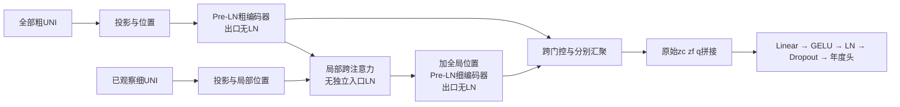

# W157：R3 归一化、拼接、门控与汇聚的源码及实测诊断

日期：2026-11-16。本轮为用户要求的调研和观察，未改变预测器、未训练、未选择新权重，没有新增Validation/Test/外层预测。

## 1. 结论先行

有值得优化的细节，但当前实测不支持“粗路量级过大、把细路淹没”这一解释。更明确的现象是：**增加细尺度观察会压低粗路表示的幅度；区域级注意力几乎退化为等权汇聚；细区域输出的共同分量很强。** 这些行为值得先检查，再考虑继续加复杂模块。

归一化确实存在衔接空档：编码器内部是Pre-LN，但出口没有最终LN，局部跨注意力没有独立输入归一化，拼接前也没有逐分支归一化。它们是待验证的优化位置，不等于已经发现性能故障或证明加LN能解决过拟合。

## 2. 本轮实际观察了什么

- 当前R3实际实现：[survival_network.py](../kt2028/survival_network.py)、[fusion_network.py](../kt2028/fusion_network.py)、[network.py](../kt2028/network.py)。运行时R3源码与W151冻结源SHA一致，`ab2842c4…`。
- 权重：CRC固定第一内部划分的原R3基线，初始化seed41、best第4轮、last第12轮。best SHA与既有完成回执一致，best/last文件在观察前后不变。
- 样本：292例Train中按患者键SHA排序的前8人，未按结局挑选；只看零/20%/完整细观察。初始主诊断72个状态组合，另有保持位置/数量的细内容置零、等权池化和粗门控读出干预。所有干预都只在Train上诊断，不当作改进后效果。
- 手工重构带mask的多头注意力输出，与原MultiheadAttention前向逐项匹配；分块线性投影求和与原拼接线性层匹配。读取原激活、局部读出梯度，未构建优化器。全部参数前后逐项相等。
- 数值除特别说明外，均为8人逐病例统计量的中位数。诊断覆盖当前架构的一个CRC基线，不代表所有癌种/权重均如此。

## 3. 归一化实际在哪些位置

| 位置 | 当前实现 | 值得关注的细节 |
| --- | --- | --- |
| 两路UNI输入投影 | Linear1024→256 + GELU | 没有额外输入LN；但原始两路RMS很接近，不能先认定这里失衡 |
| 粗/细上下文编码器 | 一层Transformer，`norm_first=True` | 每个注意力/FFN子层前有LN，外层TransformerEncoder的`norm=None`，出口没有最终LN |
| 粗查询细的局部跨注意力 | 直接MultiheadAttention | Q来自粗编码器出口，K/V来自细投影+局部位置；无独立Q/KV入口LN |
| 粗细跨门控 | 原表示与q拼接→Linear→Sigmoid | 输入无逐块LN；Sigmoid中性值为0.5，会乘性衰减被观察粗区域 |
| 区域注意力汇聚 | tanh/sigmoid打分→区域softmax | 没有出口LN，当前权重非常接近等权 |
| 患者融合 | cat(zc,zf,q)→Linear→GELU→LayerNorm→Dropout→年度头 | LN在两路已经混合及非线性之后，不等同于拼接前分别校准两路 |

PyTorch明确区分编码器内部的norm_first和外部可选norm；运行时确认两路出口均为None。[PyTorch 2.8 TransformerEncoder](https://docs.pytorch.org/docs/2.8/generated/torch.nn.TransformerEncoder.html)、[固定版本源码](https://github.com/pytorch/pytorch/blob/v2.8.0/torch/nn/modules/transformer.py#L534)。

## 4. 实测：排除了什么，又发现了什么

### 4.1 没有看到严重的粗细量级失衡

原始粗/细UNI的RMS约1.224/1.203；best时两路输入投影后约0.500/0.455。拼接前的患者级粗/细RMS约0.300/0.279，逐病例细/粗RMS比中位数 **0.957**。

把融合线性层分块后，细路投影与粗路投影的L2比为 **0.989**，共享融合矩阵对应两块权重范数约6.523/6.520。当前不是一条分支天然比另一条大十倍的情况。到第12轮，细/粗RMS比反而升至1.208，不能说细路始终被压住。

状态q虽然只有3维，其线性投影量级也并非零；best时其L2占各分块L2之和的约一成。这个比例不是因果贡献或精确输出能量，因为各项可以互相抵消。

### 4.2 粗门控的中性点值得优先检查

当前对被观察区域执行 `gc * hc`。best时粗门控均值约0.504、细门控均值约0.501；小于0.05或大于0.95的比例均为0，因此没有饱和/关闭通路的证据。

但粗门控以0.5为中心，意味着增加观察区域时，会系统性压低这些粗特征。比较同一前向中“门控后的粗患者向量”与“门控前的粗患者向量”范数：

| 观察量 | 初始化 | best第4轮 | last第12轮 |
| --- | ---: | ---: | ---: |
| 零细 | 1.000 | 1.000 | 1.000 |
| 20%细区域 | 0.898 | 0.912 | 0.912 |
| 完整细观察 | 0.504 | **0.525** | 0.529 |

这是真实的、随观察量变化的幅度迁移，不是只看Fine内容贡献。完整观察并非所有粗区域都有细块，因此总体比例不恰好等于gc均值。LayerNorm和q可能学会补偿，不能据此直接判定它必然损害泛化，但它是一个具体、低成本的检验点。

候选是以1为中性点的乘性门控，例如 `2*sigmoid(u)`，并以零初始化门控最后线性层得到起始恒等映射。它仍是可训练粗细条件门控，不是恢复旧冻结粗锚点或风险残差。本轮没有实施该改动，也没有证明其性能更好。

### 4.3 注意力在当前基线上几乎是平均汇聚

best时局部细块跨注意力的归一化熵为 **0.9974**，细区域患者汇聚为 **0.99999**；1代表等权。局部最大权重中位数约0.106，超过0.9的比例为0。有效细块数量不同，不能拿所有区域都当16块直接比较峰值。

这不是仅从熵推断：保持编码表示和其他路径不变，把细区域池化改为等权平均，best输出的绝对变化中位数仅 **0.0000209**。这里输出定义为负的五个年度生存概率均值，不是C-index或死亡概率改进。

细区域编码后，相对其患者内均值的差异能量占总能量约 **4.98%**，区域向量与患者内均值的平均余弦相似度约0.975，共同分量很强。原始细图块差异能量占比约75.6%，但二者处于不同汇聚层级，不能把全部差异下降归咎于Transformer或称完全特征坍缩。

分布性组织信号可以适合平均汇聚，高熵不等于算法无效；当前尚未看到注意力明显区分关键区域。仅凭注意力图的颜色深浅，也不能说选到了病理重点。

### 4.4 细内容确实进入了预测器

保持已观察父区域、细块数量、位置和q不变，只把已观察细向量置零，best输出变化中位数约0.0338；last约0.1448。细内容置零是分布外干预，不能当作性能评估，但它说明细路径并非没有读入或完全失效。

后期对细内容的敏感性增大，而区域池化仍接近平均，符合“学习患者级平均细形态的复杂映射”这一可能机制；不能据此认为学到了可靠细区域选择。后期敏感性增长也不是泛化变好的证据。

### 4.5 位置和内容量级接近，值得纳入归一化检查

best细局部注意力输出RMS约0.156，随后加入的全局位置RMS约0.152，量级接近。局部细位置RMS约0.211，对细投影RMS0.455也不是很小。位置并非必然坏信息，但当前未设置显式位置缩放；若调整跨注意力或出口归一化，应同时记录内容/位置比例，避免只看到输出规范化就认为问题解决。

### 4.6 暂无依据先删辅助损失

在8例Train聚合的共享读出层梯度上，best的partial/full余弦约0.959，coarse_aux/full约0.751，fine_aux/full约0.726，未见整体方向相反。本测量只覆盖冻结权重、eval模式的共享读出层，不是完整网络训练态梯度；它不足以证明永无冲突，也不支持把辅助任务“互相打架”当作当前首要原因。

## 5. 拼接层：有优化位置，但不能靠换写法获得增益

当前拼接后第一层满足：

\[
W[z_c;z_f;q]+b = W_c z_c + W_f z_f + W_q q+b.
\]

这已用实际权重和观测输入重构核对。仅把一个拼接Linear拆成三个Linear再求和，在参数对应时完全等价，不是架构改进。

真正改变行为的是在拼接前加逐分支归一化、门控或非线性。若未来试逐分支LN，必须保留无细观察时zf=0、纯细辅助时zc=0的语义。普通带bias的LayerNorm在beta学成非零后，`LN(0)=beta`，可能把“缺失分支”变成非零伪表示。

可采用显式可见性mask，或本版本支持的`LayerNorm(dim, bias=False)`；RMSNorm同样没有加性beta。比较LN/RMSNorm时固定相同eps，别把默认eps差异混入实验。q是观察状态，首轮不把它和512维特征一起做整体输入LN，也不为了维数小就另加大状态网络。[LayerNorm 2.8](https://docs.pytorch.org/docs/2.8/generated/torch.nn.LayerNorm.html)、[RMSNorm 2.8](https://docs.pytorch.org/docs/2.8/generated/torch.nn.RMSNorm.html)。

不建议直接换BatchNorm：现有每次前向是一个患者；累积8个患者梯度不等于BN见到batch8。若把区域当batch，统计量又会随患者/观察数量变化。[BatchNorm1d 2.8](https://docs.pytorch.org/docs/2.8/generated/torch.nn.BatchNorm1d.html)。

## 6. 文献和官方实现给出的实际启发

| 来源 | 明确支持的原则 | 对R3的适用边界 |
| --- | --- | --- |
| [Xiong等，ICML2020](https://proceedings.mlr.press/v119/xiong20b.html) | 归一化放置位置会影响初始化梯度与训练稳定性 | R3已是Pre-LN；不能重复宣称改成Pre-LN就解决问题 |
| [NormFormer，2021](https://arxiv.org/abs/2110.09456) | Pre-LN内部仍可通过额外归一化调节梯度量级 | 证据主要来自大语言模型，R3只有单层，不能照搬收益数值 |
| [Peri-LN，ICML2025](https://arxiv.org/abs/2502.02732) | 子层周围的归一化会改变激活方差与梯度传播 | 是设计动机，不是小样本病理生存有效性的证明 |
| [QK-Norm，Findings2020](https://aclanthology.org/2020.findings-emnlp.379/) | 每头Q/K的L2归一化配可学习缩放，可控制softmax饱和 | 当前注意力过于平缓，非过于尖锐，不应照抄“防饱和”理由；QK-Norm也不等同给输入加LN |
| [RMSNorm，NeurIPS2019](https://papers.nips.cc/paper/2019/hash/1e8a19426224ca89e83cef47f1e7f53b-Abstract.html) | 可以只校准均方根、不减均值 | 可作保零分支归一化候选，不预设比LN更适合本数据 |
| [DSCA固定源码](https://github.com/liupei101/DSCA/blob/a749074cb3415c3a6eb83bee39191bdb69968dcc/model/model_utils.py#L268) | CAPool的细特征嵌入在跨注意力前经过LN和激活 | 原R3没有复制这一完整嵌入链；官方查询分支也不是简单两侧全归一化，不能误述 |
| [EAGLE固定源码](https://github.com/WuLabMDA/EAGLE-Net/blob/6e8b1147c1732812d3f4e0f59526ff54452a228b/Eagle_net_model.py#L114) | MASE后、注意力打分前有LayerNorm | W151只移植MASE，没有移植这层LN，不能把旧负结果解释成已经否定归一化细节 |

## 7. 推荐顺序：少量明确改动，不再堆组件

1. **优先检验粗门控的中性点。** 这是直接观察到的、与观察量绑定的尺度变化；先改变这一点，其余不动。
2. **再检验归一化衔接。** 两个明确候选位置为局部跨注意力的Q/KV入口，以及两路编码器的最终出口；每次只选一个位置，记录注意力熵、位置/内容比例、向量量级和验证指标，不一次全加。
3. **拼接前逐分支校准作次级候选。** 当前没有严重失衡证据，可优先用保零的LN/RMSNorm与同预算基线比较，而非再加复杂融合头。

不以让注意力更尖为目标，也不凭8例Train诊断宣布病因已确定。归一化改善条件数不等于消除小样本过拟合。若后续获得实施指令，仍沿固定CRC单划分、短程、单因素，不能自动扩折、癌种、seed或延长训练。本轮没有启动任何候选训练，也没有修改原R3代码。

## 8. 交付与证据

本机：`D:/codex/开题2028/KT2028-assets/r3_detail_audit_w157_20261116/`，含原诊断/补充探针脚本、summary.json、pooling_probe.json、completion.json、report.html、diagnostic_summary PNG/SVG/PDF。只同步聚合统计和图；训练病例名单、逐例诊断、激活向量、特征及权重不回传。

服务器：`/root/autodl-tmp/KT2028/reviews/r3_detail_audit_w157_20261116`。原参数前后不变、优化0、Validation预测0、外层预测0；研究脚本自然结束，无后台新训练。未提交推送，保留用户已有修改。
